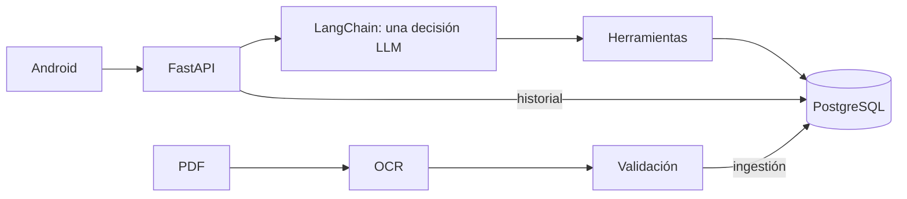

# Series 76 Technical Assistant
[English](README.md) · [Español](README.es.md)

Una app para consultar las tablas de actuadores Series 76, comparar modelos y continuar una conversación sin repetir todo. El modelo ayuda a entender la pregunta; las cifras salen del catálogo en PostgreSQL.

Abajo están los pasos para probarla. Para conocer el proyecto, puedes empezar por la [wiki](https://github.com/SamuelCharry/serie76-assistant/wiki), las [decisiones de diseño](https://github.com/SamuelCharry/serie76-assistant/wiki/Decisiones) o la [cronología del trabajo con IA](https://github.com/SamuelCharry/serie76-assistant/wiki/Como-use-IA).

## Inicio rápido

1. **Requisitos:** Git, Docker con contenedores Linux; Android Studio, **JDK 17**, SDK Platform 36 y un emulador API 26+ encendido. Ejecuta desde la raíz del repositorio; configura `JAVA_HOME` con JDK 17 y `ANDROID_HOME` con tu SDK Android.
2. **Configurar:** `cp .env.example .env` (Windows: `copy .env.example .env`), solo si no existe `.env`. Pega tu clave OpenRouter en `OPENROUTER_API_KEY` para interpretación de pago; déjala vacía para arrancar sin clave. Para ver detalles de debug local, configura `DEV_DEBUG=true` antes de arrancar.
3. **Arrancar:** `docker compose up -d --build` (ambos sistemas). El arranque carga el catálogo y crea las cuentas TEST ONLY de abajo sin restablecer contraseñas existentes.
4. **Comprobar el arranque:** abre [http://localhost:8000/ready](http://localhost:8000/ready) y espera una respuesta HTTP 200. Esto confirma que la base de datos, el catálogo y el glosario están listos. Para explorar la API, abre [Swagger](http://localhost:8000/docs). La disponibilidad de OpenRouter se comprueba por separado.
5. **Login:** usa cualquiera de estas cuentas públicas **TEST ONLY**:

| Correo | Contraseña pública de prueba |
|---|---|
| demo@series76.test | Series76-Demo-1 |
| reviewer@series76.test | Series76-Demo-2 |

6. **Compilar + instalar en el emulador encendido** (elige tu sistema):
   - macOS/Linux: `sh mobile/android/gradlew -p mobile/android :app:installDebug -PbackendUrl=http://10.0.2.2:8000/`
   - Windows PowerShell: `./mobile/android/gradlew.bat -p mobile/android :app:installDebug -PbackendUrl=http://10.0.2.2:8000/`
   - Abre **Series 76**, inicia sesión y prueba `What is the motor power of 761A00-11300000/A?` (sin clave). El emulador accede al backend en **http://10.0.2.2:8000/**.
7. **Debug:** toca el nombre/correo del perfil **7 veces en 3 segundos** y luego **ⓘ** en una respuesta. Requiere `DEV_DEBUG=true`; si lo cambias después del arranque, aplica con `docker compose up -d backend`.

Sin clave funcionan login/historial y consultas deterministas; la interpretación libre devuelve `503 not_configured`. Más abajo se explican conflictos de puertos, volúmenes existentes y configuración Android.

## Descripción

La app está hecha en Kotlin y Compose. Se conecta a un backend FastAPI que usa LangChain cuando necesita interpretar lenguaje y PostgreSQL para consultar los datos. Puedes escribir en español o inglés; las respuestas de la app están en inglés.



## Estado

El recorrido completo de instalación se probó desde un [clon de la etiqueta de entrega](reports/submission/T18-tag-clean-clone.md). También están registrados los [controles del catálogo](docs/evidence/ocr.md) y las [pruebas de Android en emulador](reports/submission/P2-D.md).

La parte más difícil sigue siendo interpretar bien todas las condiciones de una conversación. El candidato medido aprobó una media de **79,4 %** de los casos; las correcciones posteriores se probaron offline y no tienen una nueva puntuación del modelo. Más abajo explico esa diferencia y enlazo los resultados completos.

## Setup y backend

Para arrancar el backend necesitas Git y Docker con contenedores Linux. Python 3.12 de 64 bits solo hace falta si vas a ejecutar el OCR o las pruebas fuera de Docker.

Ejecuta el bloque de tu sistema desde la raíz del repositorio. Conserva tu `.env` si ya existe: el arranque aplica las migraciones, carga el catálogo y el glosario, y crea las cuentas de prueba que falten sin cambiar sus contraseñas. Puedes ver esos pasos en [Compose](docker-compose.yml) y el [script de arranque](docker/entrypoint.sh). La [guía de operaciones](docs/wiki/es/operations.md) cubre puertos y problemas de configuración.

Para un segundo checkout independiente, añade `COMPOSE_PROJECT_NAME=serie76-clean`, `POSTGRES_PORT=55432` y `API_PORT=18000` a su `.env` antes de ejecutar Compose. Usa `http://localhost:18000` en los ejemplos HTTP y `-PbackendUrl=http://10.0.2.2:18000/` al compilar para su emulador. Estos nombres y puertos aíslan el checkout; conserva la contraseña de su propio volumen.

```sh
# macOS/Linux
[ -f .env ] || cp .env.example .env
docker compose up --build -d
curl http://localhost:8000/ready
```

```powershell
# Windows PowerShell
if (-not (Test-Path .env)) { Copy-Item .env.example .env }
docker compose up --build -d
curl.exe http://localhost:8000/ready
```

Abre [Swagger](http://localhost:8000/docs): login con la cuenta de prueba, Authorize con el token y `POST /api/conversation`; conserva `session_id` para continuar. `/ready` comprueba DB/catálogo/glosario, no el proveedor. Sin claves funcionan historial y rutas deterministas; la interpretación libre devuelve 503 `not_configured`. [Ejemplos API para ambos sistemas](docs/wiki/es/api.md#curl).

En `.env`, `POSTGRES_PASSWORD` trae un placeholder local; conserva la contraseña de un volumen existente. Para inferencia autorizada configura `OPENROUTER_API_KEY` y `OPENROUTER_CHAT_MODEL=google/gemini-3.6-flash`; el endpoint predeterminado es `https://openrouter.ai/api/v1`. Reinicia configuración con `docker compose up -d backend`. Nunca publiques claves.

Después del login, `What is the motor power of 761A00-11300000/A?` funciona sin clave y devuelve los **15 W** publicados. Un campo explícito para un único código completo válido (incluidos `FLA of 761A00-11300000/A at 60 Hz` y `operating time of 761A00-11300000/A`), los saludos y las comparaciones explícitas de códigos usan SQL/plantillas sin llamadas al modelo. Las consultas ambiguas, condiciones adicionales y selección en lenguaje libre requieren `OPENROUTER_API_KEY` y `OPENROUTER_CHAT_MODEL`; sin ellos esas consultas de interpretación devuelven 503 `not_configured`. La ruta de campo usa el mismo planificador de respuesta que una decisión LLM de consulta equivalente.

Esta tabla cubre las variables añadidas de embeddings/debug. [.env.example](.env.example) es la plantilla completa: el arranque usa `POSTGRES_DB`, `POSTGRES_USER`, `POSTGRES_PASSWORD`, `POSTGRES_PORT` y `API_PORT`; Compose también acepta `COMPOSE_PROJECT_NAME`. La interpretación de lenguaje requiere `OPENROUTER_API_KEY` y `OPENROUTER_CHAT_MODEL`. Conserva las credenciales vacías para evaluar sin claves; la plantilla comenta las variables avanzadas de reintentos, plazos, trazas y evaluación.

| Variable nueva | Default | Uso |
|---|---|---|
| `OPENROUTER_EMBEDDING_MODEL` | `google/gemini-embedding-2` | `google/gemini-embedding-2` en OpenRouter; `gemini-embedding-2` en Google |
| `EMBEDDING_BASE_URL` | vacío | Hereda `OPENROUTER_BASE_URL` |
| `EMBEDDING_API_KEY` | vacío | Hereda `OPENROUTER_API_KEY` |
| `EMBEDDING_DIM` | `768` | Debe coincidir con el esquema |
| `EMBEDDINGS_ENABLED` | `true` | Activo solo si hay modelo; `false` lo deshabilita |
| `DEV_DEBUG` | `false` | Habilita trazas autenticadas del propietario |

**Base de datos:** Compose fija `pgvector/pgvector:pg17-trixie` por digest SHA-256. Para actualizar un volumen PG17 existente, respáldalo y conserva la misma glibc/collation (2.41 en el volumen verificado); la imagen pg17 con glibc 2.36 no era compatible con esa collation. No uses `docker compose down -v`. [Pin y actualización](docs/wiki/es/operations.md#pgvector).

## Usuarios demo (TEST ONLY)

| Correo | Contraseña pública de prueba |
|---|---|
| demo@series76.test | Series76-Demo-1 |
| reviewer@series76.test | Series76-Demo-2 |

Estas cuentas son públicas y sirven solo para probar la app. Si no quieres que el arranque cree cuentas demo, configura `DEMO_USERS_JSON=[]`. Las contraseñas de cuentas existentes no se restablecen. [Creación de usuarios](backend/auth/cli.py) · [Login e historial por usuario](docs/wiki/es/api.md).

## Ingestión

El repositorio incluye el catálogo ya extraído. Si quieres repetir la extracción del PDF, usa un entorno separado y una carpeta de salida nueva. El OCR corre localmente y no consulta las transcripciones usadas para evaluar sus resultados. [Script de ingesta](scripts/ingest.py) · [Cómo se validan y cargan los datos](docs/wiki/es/ingestion.md).

```sh
# macOS/Linux
python3 -m venv .venv-ingest
. .venv-ingest/bin/activate
pip install -r requirements-ingest.lock.txt
python scripts/ingest.py data/raw/series_76_electric_data.pdf --out data/processed/new-import
```

```powershell
# Windows PowerShell
python -m venv .venv-ingest
.\.venv-ingest\Scripts\Activate.ps1
pip install -r requirements-ingest.lock.txt
python scripts/ingest.py data/raw/series_76_electric_data.pdf --out data/processed/new-import
```

La primera ejecución OCR descarga pesos públicos de RapidOCR en `.cache/ocr` del checkout; después el reconocimiento es local. Prepara esos pesos antes de una ejecución sin red. La exportación lista, incluido `manifest.json`, queda en una subcarpeta por documento de `data/processed/new-import`, no directamente en esa raíz.

La salida por documento contiene CSV/JSON/HTML, manifiesto y evidencia en `data/processed/new-import`; una revisión pendiente bloquea la exportación. Los datos ya validados viven en [data/extracted/series76](data/extracted/series76) y Docker los carga en PostgreSQL automáticamente. Para recargar esos datos (ambos sistemas):

```text
docker compose exec -T backend python -m backend.catalog.cli load data/extracted/series76
```

## Banco de ejemplos

El banco contiene 658 formas de pedir información, sus interpretaciones y 100 anclas de conceptos. Sirve para ayudar al modelo a entender una frase; las cifras de los productos siguen saliendo de SQL.

La carga histórica con Google costó unos **USD 0.005 estimados** y la recarga por OpenRouter, con `google/gemini-embedding-2`, unos **USD 0.0015**. Son costes de esas ejecuciones, no una tarifa garantizada. La recuperación usa el nombre exacto del modelo para no mezclar vectores.

Revisa primero el dry-run. El segundo comando genera embeddings y consume crédito; requiere autorización. El montaje añade `config/`, que no está dentro de la imagen. [Carga del banco](scripts/load_example_bank.py) · [Recuperación](backend/conversation/embeddings.py) · [Detalles de configuración](docs/wiki/es/operations.md#example-bank).

El banco es opcional para funcionar sin claves. Sin modelo configurado, `--dry-run` informa todos los ejemplos/anclas suministrados sin DB, clave ni inferencia (`scope: input_only`); no comprueba vectores existentes. Con un modelo explícito comprueba filas pendientes en la DB activa, también sin inferencia. La plantilla `.env.example` nombra un modelo incluso con clave vacía: el dry-run predeterminado consulta la DB y devuelve `scope: model_pending`, sin inferencia. El segundo comando carga vectores para el modelo indicado y exige autorización de inferencia pagada; configura ese mismo modelo para el retrieval del backend.

```text
docker compose run --rm --no-deps --entrypoint python -v ./config:/app/config:ro backend scripts/load_example_bank.py --dry-run
docker compose run --rm --no-deps --entrypoint python -e OPENROUTER_EMBEDDING_MODEL=google/gemini-embedding-2 -v ./config:/app/config:ro backend scripts/load_example_bank.py
```

Sin modelo no hay retrieval; sin clave, con timeout o fallo SQL, se omiten las adiciones semánticas. El arranque y las rutas deterministas no llaman embeddings; una carga real sin credenciales no puede generar vectores.

## Android

Abre `mobile/android` en Android Studio, selecciona `app/debug` y pulsa Run. Necesitas JDK 17, SDK Platform 36 y un emulador o dispositivo API 26+. También puedes compilar desde la raíz con los comandos de abajo.

La app muestra preguntas, tarjetas de producto y comparaciones; permite retomar conversaciones y deshacer un borrado pendiente. [Código de la app](mobile/android/app/src/main/java/com/serie76/assistant) · [Configuración de compilación](mobile/android/app/build.gradle.kts) · [Guía Android](docs/wiki/es/android.md).

Antes de compilar, ejecuta `java -version` y confirma **JDK 17**. Configura `JAVA_HOME` con esa instalación y pon su `bin` primero en PATH; configura `ANDROID_HOME` con la carpeta SDK que contiene `platforms/android-36`. SDK Manager de Android Studio instala SDK Platform 36. Añade `platform-tools` del SDK a PATH antes de usar `adb`. JDK 17 es la base de validación documentada; compilar con otro JDK no acredita esa base.

```sh
# macOS/Linux: sustituye estas rutas por las de tus instalaciones
export JAVA_HOME=/path/to/jdk-17
export ANDROID_HOME=/path/to/Android/sdk
export PATH="$JAVA_HOME/bin:$ANDROID_HOME/platform-tools:$PATH"
java -version
test -d "$ANDROID_HOME/platforms/android-36"
adb version
```

```powershell
# Windows PowerShell: sustituye estas rutas por las de tus instalaciones
$env:JAVA_HOME='C:\path\to\jdk-17'
$env:ANDROID_HOME="$env:LOCALAPPDATA\Android\Sdk"
$env:Path="$env:JAVA_HOME\bin;$env:ANDROID_HOME\platform-tools;$env:Path"
java -version
Test-Path "$env:ANDROID_HOME\platforms\android-36"
adb version
```

```sh
# macOS/Linux; adb on PATH
sh mobile/android/gradlew -p mobile/android testDebugUnitTest assembleDebug
adb install -r mobile/android/app/build/outputs/apk/debug/app-debug.apk
```

```powershell
# Windows PowerShell; adb on PATH
./mobile/android/gradlew.bat -p mobile/android testDebugUnitTest assembleDebug
adb install -r mobile/android/app/build/outputs/apk/debug/app-debug.apk
```

Abre Series 76 y usa una cuenta de prueba. Backend del emulador: `http://10.0.2.2:8000/`. Añade `-PbackendUrl=https://your-host/` al comando de build para cambiarlo. Por USB ejecuta `adb reverse tcp:8000 tcp:8000`, compila con `-PbackendUrl=http://127.0.0.1:8000/` y reinstala. Release requiere HTTPS y firma.

**Voz:** micrófono a la izquierda de Send, permiso `RECORD_AUDIO`, SpeechRecognizer local preferido en API 31+; revisa el texto antes de enviarlo. El servicio alternativo solicita modo offline, pero puede usar su red; nunca sube audio al backend del proyecto. Si no existe servicio: `Voice input isn't available on this device`.

**Debug oculto:** toca el nombre/email del perfil **7 veces en 3 segundos** para alternar modo desarrollador; luego **ⓘ** en cada respuesta. Requiere `DEV_DEBUG=true` en backend; obtiene la traza bajo demanda con `GET /api/messages/{id}/debug`, también para historial. Disponible en ambas variantes; la autorización la aplica el backend.

## Modelos, diseño y límites

**Modelos:** `google/gemini-3.6-flash` es el único modelo de chat; fallback desactivado (`OPENROUTER_FALLBACK_MODEL=`). Embeddings: `google/gemini-embedding-2`. Flash se eligió por el equilibrio observado de calidad/latencia en la [comparación histórica pareada](docs/wiki/es/testing.md#selección-de-modelo-en-openrouter), no por superioridad universal. Una decisión completada por turno interpretado; las rutas deterministas no llaman al modelo. SQL y plantillas aportan cifras; la recuperación sólo añade campos de interpretación no resueltos. [Arquitectura](docs/wiki/es/agent.md) · [Decisiones](docs/wiki/es/patterns.md).

La versión mejorada resolvió más conversaciones, pero introdujo dos regresiones. Decidí adoptarla como una excepción a la regla inicial de no aceptar regresiones nuevas; tampoco había alcanzado el objetivo de integridad absoluta. Los errores nuevos y los límites relativos que fallaban en ambas versiones se corrigieron después.

Conviene separar esas dos etapas. Las cifras de la tabla corresponden al candidato `3ede96c`. El código reparado `1dda5f2` pasó **795 pruebas Python, con 2 omitidas**, el conjunto de decisiones controladas **119/119** y los demás controles offline obligatorios. No se repitió una evaluación pagada independiente: después de usar v17 para corregir fallos, ya era material de regresión. El [informe completo](reports/submission/P2-A.md) conserva ambas etapas.

Tres ejecuciones pareadas sobre las mismas 60 conversaciones inéditas de varios turnos (v17) mantuvieron modelo, catálogo y recuperación:

| Medida | Versión anterior | Versión mejorada |
|---|---:|---:|
| Conversaciones aprobadas por ejecución | 37/60, 35/60, 38/60 | 47/60, 46/60, 50/60 |
| Tasa media de aprobación | 61,1 % | 79,4 % |
| Aprobadas en las tres ejecuciones (pass^3) | 33/60 (55,0 %) | 43/60 (71,7 %) |
| Turnos que cumplen la integridad adjudicada | 410/438 | 429/438 |
| Latencia cliente agrupada p95 / máxima | 6,06 / 11,23 s | 6,69 / 17,89 s |
| Turnos de más de 10 s | 1 | 3 |

McNemar exacto pareado: **p = 0,013, 0,007 y 0,002**. La auditoría estructurada completa encontró **0 cifras incorrectas en 18.792 valores** de ambas versiones. Una cifra correcta no garantiza identidad ni requisitos correctos. Se cumplió la regla p95 ≤10 s, aunque hubo turnos individuales más lentos. El diagnóstico anterior localizó demoras en llamadas individuales al proveedor, no en bucles de la aplicación; no demuestra la causa de cada demora v17.

**Límites:** todavía falla, en promedio, cerca del **20 % de las conversaciones inéditas de varios turnos**; las repeticiones no son 180 conversaciones independientes. Las dos regresiones nuevas afectan un techo de torque retirado y el segundo miembro de una comparación; dos defectos compartidos afectan límites relativos de torque. Sus correcciones y pruebas offline se registran aparte de la medición real. El autor confirmó reconocimiento real con micrófono en el emulador el 2026-11-06 (reporte manual, sin artefacto automatizado adicional). Siguen pendientes la cobertura completa de permisos/errores y la validación física.

**Evidencia anterior:** v14 **32/45** y v15 **42/60** preceden a las últimas mejoras; v16 se usó para desarrollo y no es validación independiente. El ranking sintético obtuvo **NDCG@3 0,965 / cumplimiento 1,0**, no exactitud integral. El experimento de estado completo (SV2) **no fue adoptado**: 8/60 frente a 42/60. [Historial de pruebas](docs/wiki/es/testing.md) · [Experimento rechazado](reports/submission/SV2-experiment.md).

**Límite de integridad:** la comprobación final contra SQL cubre tarjetas, comparaciones, ranking y prosa positiva, además de pertenencia al conjunto mostrado cuando se exige. Una selección inválida se elimina; los incumplidores informativos llevan etiquetas explícitas. Verifica requisitos representados, no comprensión perfecta ni idoneidad de instalación. [Invariante y pruebas (P1-F)](reports/submission/P1-F.md).

**Evidencia de entrega:** la auditoría ejecutable de texto público detectó **0 filtraciones en producción dentro de su alcance**; la revisión ciega v17 encontró después un token del baseline que el detector omitió, por lo que no es garantía universal. Quick start sin claves pasó en CI Linux; otro clon limpio en Windows pasó diez pasos. La aceptación en emulador Android pasó **8/8**, combinando HTTP/SQL reales sin claves con datos controlados para debug, errores, demora y voz. [Texto público (P2-B)](reports/submission/P2-B.md) · [CI Linux (P2-C)](reports/submission/P2-C.md) · [Clon Windows (T18)](reports/submission/T18-tag-clean-clone.md) · [Emulador (P2-D)](reports/submission/P2-D.md).

**Gasto OpenRouter registrado:** **USD 6,170259916 ≈ USD 6,17 de 10**, incluidos intentos fallidos y experimentos; es el registro liquidado de evaluación, no una consulta de saldo actual. [Registro de gasto](reports/submission/P2-A.md#spend-and-excluded-attempt).

## Gates de reproducción

Gate offline vigente: **v7, 453/453 escenarios programados**. Crea y activa primero el entorno Python 3.12 del backend e instala `requirements-dev.txt` según [Ejecutar localmente](docs/wiki/es/testing.md#ejecutar-localmente), donde está la orden unittest con DB. El entorno OCR es separado. Después de iniciar Compose:

```text
python scripts/agent_acceptance.py selfcheck --cases config/agent_acceptance_cases_v7.json --config config/agent_acceptance_v7.json
python scripts/check_tool_schemas.py
python scripts/verify_catalog_db.py
```

El verificador del catálogo inicia sesión con la cuenta demo pública TEST ONLY y envía su token Bearer a las rutas protegidas. Usa `http://127.0.0.1:${API_PORT:-8000}`, priorizando `API_PORT` del proceso sobre la configuración local; `--base-url http://127.0.0.1:18000` lo sustituye explícitamente. SQL, suite completa con DB y HTTP deben aprobar para salir con 0. Nunca restablece contraseñas demo existentes.

El selfcheck v6 es histórico: sus expectativas de presentación son anteriores a T8 y ya no aprueba esta versión. Se conservan sus archivos y el resultado archivado 103/103; no son el gate vigente. Las pruebas programadas no acreditan calidad de interpretación del proveedor.

## Mapa del repositorio

[backend](backend/) · [Android](mobile/android/) · [OCR](catalog_ingest/) · [data](data/) · [config](config/) · [scripts](scripts/) · [tests](tests/) · [reports](reports/) · [Docker](docker/) · [CI](.github/) · [assistant config](.claude/) / [.codex](.codex/)

[Mapa wiki](docs/wiki/es/index.md) · [Pruebas y comandos](docs/wiki/es/testing.md) · [Defensa](docs/wiki/es/defensa-entrevista.md) · [Checklist](docs/SUBMISSION.md) · [Enunciado](docs/assessment-en.pdf)

[Wiki organizada por requisitos del assessment](https://github.com/SamuelCharry/serie76-assistant/wiki) · [Publicación de la wiki](docs/WIKI-PUBLISHING.md)
