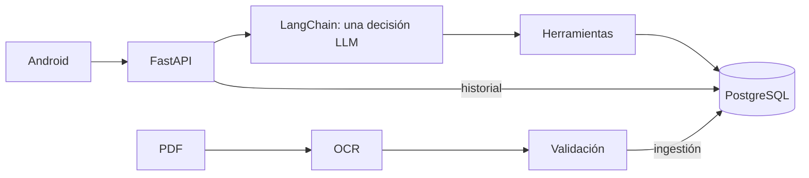

[English](README.md) · [Español](README.es.md)

# Series 76 Technical Assistant

Asistente Android nativo para seleccionar actuadores eléctricos Serie 76 y consultar datos exactos.
FastAPI + una decisión de herramienta LangChain + PostgreSQL; el LLM interpreta y el código redacta las cifras.
OCR local extrae el PDF eléctrico y el resumen aporta definiciones. Respuestas y sugerencias solo en inglés; entrada también en español.



## Inicio rápido: tres comandos

Requiere Git y Docker con contenedores Linux activo. En checkout nuevo, copia solo si .env no existe; el placeholder es para uso local TEST ONLY. Puertos 8000/5432 en loopback. El arranque migra, carga catálogo/glosario y provisiona usuarios demo automáticamente.

```sh
cp .env.example .env
docker compose up --build -d
curl http://localhost:8000/ready
```

Equivalentes Windows PowerShell (los mismos tres pasos):

```powershell
Copy-Item .env.example .env
docker compose up --build -d
curl.exe http://localhost:8000/ready
```

`/ready` comprueba DB/catálogo/glosario, no el modelo. [OpenAPI](http://localhost:8000/docs). [Variables y problemas frecuentes](docs/wiki/es/operations.md). Conserva el volumen PostgreSQL; nunca ejecutes `docker compose down -v`.

## Usuarios demo (TEST ONLY)

| Email | Contraseña pública de prueba |
|---|---|
| demo@series76.test | Series76-Demo-1 |
| reviewer@series76.test | Series76-Demo-2 |

Nunca usar en producción. El arranque no restablece contraseñas existentes. `DEMO_USERS_JSON=[]` desactiva nuevas cuentas; [detalles de autenticación](docs/wiki/es/api.md).

## Hablar con la API

macOS/Linux: inicia sesión y sustituye TOKEN por access_token localmente. Windows: usa los [ejemplos PowerShell con archivo JSON](docs/wiki/es/api.md#curl).

```sh
curl -sS http://localhost:8000/api/auth/login -H 'Content-Type: application/json' -d '{"email":"demo@series76.test","password":"Series76-Demo-1"}'
curl -i http://localhost:8000/api/conversation -H 'Authorization: Bearer TOKEN' -H 'Content-Type: application/json' -d '{"query":"What is the motor power of 761A00-11300000/A?"}'
```

Con token válido y sin clave/modelo configurados, se espera **HTTP 503**:

```json
{"detail":"Conversation service unavailable. Check backend configuration and try again.","error_code":"not_configured"}
```

Para activar interpretación con autorización explícita de inferencia, configura `OPENROUTER_API_KEY=<clave-privada>` y `OPENROUTER_CHAT_MODEL=google/gemini-3.6-flash` en .env ignorado y ejecuta `docker compose up -d backend`. El modelo se evaluó mediante el endpoint Google compatible con OpenAI; la aceptación OpenRouter está **pendiente**. Una decisión por turno, valores SQL y plantillas; sin embeddings. [Diseño/compromisos](docs/wiki/es/patterns.md), [evidencia del modelo](docs/wiki/es/testing.md). Envía session_id en seguimientos. [API completa](docs/wiki/es/api.md).

## Android

Abre `mobile/android` en Android Studio: JDK 17, SDK Platform 36, emulador API 26+. Selecciona app/debug y Run. O compila desde la raíz:

```sh
sh mobile/android/gradlew -p mobile/android assembleDebug
# Windows: ./mobile/android/gradlew.bat -p mobile/android assembleDebug
adb install -r mobile/android/app/build/outputs/apk/debug/app-debug.apk
```

Backend: `http://10.0.2.2:8000/` (emulador); cambia con `-PbackendUrl=https://tu-host/` y recompila. USB: `adb reverse tcp:8000 tcp:8000` y `-PbackendUrl=http://127.0.0.1:8000/`. Debug: backend `DEV_DEBUG=true`, recrea backend y drawer izquierdo → Developer debug → respuesta. Herramientas debug excluidas de release. Login/historial/chat implementados; voz no implementada. [Compilación, pantallas, estados y límites](docs/wiki/es/android.md).

## Reejecutar ingestión y pruebas

Salidas validadas: [CSV](data/extracted/series76/catalog.csv), [JSON](data/extracted/series76/catalog.json), [HTML](data/extracted/series76/catalog.html). [Reejecutar OCR y carga SQL](docs/wiki/es/ingestion.md). Python 3.12 + requirements-dev.txt; OCR separado con requirements-ingest.lock.txt. Con DB local lista:

```sh
# macOS/Linux
python -m venv .venv
. .venv/bin/activate
pip install -r requirements-dev.txt
SERIES76_TEST_DB=1 python -m unittest discover -s tests
```

```powershell
# Windows PowerShell
python -m venv .venv
.\.venv\Scripts\Activate.ps1
pip install -r requirements-dev.txt
$env:SERIES76_TEST_DB='1'
python -m unittest discover -s tests
```

Las pruebas usan PostgreSQL de Compose en `127.0.0.1:5432` (o POSTGRES_PORT): `local_environment()` mapea POSTGRES_* de .env a PG*; prevalecen PG* del proceso. [Conexión y CI](docs/wiki/es/testing.md#conexión-postgresql). OCR usa otro entorno activado: [preparación](docs/wiki/es/ingestion.md#reejecutar).

[Preparación, suites, Android y CI](docs/wiki/es/testing.md). Las herramientas con decisiones programadas prueban código, no aceptación del modelo real.

## Mapa del repositorio

- `backend/` — FastAPI, catálogo, autenticación, agente/historial.
- `catalog_ingest/` — OCR local, reconstrucción y validación.
- `config/` — casos y configuración de aceptación congelados.
- `data/` — PDF fuente, extracción validada, referencias solo evaluación.
- `docker/` — entrypoint backend idempotente.
- `docs/` — enunciado, evidencia, ADR y wiki bilingüe.
- `mobile/` — cliente Android nativo Kotlin/Compose.
- `reports/` — registros de verificación de entrega.
- `scripts/` — CLI de ingestión, carga y verificación.
- `tests/` — pruebas offline/programadas y PostgreSQL opt-in.
- `.claude/, .codex/` — configuración real del asistente de proyecto.
- `.github/` — CI y plantillas de contribución.

## Estado del assessment

“Verificado” se limita a la evidencia enlazada; implementado no significa aceptado en OpenRouter.

| Requisito | Implementado | Verificado | Pendiente |
|---|---|---|---|
| Ingestión PDF + PostgreSQL | Sí | [941/941 controles primarios](docs/evidence/ocr.md), [SQL](docs/evidence/postgres.md) | Diseños nuevos |
| FastAPI + herramientas LangChain | Sí | [Cohortes Google A+](docs/evidence/agent_acceptance.md), pruebas locales SQL/programadas | Aceptación OpenRouter |
| Multi-turno + historial persistente | Sí | HTTP/reinicio con interpretación controlada | Continuación OpenRouter tras reinicio |
| Códigos inválidos, N/A, ambigüedad, sin resultados | Sí | [T7: 103/103 escenarios v6 controlados](reports/submission/T7-backend.md), cohortes Google históricas | v6 con modelo real y aceptación OpenRouter |
| Android historial/chat/debug + estados | Sí | [T7: 40 pruebas JVM + APK debug](reports/submission/T7-android.md) | Revisión en dispositivo y Android → LLM real → SQL → Android |
| Login opcional + aislamiento | Sí | Pruebas auth y recorridos controlados | HTTPS público/dispositivo físico |
| Docker, configuración, docs y asistente | Sí | [T1](reports/submission/T1.md), [T2](reports/submission/T2.md), [T3](reports/submission/T3.md) | Reproducción final del evaluador |
| T7 preguntas/Submit, filtros removibles, sugerencias, comparaciones, saludo | Sí | [202 pruebas Python; 2 omisiones opcionales](reports/submission/T7-backend.md), [estados/contrato Android](reports/submission/T7-android.md) | v6 con modelo real e integración app/backend completa |
| T7 retry/fallback acotados y keep-alive | Sí | [Deadline/transporte locales](reports/submission/T7-backend.md), [regresión del pool](reports/submission/T7-android.md) | Fallos con proveedor real |
| Voz opcional | No | No | No implementada |

[Wiki map](docs/wiki/es/index.md) · [Architecture](docs/wiki/es/agent.md) · [Original brief](docs/assessment-en.pdf) · [Defensa de entrevista](docs/wiki/es/defensa-entrevista.md)
