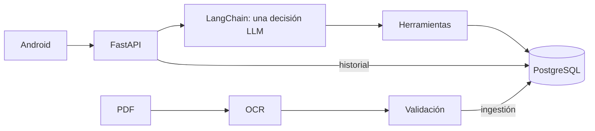

# Series 76 Technical Assistant
[English](README.md) · [Español](README.es.md)

## Inicio rápido

1. **Requisitos:** Git, Docker con contenedores Linux; Android Studio, **JDK 17**, SDK Platform 36 y un emulador API 26+ encendido. Ejecuta desde la raíz del repositorio; configura `JAVA_HOME` con JDK 17 y `ANDROID_HOME` con tu SDK Android.
2. **Configurar:** `cp .env.example .env` (Windows: `copy .env.example .env`), solo si no existe `.env`. Pega tu clave OpenRouter en `OPENROUTER_API_KEY` para interpretación de pago; déjala vacía para arrancar sin clave. Para ver detalles de debug local, configura `DEV_DEBUG=true` antes de arrancar.
3. **Arrancar:** `docker compose up -d --build` (ambos sistemas). El arranque carga el catálogo y crea las cuentas TEST ONLY de abajo sin restablecer contraseñas existentes.
4. **Salud:** abre [http://localhost:8000/ready](http://localhost:8000/ready); espera HTTP 200 tras compilar/cargar. [API / Swagger](http://localhost:8000/docs). Comprueba base de datos/catálogo/glosario, no OpenRouter.
5. **Login:** usa cualquiera de estas cuentas públicas **TEST ONLY**:

| Correo | Contraseña pública de prueba |
|---|---|
| demo@series76.test | Series76-Demo-1 |
| reviewer@series76.test | Series76-Demo-2 |

6. **Compilar + instalar en el emulador encendido** (elige tu sistema):
   - macOS/Linux: `sh mobile/android/gradlew -p mobile/android :app:installDebug -PbackendUrl=http://10.0.2.2:8000/`
   - Windows PowerShell: `./mobile/android/gradlew.bat -p mobile/android :app:installDebug -PbackendUrl=http://10.0.2.2:8000/`
   - Abre **Series 76**, inicia sesión y prueba `What is the motor power of 761A00-11300000/A?` (sin clave). El emulador accede al backend en **http://10.0.2.2:8000/**.
7. **Debug:** toca el nombre/correo del perfil **7 veces en 3 segundos** y luego **ⓘ** en una respuesta. Requiere `DEV_DEBUG=true`; si lo cambias después del arranque, aplica con `docker compose up -d backend`.

Sin clave funcionan login/historial y consultas deterministas; la interpretación libre devuelve `503 not_configured`. Más abajo se explican conflictos de puertos, volúmenes existentes y configuración Android.

## Descripción

Asistente Android nativo para seleccionar actuadores Series 76: FastAPI, una decisión LangChain y PostgreSQL. El LLM interpreta; SQL y plantillas producen las cifras. Respuestas en inglés, entrada también en español.



## Estado

| Función | Implementado y verificado localmente | Pendiente |
|---|---|---|
| OCR y catálogo PostgreSQL | [941/941 verificaciones primarias](docs/evidence/ocr.md), carga idempotente | Nuevos layouts |
| T8 interacción, recomendaciones, acciones, borrado, planificador y guardas | [Backend T8–T8h](docs/wiki/es/testing.md), [51 pruebas JVM T8](reports/submission/T8-android.md) | Flujo real en dispositivo |
| T9 embeddings aditivos | [484 pruebas Python, 2 omisiones; 446 escenarios scripted](reports/submission/T9-embeddings.md), smoke Google | Dispositivo; v14 32/45 y v15 v1 42/60 antes de P1-F |
| T9 voz y debug por respuesta | [74 pruebas JVM, APK debug/release](reports/submission/T9-android.md) | Voz real, UI y backend integrado en dispositivo |
| Login, historial privado, Docker | [Autenticación](docs/wiki/es/api.md), [arranque reproducible](reports/submission/T2.md) | HTTPS público y reproducción final |

## Setup y backend

**Qué:** Git y Docker con contenedores Linux; Python 3.12 de 64 bits solo para OCR/pruebas locales. **Cómo:** desde la raíz, ejecuta el bloque de tu sistema; conserva cualquier `.env` existente. El arranque migra, carga catálogo/glosario y crea usuarios de prueba sin cambiar contraseñas. **Código:** [Compose](docker-compose.yml), [entrypoint](docker/entrypoint.sh); [operaciones](docs/wiki/es/operations.md).

Para un segundo checkout independiente, añade `COMPOSE_PROJECT_NAME=serie76-clean`, `POSTGRES_PORT=55432` y `API_PORT=18000` a su `.env` antes de ejecutar Compose. Usa `http://localhost:18000` en los ejemplos HTTP y `-PbackendUrl=http://10.0.2.2:18000/` al compilar para su emulador. Estos nombres y puertos aíslan el checkout; conserva la contraseña de su propio volumen.

```sh
# macOS/Linux
[ -f .env ] || cp .env.example .env
docker compose up --build -d
curl http://localhost:8000/ready
```

```powershell
# Windows PowerShell
if (-not (Test-Path .env)) { Copy-Item .env.example .env }
docker compose up --build -d
curl.exe http://localhost:8000/ready
```

Abre [Swagger](http://localhost:8000/docs): login con la cuenta de prueba, Authorize con el token y `POST /api/conversation`; conserva `session_id` para continuar. `/ready` comprueba DB/catálogo/glosario, no el proveedor. Sin claves funcionan historial y rutas deterministas; la interpretación libre devuelve 503 `not_configured`. [Ejemplos API para ambos sistemas](docs/wiki/es/api.md#curl).

En `.env`, `POSTGRES_PASSWORD` trae un placeholder local; conserva la contraseña de un volumen existente. Para inferencia autorizada configura `OPENROUTER_API_KEY` y `OPENROUTER_CHAT_MODEL=google/gemini-3.6-flash`; el endpoint predeterminado es `https://openrouter.ai/api/v1`. Reinicia configuración con `docker compose up -d backend`. Nunca publiques claves.

Después del login, `What is the motor power of 761A00-11300000/A?` funciona sin clave y devuelve los **15 W** publicados. Un campo explícito para un único código completo válido (incluidos `FLA of 761A00-11300000/A at 60 Hz` y `operating time of 761A00-11300000/A`), los saludos y las comparaciones explícitas de códigos usan SQL/plantillas sin llamadas al modelo. Las consultas ambiguas, condiciones adicionales y selección en lenguaje libre requieren `OPENROUTER_API_KEY` y `OPENROUTER_CHAT_MODEL`; sin ellos esas consultas de interpretación devuelven 503 `not_configured`. La ruta de campo usa el mismo planificador de respuesta que una decisión LLM de consulta equivalente.

Esta tabla cubre las variables añadidas de embeddings/debug. [.env.example](.env.example) es la plantilla completa: el arranque usa `POSTGRES_DB`, `POSTGRES_USER`, `POSTGRES_PASSWORD`, `POSTGRES_PORT` y `API_PORT`; Compose también acepta `COMPOSE_PROJECT_NAME`. La interpretación de lenguaje requiere `OPENROUTER_API_KEY` y `OPENROUTER_CHAT_MODEL`. Conserva las credenciales vacías para evaluar sin claves; la plantilla comenta las variables avanzadas de reintentos, plazos, trazas y evaluación.

| Variable nueva | Default | Uso |
|---|---|---|
| `OPENROUTER_EMBEDDING_MODEL` | `google/gemini-embedding-2` | `google/gemini-embedding-2` en OpenRouter; `gemini-embedding-2` en Google |
| `EMBEDDING_BASE_URL` | vacío | Hereda `OPENROUTER_BASE_URL` |
| `EMBEDDING_API_KEY` | vacío | Hereda `OPENROUTER_API_KEY` |
| `EMBEDDING_DIM` | `768` | Debe coincidir con el esquema |
| `EMBEDDINGS_ENABLED` | `true` | Activo solo si hay modelo; `false` lo deshabilita |
| `DEV_DEBUG` | `false` | Habilita trazas autenticadas del propietario |

**Base de datos:** Compose fija `pgvector/pgvector:pg17-trixie` por digest SHA-256. Para actualizar un volumen PG17 existente, respáldalo y conserva la misma glibc/collation (2.41 en el volumen verificado); la imagen pg17 con glibc 2.36 no era compatible con esa collation. No uses `docker compose down -v`. [Pin y actualización](docs/wiki/es/operations.md#pgvector).

## Usuarios demo (TEST ONLY)

| Correo | Contraseña pública de prueba |
|---|---|
| demo@series76.test | Series76-Demo-1 |
| reviewer@series76.test | Series76-Demo-2 |

**Qué/cómo:** solo pruebas; `DEMO_USERS_JSON=[]` desactiva nuevas altas, nunca restablece contraseñas. **Código:** [CLI auth](backend/auth/cli.py); [login y aislamiento](docs/wiki/es/api.md).

## Ingestión

**Qué:** OCR local del PDF eléctrico; no usa referencias de evaluación. **Cómo:** instala el entorno separado y genera una salida nueva. **Código:** [ingest.py](scripts/ingest.py); [pipeline, validación y carga](docs/wiki/es/ingestion.md).

```sh
# macOS/Linux
python3 -m venv .venv-ingest
. .venv-ingest/bin/activate
pip install -r requirements-ingest.lock.txt
python scripts/ingest.py data/raw/series_76_electric_data.pdf --out data/processed/new-import
```

```powershell
# Windows PowerShell
python -m venv .venv-ingest
.\.venv-ingest\Scripts\Activate.ps1
pip install -r requirements-ingest.lock.txt
python scripts/ingest.py data/raw/series_76_electric_data.pdf --out data/processed/new-import
```

La primera ejecución OCR descarga pesos públicos de RapidOCR en `.cache/ocr` del checkout; después el reconocimiento es local. Prepara esos pesos antes de una ejecución sin red. La exportación lista, incluido `manifest.json`, queda en una subcarpeta por documento de `data/processed/new-import`, no directamente en esa raíz.

La salida por documento contiene CSV/JSON/HTML, manifiesto y evidencia en `data/processed/new-import`; una revisión pendiente bloquea la exportación. Los datos ya validados viven en [data/extracted/series76](data/extracted/series76) y Docker los carga en PostgreSQL automáticamente. Para recargar esos datos (ambos sistemas):

```text
docker compose exec -T backend python -m backend.catalog.cli load data/extracted/series76
```

## Banco de ejemplos

**Qué:** 658 frases de usuario con interpretaciones y 100 anclas; nunca cifras del catálogo como conocimiento. La carga histórica Google costó aproximadamente **USD 0.005 estimados**. La recarga OpenRouter bajo `google/gemini-embedding-2` costó unos **USD 0.0015**; la recuperación filtra por ese nombre exacto. Son estimaciones de esas ejecuciones, no precios garantizados. **Cómo:** revisa el dry-run; la segunda orden hace inferencia y requiere autorización. El montaje aporta `config/`, ausente en la imagen. **Código:** [loader](scripts/load_example_bank.py), [embeddings](backend/conversation/embeddings.py); [carga, procedencia y comportamiento sin claves](docs/wiki/es/operations.md#example-bank).

El banco es opcional para funcionar sin claves. Sin modelo configurado, `--dry-run` informa todos los ejemplos/anclas suministrados sin DB, clave ni inferencia (`scope: input_only`); no comprueba vectores existentes. Con un modelo explícito comprueba filas pendientes en la DB activa, también sin inferencia. El segundo comando carga vectores para el modelo indicado y exige autorización de inferencia pagada; configura ese mismo modelo para el retrieval del backend.

```text
docker compose run --rm --no-deps --entrypoint python -v ./config:/app/config:ro backend scripts/load_example_bank.py --dry-run
docker compose run --rm --no-deps --entrypoint python -e OPENROUTER_EMBEDDING_MODEL=google/gemini-embedding-2 -v ./config:/app/config:ro backend scripts/load_example_bank.py
```

Sin modelo no hay retrieval; sin clave, con timeout o fallo SQL, se omiten las adiciones semánticas. El arranque y las rutas deterministas no llaman embeddings; una carga real sin credenciales no puede generar vectores.

## Android

**Qué:** Kotlin/Compose, preguntas en una tarjeta, recomendaciones, acciones y borrado con Undo. **Cómo:** Android Studio, JDK 17, SDK Platform 36, emulador/dispositivo API 26+; abre `mobile/android`, selecciona app/debug y Run, o usa tu bloque desde la raíz. **Código:** [app](mobile/android/app/src/main/java/com/serie76/assistant), [build](mobile/android/app/build.gradle.kts); [guía Android](docs/wiki/es/android.md).

Antes de compilar, ejecuta `java -version` y confirma **JDK 17**. Configura `JAVA_HOME` con esa instalación y pon su `bin` primero en PATH; configura `ANDROID_HOME` con la carpeta SDK que contiene `platforms/android-36`. SDK Manager de Android Studio instala SDK Platform 36. Añade `platform-tools` del SDK a PATH antes de usar `adb`. JDK 17 es la base de validación documentada; compilar con otro JDK no acredita esa base.

```sh
# macOS/Linux: sustituye estas rutas por las de tus instalaciones
export JAVA_HOME=/path/to/jdk-17
export ANDROID_HOME=/path/to/Android/sdk
export PATH="$JAVA_HOME/bin:$ANDROID_HOME/platform-tools:$PATH"
java -version
test -d "$ANDROID_HOME/platforms/android-36"
adb version
```

```powershell
# Windows PowerShell: sustituye estas rutas por las de tus instalaciones
$env:JAVA_HOME='C:\path\to\jdk-17'
$env:ANDROID_HOME="$env:LOCALAPPDATA\Android\Sdk"
$env:Path="$env:JAVA_HOME\bin;$env:ANDROID_HOME\platform-tools;$env:Path"
java -version
Test-Path "$env:ANDROID_HOME\platforms\android-36"
adb version
```

```sh
# macOS/Linux; adb on PATH
sh mobile/android/gradlew -p mobile/android assembleDebug
adb install -r mobile/android/app/build/outputs/apk/debug/app-debug.apk
```

```powershell
# Windows PowerShell; adb on PATH
./mobile/android/gradlew.bat -p mobile/android assembleDebug
adb install -r mobile/android/app/build/outputs/apk/debug/app-debug.apk
```

Abre Series 76 y usa una cuenta de prueba. Backend del emulador: `http://10.0.2.2:8000/`. Añade `-PbackendUrl=https://your-host/` al comando de build para cambiarlo. Por USB ejecuta `adb reverse tcp:8000 tcp:8000`, compila con `-PbackendUrl=http://127.0.0.1:8000/` y reinstala. Release requiere HTTPS y firma.

**Voz:** micrófono a la izquierda de Send, permiso `RECORD_AUDIO`, SpeechRecognizer local preferido en API 31+; revisa el texto antes de enviarlo. El servicio alternativo solicita modo offline, pero puede usar su red; nunca sube audio al backend del proyecto. Si no existe servicio: `Voice input isn't available on this device`.

**Debug oculto:** toca el nombre/email del perfil **7 veces en 3 segundos** para alternar modo desarrollador; luego **ⓘ** en cada respuesta. Requiere `DEV_DEBUG=true` en backend; obtiene la traza bajo demanda con `GET /api/messages/{id}/debug`, también para historial. Disponible en ambas variantes; la autorización la aplica el backend.

## Modelos, diseño y límites

Después de una comparación o lista visible, pregunta `which one do you recommend and why?` o `¿cuál me recomiendas?`. La recomendación se limita a esos modelos, aplica los requisitos activos y los del nuevo turno antes de ordenar, explica exclusiones con valores del catálogo y declara prioridad, ventajas y contrapartida del segundo candidato. `Which should I buy?` pide consejo de selección; no realiza un pedido. Si ninguno cumple, el modelo visible más cercano se identifica expresamente como incumplidor y no se recomienda.

**Aceptación histórica OpenRouter v10/v11 (2026-11-05):** USD 1.17 gastados de la clave de USD 10. La revisión ciega estricta usó tres revisores independientes por ronda y variantes mezcladas por conversación: v10 reservado (41 conversaciones) + v11 (40), 81 en total, 74 en inglés. Son resultados medidos de esas cohortes, no precios actuales ni garantías de latencia.

| Modelo | Inglés | Total | p95 / max | Turnos > 10 s | USD / 1,000 turnos LLM |
|---|---:|---:|---:|---:|---:|
| gemini-3.6-flash | 63/74 | 69/81 | 5.9 / 8.9 s | 0 | 3.0 |
| gpt-6-luna | 61/74 | 67/81 | 4.9 / 12.2 s | 1 | 0.8 |
| deepseek-v4.1-flash | 59/74 | 65/81 | 8.8 / 10.8 s | 2 | 0.8 |
| claude-haiku-5.5 | 50/74 | 55/81 | 3.1 / 8.7 s | 0 | 0.7 |

**Regla histórica de selección de modelo v10/v11:** (1) calidad en inglés salvo empate estadístico, (2) ningún turno observado superior a 10 s, (3) coste, (4) licencia solo para producción (DeepSeek tiene pesos abiertos; falta verificar la licencia). Flash vs Luna: McNemar p = 0.63 (3 vs 1 discordantes); Flash vs DeepSeek: p = 0.125; Haiku es significativamente peor (p < 0.001). La falta de significancia no demuestra equivalencia.

**Modelo único predeterminado:** `OPENROUTER_CHAT_MODEL=google/gemini-3.6-flash`, `OPENROUTER_FALLBACK_MODEL=` (desactivado), `OPENROUTER_EMBEDDING_MODEL=google/gemini-embedding-2`. Una decisión de herramienta por turno interpretado; el código valida y SQL aporta las cifras. Plan B añade prioridad validada, partes no publicadas y retención de requisitos, sin agentes ni llamadas adicionales.

**Plan B / T14 conservado:** resultados ciegos estrictos: v12 **29/45**, v13 **23/45** y nuevo conjunto reservado v14 **32/45 (71 %)** y después v1 de producción en v15 **42/60 (70 %)**, antes de P1-F. Son cohortes distintas; la diferencia no estima un efecto causal. v13 queda solo como diagnóstico. La regla T14 exigía al menos 27/45, todos los gates verdes y p95 de hasta 10 s. v14 tuvo 85 turnos (66 interpretados), p95 **6,2 s**, máximo **9,3 s**, ningún turno superior a 10 s y ningún error HTTP. En v13, dos de 79 turnos interpretados tardaron 11–16 s en llamadas individuales al proveedor, no en bucles del código. Plan B gastó **USD 0,236607225**; uso total liquidado de la clave: **USD 1,919522541**.

**Verificado sobre el código final de Plan B:** 615 pruebas Python ejecutadas (613 aprobadas, dos omitidas); v7 453/453; T10 48/48 (8/48 antes); T12 47/47 (7/47 antes); T14 42/42 (7/42 antes). Todos los gates obligatorios terminaron con código cero. Esquema: **5.520 bytes / 108 valores enum**; preflight real aceptado. Ranking NDCG@3 **0,965378**, cumplimiento **1,0 en la evaluación sintética de ranking**, no en todas las conversaciones reales. Las decisiones grabadas de v13 se reprodujeron sin inferencia: 23/45 antes y 28/45 después; es diagnóstico y las decisiones antiguas no tienen los nuevos campos. [T14 report](reports/submission/T14-plan-b.md).

**Experimento SV2 — no adoptado:** en el mismo v15 congelado, v1 de producción aprobó **42/60 (70 %)** y v2 de estado completo **8/60 (13,3 %)** (discordantes 35/1; McNemar p ≈ 1,1e-9). Reducir el esquema de 108 a 6 enums no mejoró el comportamiento. [Diseño, regla y resultados](reports/submission/SV2-experiment.md).

**Invariante P1-F:** la comprobación final de elegibilidad contra SQL cubre tarjetas, comparaciones, rankings y referencias positivas a productos en la prosa, incluida la pertenencia al conjunto mostrado cuando se exige. Una selección positiva inválida elimina todos sus canales; los incumplidores informativos exigen etiquetas explícitas. v15 expuso **cuatro violaciones técnicas**, corregidas y cubiertas por regresiones locales, además de dos violaciones del conjunto mostrado. El 42/60 histórico precede al arreglo; no se afirma nueva aceptación con modelo real ni despliegue. Se verifican requisitos representados, no interpretación perfecta, alcance de agregados ni idoneidad de la instalación. [Implementación y verificación](reports/submission/P1-F.md).

**Cómo:** el LLM nunca produce cifras finales: una decisión por turno interpretado, cero en rutas deterministas. Retrieval solo añade campos no resueltos; no sustituye requisitos explícitos. La guarda final revisa cobertura de cantidades y filtros; SQL/plantillas preservan unidades, N/A y procedencia. El ranking declara su criterio, no certifica idoneidad. **Código:** [agente](backend/conversation/agent.py), [guardas](backend/conversation/requirement_coverage.py), [ranking](backend/conversation/ranking.py); [arquitectura](docs/wiki/es/agent.md), [decisiones y trade-offs](docs/wiki/es/patterns.md).

**Calidad histórica Google (antes de T10):** En 41 conversaciones inéditas (68 turnos): 0 cifras de catálogo incorrectas en 491 valores comprobados, todas las respuestas en menos de 10 s, 18 de 19 conversaciones cotidianas completamente correctas y 82 % de turnos correctos; menor acierto con formulaciones inusuales (12 de 22 conversaciones adversariales), principalmente requisitos de apertura/cierre o modulación expresados en lenguaje cotidiano o en español y descripciones del lugar. [Resultados por turno, intervalos y diferencias de puntuación](docs/wiki/es/testing.md#vista-por-turno-y-uso-cotidiano).

**Límites conocidos:** v14 falló 13/45 conversaciones: persisten errores de intención, requisitos o partes omitidas y explicaciones incompletas. Los revisores comprobaron todas las cifras mostradas: cero valores individuales de producto incorrectos, pero **dos fallos de alcance en conteos agregados**. Por tanto, no se afirma que v14 tenga cero errores numéricos. Quedan pendientes emulador, voz real e integración Android y prueba desde un clon limpio. El ingeniero debe confirmar **filtros activos, servicio, cerramiento y clasificación del área peligrosa antes de ordenar**. **2026-11-05 T15:** las correcciones offline cubren compatibilidad DC (10 elegibles: 5 DC puros y 5 AC/DC) y Weatherproof (34 publicados y 4 N/A); los conteos declaran filtros y exclusiones N/A. Sin nueva inferencia ni cambio de la puntuación v14. [Auditoría](reports/submission/T15-aggregate-counts.md).

## Gates de reproducción

Gate offline vigente: **v7, 453/453 escenarios programados**. En el entorno Python backend activado, después de iniciar Compose:

```text
python scripts/agent_acceptance.py selfcheck --cases config/agent_acceptance_cases_v7.json --config config/agent_acceptance_v7.json
python scripts/check_tool_schemas.py
python scripts/verify_catalog_db.py
```

El verificador del catálogo inicia sesión con la cuenta demo pública TEST ONLY y envía su token Bearer a las rutas protegidas. Usa `http://127.0.0.1:${API_PORT:-8000}`, priorizando `API_PORT` del proceso sobre la configuración local; `--base-url http://127.0.0.1:18000` lo sustituye explícitamente. SQL, suite completa con DB y HTTP deben aprobar para salir con 0. Nunca restablece contraseñas demo existentes.

El selfcheck v6 es histórico: sus expectativas de presentación son anteriores a T8 y ya no aprueba esta versión. Se conservan sus archivos y el resultado archivado 103/103; no son el gate vigente. Las pruebas programadas no acreditan calidad de interpretación del proveedor.

## Mapa del repositorio

[backend](backend/) · [Android](mobile/android/) · [OCR](catalog_ingest/) · [data](data/) · [config](config/) · [scripts](scripts/) · [tests](tests/) · [reports](reports/) · [Docker](docker/) · [CI](.github/) · [assistant config](.claude/) / [.codex](.codex/)

[Mapa wiki](docs/wiki/es/index.md) · [Pruebas y comandos](docs/wiki/es/testing.md) · [Defensa](docs/wiki/es/defensa-entrevista.md) · [Checklist](docs/SUBMISSION.md) · [Enunciado](docs/assessment-en.pdf)
