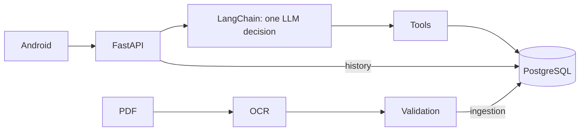

# Series 76 Technical Assistant
[English](README.md) · [Español](README.es.md)

## Quick start

1. **Requirements:** Git, Docker running Linux containers; Android Studio, **JDK 17**, SDK Platform 36 and a running API 26+ emulator. Run commands from the repository root; set `JAVA_HOME` to JDK 17 and `ANDROID_HOME` to your Android SDK.
2. **Configure:** `cp .env.example .env` (Windows: `copy .env.example .env`), only if `.env` does not exist. Paste your OpenRouter key into `OPENROUTER_API_KEY` for paid language interpretation; leave it empty for keyless startup. For local debug details, set `DEV_DEBUG=true` before starting.
3. **Start:** `docker compose up -d --build` (both platforms). Startup loads the catalogue and provisions the TEST ONLY accounts below without resetting existing passwords.
4. **Health:** open [http://localhost:8000/ready](http://localhost:8000/ready); wait for HTTP 200 after the initial build/load. [API / Swagger](http://localhost:8000/docs). This checks the database/catalogue/glossary, not OpenRouter.
5. **Login:** use either public **TEST ONLY** account:

| Email | Public test password |
|---|---|
| demo@series76.test | Series76-Demo-1 |
| reviewer@series76.test | Series76-Demo-2 |

6. **Build + install on the running emulator** (choose your platform):
   - macOS/Linux: `sh mobile/android/gradlew -p mobile/android :app:installDebug -PbackendUrl=http://10.0.2.2:8000/`
   - Windows PowerShell: `./mobile/android/gradlew.bat -p mobile/android :app:installDebug -PbackendUrl=http://10.0.2.2:8000/`
   - Open **Series 76**, sign in, then try `What is the motor power of 761A00-11300000/A?` (keyless). The emulator reaches the backend at **http://10.0.2.2:8000/**.
7. **Debug:** tap the profile name/email **7 times within 3 seconds**, then tap **ⓘ** on an answer. Requires `DEV_DEBUG=true`; if changed after startup, apply with `docker compose up -d backend`.

Without a key, login/history and deterministic queries work; free-language interpretation returns `503 not_configured`. For port conflicts, existing volumes and Android setup, see the details below.

## Overview

Native Android assistant for selecting Series 76 actuators: FastAPI, one LangChain decision and PostgreSQL. The LLM interprets; SQL and templates produce the numbers. Answers are English-only; input may also be Spanish.



## Assessment status

| Feature | Verified evidence | Remaining limit |
|---|---|---|
| OCR and PostgreSQL catalogue | [941/941 primary checks](docs/evidence/ocr.md), idempotent loading | New layouts need validation |
| Multi-turn selection | [Paired v17 mean 79.4%, 0/18,792 wrong figures](reports/submission/P2-A.md) | About 20% of conversations fail; repairs are separate from measured results |
| Public text and hidden debug | [Executable text audit](reports/submission/P2-B.md), [emulator checks](reports/submission/P2-D.md) | Detector coverage is finite; debug transport was controlled |
| Android interaction and voice | [8/8 emulator tests](reports/submission/P2-D.md) | Real recognition and login/debug fault paths need checks |
| Login, private history, Docker | [Linux CI](reports/submission/P2-C.md), [Windows clean clone](reports/submission/T18-tag-clean-clone.md) | Evaluator access and physical-device validation |

## Setup and backend

**What:** Git and Docker with Linux containers; 64-bit Python 3.12 only for local OCR/tests. **How:** from the repository root, run your platform block; preserve an existing `.env`. Startup migrates, loads catalogue/glossary and provisions test users without resetting passwords. **Code:** [Compose](docker-compose.yml), [entrypoint](docker/entrypoint.sh); [operations](docs/wiki/en/operations.md).

For an independent second checkout, add `COMPOSE_PROJECT_NAME=serie76-clean`, `POSTGRES_PORT=55432` and `API_PORT=18000` to its `.env` before running Compose. Use `http://localhost:18000` in HTTP examples and `-PbackendUrl=http://10.0.2.2:18000/` for its emulator build. These names and ports isolate this checkout; keep its database password consistent with its own volume.

```sh
# macOS/Linux
[ -f .env ] || cp .env.example .env
docker compose up --build -d
curl http://localhost:8000/ready
```

```powershell
# Windows PowerShell
if (-not (Test-Path .env)) { Copy-Item .env.example .env }
docker compose up --build -d
curl.exe http://localhost:8000/ready
```

Open [Swagger](http://localhost:8000/docs): log in with a test account, Authorize with the token and use `POST /api/conversation`; retain `session_id` for follow-ups. `/ready` checks DB/catalogue/glossary, not the provider. Keyless history and deterministic routes work; free-language interpretation returns 503 `not_configured`. [API examples for both platforms](docs/wiki/en/api.md#curl).

In `.env`, `POSTGRES_PASSWORD` starts as a local placeholder; preserve an existing volume's password. For authorized inference set `OPENROUTER_API_KEY` and `OPENROUTER_CHAT_MODEL=google/gemini-3.6-flash`; the default endpoint is `https://openrouter.ai/api/v1`. Apply configuration with `docker compose up -d backend`. Never publish keys.

After login, `What is the motor power of 761A00-11300000/A?` works keyless and returns the published **15 W**. A single named field for one complete valid code (including `FLA of 761A00-11300000/A at 60 Hz` or `operating time of 761A00-11300000/A`), greetings and explicit code comparisons use SQL/templates with zero model calls. Ambiguous requests, extra conditions and free-language selection need `OPENROUTER_API_KEY` plus `OPENROUTER_CHAT_MODEL`; without them those interpretation requests return 503 `not_configured`. The field route uses the same answer planner as an equivalent LLM lookup decision.

For a copyable keyless comparison, send `Compare 761A00-11300000/A and 761B00-11300000/A` as `query` to the same conversation endpoint. Both full codes are published catalogue entries. To check the missing-provider response, send `I need an actuator for an outdoor valve` with an empty API key; expect HTTP 503 and `error_code: not_configured`.

This table covers the added embedding/debug settings. [.env.example](.env.example) is the full configuration template: startup uses `POSTGRES_DB`, `POSTGRES_USER`, `POSTGRES_PASSWORD`, `POSTGRES_PORT` and `API_PORT`; Compose also accepts `COMPOSE_PROJECT_NAME`. Language interpretation requires `OPENROUTER_API_KEY` and `OPENROUTER_CHAT_MODEL`. Preserve empty credentials for keyless evaluation; advanced retries, deadlines, tracing and evaluation-only variables are commented in that template.

| New variable | Default | Purpose |
|---|---|---|
| `OPENROUTER_EMBEDDING_MODEL` | `google/gemini-embedding-2` | `google/gemini-embedding-2` on OpenRouter; `gemini-embedding-2` on Google |
| `EMBEDDING_BASE_URL` | empty | Inherits `OPENROUTER_BASE_URL` |
| `EMBEDDING_API_KEY` | empty | Inherits `OPENROUTER_API_KEY` |
| `EMBEDDING_DIM` | `768` | Must match the schema |
| `EMBEDDINGS_ENABLED` | `true` | Effective only when a model is configured; `false` disables it |
| `DEV_DEBUG` | `false` | Enables authenticated owner-scoped traces |

**Database:** Compose pins `pgvector/pgvector:pg17-trixie` by SHA-256 digest. Before upgrading an existing PG17 volume, back it up and match its glibc/collation (2.41 in the verified volume); the pg17 image with glibc 2.36 did not match that collation. Never use `docker compose down -v`. [Pin and upgrade](docs/wiki/en/operations.md#pgvector).

## Demo users (TEST ONLY)

| Email | Public test password |
|---|---|
| demo@series76.test | Series76-Demo-1 |
| reviewer@series76.test | Series76-Demo-2 |

**What/how:** test use only; `DEMO_USERS_JSON=[]` disables new provisioning, never resets passwords. **Code:** [auth CLI](backend/auth/cli.py); [login and isolation](docs/wiki/en/api.md).

## Ingestion

**What:** local OCR of the electrical PDF; evaluation references are excluded. **How:** install a separate environment and generate a new output. **Code:** [ingest.py](scripts/ingest.py); [pipeline, validation and loading](docs/wiki/en/ingestion.md).

```sh
# macOS/Linux
python3 -m venv .venv-ingest
. .venv-ingest/bin/activate
pip install -r requirements-ingest.lock.txt
python scripts/ingest.py data/raw/series_76_electric_data.pdf --out data/processed/new-import
```

```powershell
# Windows PowerShell
python -m venv .venv-ingest
.\.venv-ingest\Scripts\Activate.ps1
pip install -r requirements-ingest.lock.txt
python scripts/ingest.py data/raw/series_76_electric_data.pdf --out data/processed/new-import
```

The first OCR execution downloads public RapidOCR weights into the clone's `.cache/ocr`; recognition then runs locally. Provision those weights before an offline run. A ready export, including `manifest.json`, is stored in a per-document subfolder of `data/processed/new-import`, not directly at that root.

Per-document CSV/JSON/HTML, manifest and evidence go under `data/processed/new-import`; pending review blocks export. Retained validated data lives in [data/extracted/series76](data/extracted/series76) and Docker loads it into PostgreSQL automatically. To reload that data (both platforms):

```text
docker compose exec -T backend python -m backend.catalog.cli load data/extracted/series76
```

## Example bank

**What:** 658 user phrasings with interpretations and 100 anchors; never catalogue figures as knowledge. The historical Google load cost about **USD 0.005 estimated**. The OpenRouter reload under `google/gemini-embedding-2` cost about **USD 0.0015**; retrieval filters by this exact model name. These are run estimates, not guaranteed prices. **How:** inspect the dry-run; the second command performs inference and requires authorization. The mount supplies `config/`, absent from the image. **Code:** [loader](scripts/load_example_bank.py), [embeddings](backend/conversation/embeddings.py); [loading, provenance and keyless behavior](docs/wiki/en/operations.md#example-bank).

The bank is optional for keyless operation. With no model configured, `--dry-run` reports all supplied examples/anchors without a database, API key or inference (`scope: input_only`); it does not check existing vectors. With an explicit model it checks pending rows in the running DB, still without inference. The default `.env.example` already names an embedding model, even with an empty API key, so the first command below checks the running database and reports `scope: model_pending`; keyless does not mean model-less. The second command below loads vectors for the named model and must wait for paid-inference authorization; configure that same model for backend retrieval.

```text
docker compose run --rm --no-deps --entrypoint python -v ./config:/app/config:ro backend scripts/load_example_bank.py --dry-run
docker compose run --rm --no-deps --entrypoint python -e OPENROUTER_EMBEDDING_MODEL=google/gemini-embedding-2 -v ./config:/app/config:ro backend scripts/load_example_bank.py
```

Without a model retrieval is disabled; missing keys, timeout or SQL failure omit semantic additions. Startup and deterministic routes make no embedding calls; a real load without credentials cannot create vectors.

## Android

**What:** Kotlin/Compose, one question card, recommendations, actions and deletion with Undo. **How:** Android Studio, JDK 17, SDK Platform 36, API 26+ emulator/device; open `mobile/android`, select app/debug and Run, or use your block from the root. **Code:** [app](mobile/android/app/src/main/java/com/serie76/assistant), [build](mobile/android/app/build.gradle.kts); [Android guide](docs/wiki/en/android.md).

Before building, run `java -version` and confirm **JDK 17**. Set `JAVA_HOME` to that JDK installation and put its `bin` first on PATH; set `ANDROID_HOME` to the SDK folder containing `platforms/android-36`. Android Studio's SDK Manager installs SDK Platform 36. Add the SDK's `platform-tools` to PATH before using `adb`. JDK 17 is the documented validation baseline; success on another JDK does not establish that baseline.

```sh
# macOS/Linux: replace these paths with your installed locations
export JAVA_HOME=/path/to/jdk-17
export ANDROID_HOME=/path/to/Android/sdk
export PATH="$JAVA_HOME/bin:$ANDROID_HOME/platform-tools:$PATH"
java -version
test -d "$ANDROID_HOME/platforms/android-36"
adb version
```

```powershell
# Windows PowerShell: replace these paths with your installed locations
$env:JAVA_HOME='C:\path\to\jdk-17'
$env:ANDROID_HOME="$env:LOCALAPPDATA\Android\Sdk"
$env:Path="$env:JAVA_HOME\bin;$env:ANDROID_HOME\platform-tools;$env:Path"
java -version
Test-Path "$env:ANDROID_HOME\platforms\android-36"
adb version
```

```sh
# macOS/Linux; adb on PATH
sh mobile/android/gradlew -p mobile/android testDebugUnitTest assembleDebug
adb install -r mobile/android/app/build/outputs/apk/debug/app-debug.apk
```

```powershell
# Windows PowerShell; adb on PATH
./mobile/android/gradlew.bat -p mobile/android testDebugUnitTest assembleDebug
adb install -r mobile/android/app/build/outputs/apk/debug/app-debug.apk
```

Open Series 76 and use a test account. Emulator backend: `http://10.0.2.2:8000/`. Append `-PbackendUrl=https://your-host/` to the build command to change it. For USB run `adb reverse tcp:8000 tcp:8000`, build with `-PbackendUrl=http://127.0.0.1:8000/` and reinstall. Release requires HTTPS and signing.

**Voice:** microphone left of Send, `RECORD_AUDIO` permission, on-device SpeechRecognizer preferred on API 31+; review the transcript before sending. The fallback service requests offline mode but may use its own network; no audio goes to this project's backend. Without a recognition service: `Voice input isn't available on this device`.

**Hidden debug:** tap the profile name/email **7 times within 3 seconds** to toggle developer mode, then **ⓘ** on each answer. Requires backend `DEV_DEBUG=true`; lazily loads `GET /api/messages/{id}/debug`, including saved history. Available in both variants; the backend enforces authorization.

## Models, design and limitations

**Models:** `google/gemini-3.6-flash` is the only chat model; fallback is disabled (`OPENROUTER_FALLBACK_MODEL=`). Embeddings use `google/gemini-embedding-2`. Flash was selected for the observed quality/latency balance in the [historical paired model comparison](docs/wiki/en/testing.md#openrouter-model-selection), not universal superiority. One completed tool decision per interpreted turn; deterministic routes make no model call. SQL and templates provide figures; retrieval only adds unresolved interpretation fields. [Architecture](docs/wiki/en/agent.md) · [Trade-offs](docs/wiki/en/patterns.md).

**Adopted improvement:** the owner authorized the improved Flash version as an explicit exception to the pre-registered no-regression rule; the original absolute integrity target was not met. The [paired evaluation and repair record](reports/submission/P2-A.md) distinguishes the measured candidate from subsequent offline repairs. Both new regressions and the shared relative-bound defects were repaired with regression tests. Repaired source `1dda5f2` passed **797 tests (795 passed, 2 skipped)**, the **119/119** expanded oracle and all required offline gates. The paid scores below belong only to measured candidate `3ede96c`; v17 became regression material during repair, and the repaired source has no independent paid evaluation.

Three paired runs on the same 60 previously unseen, multi-turn conversations (v17) used the same model, catalogue and retrieval:

| Measure | Previous version | Improved version |
|---|---:|---:|
| Conversations passing, per run | 37/60, 35/60, 38/60 | 47/60, 46/60, 50/60 |
| Mean conversation pass rate | 61.1% | 79.4% |
| Passed in all three runs (pass^3) | 33/60 (55.0%) | 43/60 (71.7%) |
| Turns meeting adjudicated integrity requirements | 410/438 | 429/438 |
| Pooled client latency p95 / maximum | 6.06 / 11.23 s | 6.69 / 17.89 s |
| Turns over 10 s | 1 | 3 |

Exact paired McNemar p-values were **0.013, 0.007 and 0.002**. The full structured audit found **0 wrong figures in 18,792 values** across both versions. Correct figures do not guarantee correct product identity or retained requirements. The p95 ≤10 s rule passed; individual turns still exceeded 10 s. Earlier slow-turn diagnosis found single provider calls, not application loops; that does not establish the cause of every v17 tail.

**Limits:** about **20% of novel multi-turn conversations still fail** on average; the three repeats are not 180 independent conversations. Two new regressions concerned a withdrawn torque ceiling and the second comparison member; two shared defects concerned relative torque bounds. Their offline repairs and tests are tracked in the linked report, separately from live measurements. Voice recognition, microphone permissions/service behavior and physical-device readability still need manual checks.

**Earlier evidence:** v14 **32/45** and v15 **42/60** predate the latest improvements; v16 was used for development and is not independent validation. Synthetic ranking achieved **NDCG@3 0.965 / compliance 1.0**, not end-to-end accuracy. The complete-state experiment (SV2) was **not adopted**: 8/60 versus 42/60. [Testing history](docs/wiki/en/testing.md) · [Rejected experiment](reports/submission/SV2-experiment.md).

**Integrity boundary:** the SQL eligibility invariant checks cards, comparisons, rankings and positive prose, plus membership in the previously shown set when requested. Invalid selections are cleared; informational non-matches require explicit labels. It checks represented requirements, not perfect interpretation or installation suitability. [Invariant and tests (P1-F)](reports/submission/P1-F.md).

**Delivery evidence:** the executable public-text audit detected **0 production leaks in its recorded scope**; later v17 blind review found a baseline token that automation missed, so zero detected leaks is not a universal guarantee. Linux keyless Quick start passed in CI; a separate Windows clean clone passed its ten steps. Android emulator acceptance passed **8/8**, mixing real keyless HTTP/SQL with controlled debug, fault, delay and voice inputs. [Text audit (P2-B)](reports/submission/P2-B.md) · [Linux CI (P2-C)](reports/submission/P2-C.md) · [Windows clone (T18)](reports/submission/T18-tag-clean-clone.md) · [Emulator (P2-D)](reports/submission/P2-D.md).

**Recorded OpenRouter spend:** **USD 6.170259916 ≈ USD 6.17 of 10**, including failed attempts and experiments; this is the settled evaluation ledger, not a live balance. [Spend record](reports/submission/P2-A.md#spend-and-excluded-attempt).

## Reproduction gates

Current offline gate: **v7, 453/453 scripted scenarios**. First create and activate the Python 3.12 backend environment and install `requirements-dev.txt`, following [Run locally](docs/wiki/en/testing.md#run-locally). That section also gives the database-enabled unittest command. The separate OCR environment above is not the backend test environment. After Compose startup, run:

```text
python scripts/agent_acceptance.py selfcheck --cases config/agent_acceptance_cases_v7.json --config config/agent_acceptance_v7.json
python scripts/check_tool_schemas.py
python scripts/verify_catalog_db.py
```

The catalogue verifier logs in with the public TEST ONLY demo account and sends its Bearer token to protected endpoints. It defaults to `http://127.0.0.1:${API_PORT:-8000}`, using process `API_PORT` before the local template setting; `--base-url http://127.0.0.1:18000` overrides it explicitly. Its SQL, full database test suite and HTTP stages must all pass for exit 0. Existing demo passwords are never reset.

The v6 selfcheck is historical: its presentation expectations predate T8 and it no longer passes this release. Its files and archived 103/103 result are preserved, not the current gate. Scripted checks do not establish provider interpretation quality.

## Repository map

[backend](backend/) · [Android](mobile/android/) · [OCR](catalog_ingest/) · [data](data/) · [config](config/) · [scripts](scripts/) · [tests](tests/) · [reports](reports/) · [Docker](docker/) · [CI](.github/) · [assistant config](.claude/) / [.codex](.codex/)

[Wiki map](docs/wiki/en/index.md) · [Tests and commands](docs/wiki/en/testing.md) · [Interview defense](docs/wiki/es/defensa-entrevista.md) · [Checklist](docs/SUBMISSION.md) · [Brief](docs/assessment-en.pdf)

[Published wiki and defense guide](https://github.com/SamuelCharry/serie76-assistant/wiki) ? [Wiki publication](docs/WIKI-PUBLISHING.md)
