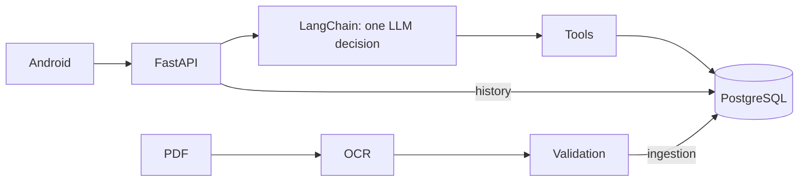

[English](README.md) · [Español](README.es.md)

# Series 76 Technical Assistant

Native Android assistant for selecting Series 76 actuators: FastAPI, one LangChain decision and PostgreSQL. The LLM interprets; SQL and templates produce the numbers. Answers are English-only; input may also be Spanish.



## Assessment status

| Feature | Implemented and verified locally | Pending |
|---|---|---|
| OCR and PostgreSQL catalogue | [941/941 primary checks](docs/evidence/ocr.md), idempotent loading | New layouts |
| T8 interaction, recommendations, actions, deletion, planner and guards | [T8–T8h backend](docs/wiki/en/testing.md), [51 T8 JVM tests](reports/submission/T8-android.md) | OpenRouter acceptance and real device flow |
| T9 additive embeddings | [484 Python tests, 2 skips; 446 scripted scenarios](reports/submission/T9-embeddings.md), Google smoke | OpenRouter acceptance |
| T9 voice and per-answer debug | [74 JVM tests, debug/release APKs](reports/submission/T9-android.md) | Actual voice, UI and integrated backend on device |
| Login, private history, Docker | [Authentication](docs/wiki/en/api.md), [reproducible startup](reports/submission/T2.md) | Public HTTPS and final reproduction |

## Setup and backend

**What:** Git and Docker with Linux containers; 64-bit Python 3.12 only for local OCR/tests. **How:** from the repository root, run your platform block; preserve an existing `.env`. Startup migrates, loads catalogue/glossary and provisions test users without resetting passwords. **Code:** [Compose](docker-compose.yml), [entrypoint](docker/entrypoint.sh); [operations](docs/wiki/en/operations.md).

For an independent second checkout, add `COMPOSE_PROJECT_NAME=serie76-clean`, `POSTGRES_PORT=55432` and `API_PORT=18000` to its `.env` before running Compose. Use `http://localhost:18000` in HTTP examples and `-PbackendUrl=http://10.0.2.2:18000/` for its emulator build. These names and ports isolate this checkout; keep its database password consistent with its own volume.

```sh
# macOS/Linux
[ -f .env ] || cp .env.example .env
docker compose up --build -d
curl http://localhost:8000/ready
```

```powershell
# Windows PowerShell
if (-not (Test-Path .env)) { Copy-Item .env.example .env }
docker compose up --build -d
curl.exe http://localhost:8000/ready
```

Open [Swagger](http://localhost:8000/docs): log in with a test account, Authorize with the token and use `POST /api/conversation`; retain `session_id` for follow-ups. `/ready` checks DB/catalogue/glossary, not the provider. Keyless history and deterministic routes work; free-language interpretation returns 503 `not_configured`. [API examples for both platforms](docs/wiki/en/api.md#curl).

In `.env`, `POSTGRES_PASSWORD` starts as a local placeholder; preserve an existing volume's password. For authorized inference set `OPENROUTER_API_KEY` and `OPENROUTER_CHAT_MODEL=google/gemini-3.6-flash`; the default endpoint is `https://openrouter.ai/api/v1`. Apply configuration with `docker compose up -d backend`. Never publish keys.

After login, `What is the motor power of 761A00-11300000/A?` works keyless and returns the published **15 W**. A single named field for one complete valid code (including `FLA of 761A00-11300000/A at 60 Hz` or `operating time of 761A00-11300000/A`), greetings and explicit code comparisons use SQL/templates with zero model calls. Ambiguous requests, extra conditions and free-language selection need `OPENROUTER_API_KEY` plus `OPENROUTER_CHAT_MODEL`; without them those interpretation requests return 503 `not_configured`. The field route uses the same answer planner as an equivalent LLM lookup decision.

This table covers the added embedding/debug settings. [.env.example](.env.example) is the full configuration template: startup uses `POSTGRES_DB`, `POSTGRES_USER`, `POSTGRES_PASSWORD`, `POSTGRES_PORT` and `API_PORT`; Compose also accepts `COMPOSE_PROJECT_NAME`. Language interpretation requires `OPENROUTER_API_KEY` and `OPENROUTER_CHAT_MODEL`. Preserve empty credentials for keyless evaluation; advanced retries, deadlines, tracing and evaluation-only variables are commented in that template.

| New variable | Default | Purpose |
|---|---|---|
| `OPENROUTER_EMBEDDING_MODEL` | empty | `google/gemini-embedding-2` on OpenRouter; `gemini-embedding-2` on Google |
| `EMBEDDING_BASE_URL` | empty | Inherits `OPENROUTER_BASE_URL` |
| `EMBEDDING_API_KEY` | empty | Inherits `OPENROUTER_API_KEY` |
| `EMBEDDING_DIM` | `768` | Must match the schema |
| `EMBEDDINGS_ENABLED` | `true` | Effective only when a model is configured; `false` disables it |
| `DEV_DEBUG` | `false` | Enables authenticated owner-scoped traces |

**Database:** Compose pins `pgvector/pgvector:pg17-trixie` by SHA-256 digest. Before upgrading an existing PG17 volume, back it up and match its glibc/collation (2.41 in the verified volume); the pg17 image with glibc 2.36 did not match that collation. Never use `docker compose down -v`. [Pin and upgrade](docs/wiki/en/operations.md#pgvector).

## Demo users (TEST ONLY)

| Email | Public test password |
|---|---|
| demo@series76.test | Series76-Demo-1 |
| reviewer@series76.test | Series76-Demo-2 |

**What/how:** test use only; `DEMO_USERS_JSON=[]` disables new provisioning, never resets passwords. **Code:** [auth CLI](backend/auth/cli.py); [login and isolation](docs/wiki/en/api.md).

## Ingestion

**What:** local OCR of the electrical PDF; evaluation references are excluded. **How:** install a separate environment and generate a new output. **Code:** [ingest.py](scripts/ingest.py); [pipeline, validation and loading](docs/wiki/en/ingestion.md).

```sh
# macOS/Linux
python3 -m venv .venv-ingest
. .venv-ingest/bin/activate
pip install -r requirements-ingest.lock.txt
python scripts/ingest.py data/raw/series_76_electric_data.pdf --out data/processed/new-import
```

```powershell
# Windows PowerShell
python -m venv .venv-ingest
.\.venv-ingest\Scripts\Activate.ps1
pip install -r requirements-ingest.lock.txt
python scripts/ingest.py data/raw/series_76_electric_data.pdf --out data/processed/new-import
```

The first OCR execution downloads public RapidOCR weights into the clone's `.cache/ocr`; recognition then runs locally. Provision those weights before an offline run. A ready export, including `manifest.json`, is stored in a per-document subfolder of `data/processed/new-import`, not directly at that root.

Per-document CSV/JSON/HTML, manifest and evidence go under `data/processed/new-import`; pending review blocks export. Retained validated data lives in [data/extracted/series76](data/extracted/series76) and Docker loads it into PostgreSQL automatically. To reload that data (both platforms):

```text
docker compose exec -T backend python -m backend.catalog.cli load data/extracted/series76
```

## Example bank

**What:** 649 user phrasings with interpretations and 100 anchors; never catalogue figures as knowledge. The Google load cost about **USD 0.005 estimated**, not a billing receipt or guaranteed price. **How:** inspect the dry-run; the second command performs inference and requires authorization. The mount supplies `config/`, absent from the image. **Code:** [loader](scripts/load_example_bank.py), [embeddings](backend/conversation/embeddings.py); [loading, provenance and keyless behavior](docs/wiki/en/operations.md#example-bank).

The bank is optional for keyless operation. With no model configured, `--dry-run` reports all supplied examples/anchors without a database, API key or inference (`scope: input_only`); it does not check existing vectors. With an explicit model it checks pending rows in the running DB, still without inference. The second command below loads vectors for the named model and must wait for paid-inference authorization; configure that same model for backend retrieval.

```text
docker compose run --rm --no-deps --entrypoint python -v ./config:/app/config:ro backend scripts/load_example_bank.py --dry-run
docker compose run --rm --no-deps --entrypoint python -e OPENROUTER_EMBEDDING_MODEL=google/gemini-embedding-2 -v ./config:/app/config:ro backend scripts/load_example_bank.py
```

Without a model retrieval is disabled; missing keys, timeout or SQL failure omit semantic additions. Startup and deterministic routes make no embedding calls; a real load without credentials cannot create vectors.

## Android

**What:** Kotlin/Compose, one question card, recommendations, actions and deletion with Undo. **How:** Android Studio, JDK 17, SDK Platform 36, API 26+ emulator/device; open `mobile/android`, select app/debug and Run, or use your block from the root. **Code:** [app](mobile/android/app/src/main/java/com/serie76/assistant), [build](mobile/android/app/build.gradle.kts); [Android guide](docs/wiki/en/android.md).

Before building, run `java -version` and confirm **JDK 17**. Set `JAVA_HOME` to that JDK installation and put its `bin` first on PATH; set `ANDROID_HOME` to the SDK folder containing `platforms/android-36`. Android Studio's SDK Manager installs SDK Platform 36. Add the SDK's `platform-tools` to PATH before using `adb`. JDK 17 is the documented validation baseline; success on another JDK does not establish that baseline.

```sh
# macOS/Linux: replace these paths with your installed locations
export JAVA_HOME=/path/to/jdk-17
export ANDROID_HOME=/path/to/Android/sdk
export PATH="$JAVA_HOME/bin:$ANDROID_HOME/platform-tools:$PATH"
java -version
test -d "$ANDROID_HOME/platforms/android-36"
adb version
```

```powershell
# Windows PowerShell: replace these paths with your installed locations
$env:JAVA_HOME='C:\path\to\jdk-17'
$env:ANDROID_HOME="$env:LOCALAPPDATA\Android\Sdk"
$env:Path="$env:JAVA_HOME\bin;$env:ANDROID_HOME\platform-tools;$env:Path"
java -version
Test-Path "$env:ANDROID_HOME\platforms\android-36"
adb version
```

```sh
# macOS/Linux; adb on PATH
sh mobile/android/gradlew -p mobile/android assembleDebug
adb install -r mobile/android/app/build/outputs/apk/debug/app-debug.apk
```

```powershell
# Windows PowerShell; adb on PATH
./mobile/android/gradlew.bat -p mobile/android assembleDebug
adb install -r mobile/android/app/build/outputs/apk/debug/app-debug.apk
```

Open Series 76 and use a test account. Emulator backend: `http://10.0.2.2:8000/`. Append `-PbackendUrl=https://your-host/` to the build command to change it. For USB run `adb reverse tcp:8000 tcp:8000`, build with `-PbackendUrl=http://127.0.0.1:8000/` and reinstall. Release requires HTTPS and signing.

**Voice:** microphone left of Send, `RECORD_AUDIO` permission, on-device SpeechRecognizer preferred on API 31+; review the transcript before sending. The fallback service requests offline mode but may use its own network; no audio goes to this project's backend. Without a recognition service: `Voice input isn't available on this device`.

**Hidden debug:** tap the profile name/email **7 times within 3 seconds** to toggle developer mode, then **ⓘ** on each answer. Requires backend `DEV_DEBUG=true`; lazily loads `GET /api/messages/{id}/debug`, including saved history. Available in both variants; the backend enforces authorization.

## Models, design and limitations

**What/why:** `gemini-3.6-flash` uses the OpenAI-compatible client; OpenRouter is the submission target, with acceptance pending. On the same 44 conversations, 3.6 Flash/3.8 Flash/3.1 Pro scored **21/44, 25/44, 28/44**; Pro had **7.1 s p95** and an **11 s** turn. After round 6, 3.6 Flash was selected: **28/43** against 3.8 Flash's **26/43**. Embeddings use `gemini-embedding-2`, OpenRouter ID `google/gemini-embedding-2`. [Method and full results](docs/wiki/en/testing.md).

**How:** the LLM never produces final numbers: one decision per interpreted turn, zero on deterministic routes. Retrieval only adds unresolved fields; it cannot replace explicit requirements. The final guard checks quantity and filter coverage; SQL/templates preserve units, N/A and provenance. Ranking declares its criterion, not suitability certification. **Code:** [agent](backend/conversation/agent.py), [coverage guard](backend/conversation/requirement_coverage.py), [ranking](backend/conversation/ranking.py); [architecture](docs/wiki/en/agent.md), [decisions and trade-offs](docs/wiki/en/patterns.md).

**Known limitations:** **68–73% strict pass** on unseen held-out conversations (rounds 9–10); round 9 was 73% ON/71% OFF, a small margin, and round 10 ON after repairs scored 28/41 (68%). Every response in rounds 9–10 was under 10 s (p95 3.7–5.1 s); no round had wrong catalogue numbers. Paraphrased or Spanish service/enclosure cues can still be missed and become clarification questions; some mid-conversation retractions or added bounds are not merged; site-hazard judgment can err both ways, so the assistant asks for confirmation and always shows the enclosure; some single-field or out-of-scope questions receive excessive detail. Engineers must confirm **active filters, service, enclosure and hazardous-area classification before ordering**. Actual voice, Android integration and OpenRouter acceptance remain pending.

## Reproduction gates

Current offline gate: **v7, 446/446 scripted scenarios**. In the activated backend Python environment, after Compose startup:

```text
python scripts/agent_acceptance.py selfcheck --cases config/agent_acceptance_cases_v7.json --config config/agent_acceptance_v7.json
python scripts/check_tool_schemas.py
python scripts/verify_catalog_db.py
```

The catalogue verifier logs in with the public TEST ONLY demo account and sends its Bearer token to protected endpoints. It defaults to `http://127.0.0.1:${API_PORT:-8000}`, using process `API_PORT` before the local template setting; `--base-url http://127.0.0.1:18000` overrides it explicitly. Its SQL, full database test suite and HTTP stages must all pass for exit 0. Existing demo passwords are never reset.

The v6 selfcheck is historical: its presentation expectations predate T8 and it no longer passes this release. Its files and archived 103/103 result are preserved, not the current gate. Scripted checks do not establish provider interpretation quality.

## Repository map

[backend](backend/) · [Android](mobile/android/) · [OCR](catalog_ingest/) · [data](data/) · [config](config/) · [scripts](scripts/) · [tests](tests/) · [reports](reports/) · [Docker](docker/) · [CI](.github/) · [assistant config](.claude/) / [.codex](.codex/)

[Wiki map](docs/wiki/en/index.md) · [Tests and commands](docs/wiki/en/testing.md) · [Interview defense](docs/wiki/es/defensa-entrevista.md) · [Checklist](docs/SUBMISSION.md) · [Brief](docs/assessment-en.pdf)
