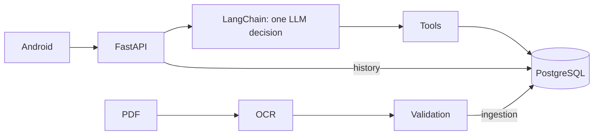

[English](README.md) · [Español](README.es.md)

# Series 76 Technical Assistant

A native Android assistant for selecting Series 76 electric actuators and retrieving exact catalogue data.
FastAPI + one LangChain tool decision + PostgreSQL; the LLM interprets intent and code renders the numbers.
Local OCR extracts the electrical PDF; the supplied summary provides definitions. Answers and suggested replies are English-only; input may be Spanish.



## Quick start: three commands

Requires Git and Docker with Linux containers running. From a fresh checkout, copy only if .env does not exist; the placeholder is for local TEST ONLY use. Ports default to 8000/5432 on loopback. Startup migrates, loads catalogue/glossary and provisions demo users automatically.

```sh
cp .env.example .env
docker compose up --build -d
curl http://localhost:8000/ready
```

Windows PowerShell equivalents (same three steps):

```powershell
Copy-Item .env.example .env
docker compose up --build -d
curl.exe http://localhost:8000/ready
```

`/ready` checks DB/catalogue/glossary, not the model. [OpenAPI](http://localhost:8000/docs). [Every variable and troubleshooting](docs/wiki/en/operations.md). Preserve the PostgreSQL volume; never run `docker compose down -v`.

## Demo users (TEST ONLY)

| Email | Public test password |
|---|---|
| demo@series76.test | Series76-Demo-1 |
| reviewer@series76.test | Series76-Demo-2 |

Never use these accounts in production. Existing passwords are never reset at startup. `DEMO_USERS_JSON=[]` disables new provisioning; [auth details](docs/wiki/en/api.md).

## Talk to the API

macOS/Linux: log in, then replace TOKEN with access_token locally. Windows: use the [PowerShell JSON-file examples](docs/wiki/en/api.md#curl).

```sh
curl -sS http://localhost:8000/api/auth/login -H 'Content-Type: application/json' -d '{"email":"demo@series76.test","password":"Series76-Demo-1"}'
curl -i http://localhost:8000/api/conversation -H 'Authorization: Bearer TOKEN' -H 'Content-Type: application/json' -d '{"query":"What is the motor power of 761A00-11300000/A?"}'
```

With a valid token and no model key/model set, expect **HTTP 503**:

```json
{"detail":"Conversation service unavailable. Check backend configuration and try again.","error_code":"not_configured"}
```

To enable interpretation after explicit inference authorization, set `OPENROUTER_API_KEY=<private-key>` and `OPENROUTER_CHAT_MODEL=google/gemini-3.6-flash` in your ignored .env, then `docker compose up -d backend`. The model was evaluated through Google's OpenAI-compatible endpoint; OpenRouter acceptance is **pending**. One tool decision per turn, SQL values and template answers; no embeddings. [Design/trade-offs](docs/wiki/en/patterns.md), [model evidence](docs/wiki/en/testing.md). Send the returned session_id on follow-ups. [Complete API](docs/wiki/en/api.md).

## Android

Open `mobile/android` in Android Studio: JDK 17, SDK Platform 36, emulator API 26+. Select app/debug and Run. Or build from the repository root:

```sh
sh mobile/android/gradlew -p mobile/android assembleDebug
# Windows: ./mobile/android/gradlew.bat -p mobile/android assembleDebug
adb install -r mobile/android/app/build/outputs/apk/debug/app-debug.apk
```

Default backend: `http://10.0.2.2:8000/` (emulator); override with `-PbackendUrl=https://your-host/` and rebuild. USB: `adb reverse tcp:8000 tcp:8000`, then use `-PbackendUrl=http://127.0.0.1:8000/`. Debug: set backend `DEV_DEBUG=true`, recreate backend, then left drawer → Developer debug → response. Debug tools are excluded from release. Login/history/chat implemented; voice not implemented. [Build, screens, states and limits](docs/wiki/en/android.md).

## Re-run ingestion and tests

Validated outputs: [CSV](data/extracted/series76/catalog.csv), [JSON](data/extracted/series76/catalog.json), [HTML](data/extracted/series76/catalog.html). [Re-run OCR and SQL loading](docs/wiki/en/ingestion.md). Python 3.12 + requirements-dev.txt; separate OCR runtime uses requirements-ingest.lock.txt. With local DB ready:

```sh
# macOS/Linux
python -m venv .venv
. .venv/bin/activate
pip install -r requirements-dev.txt
SERIES76_TEST_DB=1 python -m unittest discover -s tests
```

```powershell
# Windows PowerShell
python -m venv .venv
.\.venv\Scripts\Activate.ps1
pip install -r requirements-dev.txt
$env:SERIES76_TEST_DB='1'
python -m unittest discover -s tests
```

Tests use Compose PostgreSQL on `127.0.0.1:5432` (or POSTGRES_PORT): `local_environment()` maps .env POSTGRES_* to PG*; existing process PG* wins. [Connection mapping and CI](docs/wiki/en/testing.md#postgresql-connection). OCR uses a second activated environment: [setup](docs/wiki/en/ingestion.md#rerun).

[Environment setup, all suites, Android and CI](docs/wiki/en/testing.md). Scripted tool calls prove code behavior; they do not establish real-model acceptance.

## Repository map

- `backend/` — FastAPI, catalogue, auth, agent/history.
- `catalog_ingest/` — local OCR, reconstruction and validation.
- `config/` — frozen acceptance cases and configuration.
- `data/` — source PDFs, validated extraction, evaluation-only references.
- `docker/` — idempotent backend entrypoint.
- `docs/` — brief, evidence, ADR and bilingual wiki.
- `mobile/` — native Kotlin/Compose Android client.
- `reports/` — submission verification records.
- `scripts/` — ingestion, loading and verification CLIs.
- `tests/` — offline/scripted and opt-in PostgreSQL checks.
- `.claude/, .codex/` — real project assistant configuration.
- `.github/` — CI and contribution templates.

## Assessment status

“Verified” is scoped to linked evidence; implemented does not mean accepted on OpenRouter.

| Requirement | Implemented | Verified | Pending |
|---|---|---|---|
| PDF ingestion + PostgreSQL | Yes | [941/941 primary checks](docs/evidence/ocr.md), [SQL](docs/evidence/postgres.md) | New document layouts |
| FastAPI + LangChain custom tools | Yes | [Google A+ cohorts](docs/evidence/agent_acceptance.md), local scripted/SQL tests | OpenRouter acceptance |
| Multi-turn + persisted history | Yes | Controlled HTTP/restart checks | Real OpenRouter continuation after restart |
| Invalid codes, N/A, ambiguity, no matches | Yes | [T7: 103/103 scripted v6 scenarios](reports/submission/T7-backend.md), historical Google cohorts | Real-model v6 and OpenRouter acceptance |
| Native saved conversations/chat/debug + states | Yes | [T7: 40 JVM tests + debug APK](reports/submission/T7-android.md) | Device review and Android → real LLM → SQL → Android |
| Optional login + user isolation | Yes | Auth tests + controlled live checks | Public HTTPS/device deployment |
| Docker, config, docs, assistant setup | Yes | [T1](reports/submission/T1.md), [T2](reports/submission/T2.md), [T3](reports/submission/T3.md) | Final evaluator reproduction |
| T7 questions/Submit, filter tags, suggestions, comparison layouts, greeting | Yes | [202 Python tests; 2 optional skips](reports/submission/T7-backend.md), [Android state/contract tests](reports/submission/T7-android.md) | Real-model v6 and full app/backend acceptance |
| T7 bounded retry/fallback and keep-alive | Yes | [Local deadline/transport tests](reports/submission/T7-backend.md), [pool regression](reports/submission/T7-android.md) | Real-provider failure behavior |
| Optional voice | No | No | Not implemented |

[Wiki map](docs/wiki/en/index.md) · [Architecture](docs/wiki/en/agent.md) · [Original brief](docs/assessment-en.pdf) · [Interview defense](docs/wiki/es/defensa-entrevista.md)
