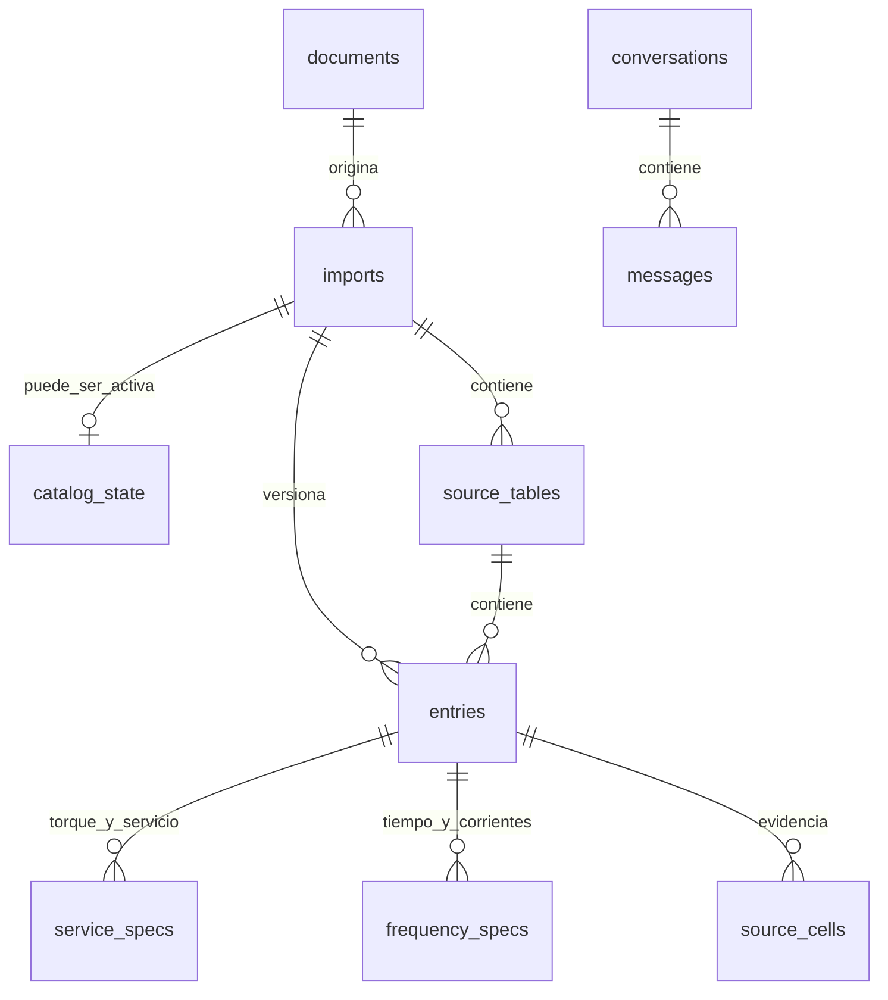

# Relevo: arquitecturas, evidencia y decisión pendiente

> **Estado actualizado (3 de noviembre de 2026): decisión tomada.** Se eligió e implementó A+, una evolución de A con glosario estructurado, política determinista y trazas completas (ver [ADR 0001](../docs/adr/0001-arquitectura-agente.md) y [00_EMPEZAR_AQUI](00_EMPEZAR_AQUI.md)). Los defectos 1, 2, 3 y 5 de este documento están corregidos. El 1 tenía otra causa además del filtro de dígitos: no había caracteres U+FFFD en los datos, el `�` era de la consola; lo defectuoso eran viñetas concatenadas con saltos de maquetado. El defecto 4 (costos por invocación) queda resuelto con un ledger por llamada en `reports/agent_acceptance`. El resto del documento es histórico.

Corte: 3 de noviembre de 2026. Samuel cambiará a un modelo de mayor capacidad para razonar mejor sobre arquitectura. Pidió dejar todo en contexto, especialmente las alternativas. Este archivo resume el último bloque; los pendientes antiguos sobre implementar PostgreSQL, herramientas o conversaciones pueden estar superados.

## Intención y estado de la decisión

Samuel cuestionó que retrieval se resolviera únicamente con relaciones: las personas pueden dar descripciones pobres y el contexto semántico puede ayudar. Propuso un agente contextual/vectorial y otro orientado a cifras. Pidió ER, diagramas, tres alternativas multiagente y comparación real. Eligió comparar cinco configuraciones con un presupuesto NUEVO de USD0,50 en Google, separado del ensayo previo de modelos.

Después indicó que no entendía las conclusiones ni las arquitecturas y pidió investigar empresas que hagan selección técnica de productos. Se explicó de nuevo con ejemplos y fuentes primarias. **No aprobó una arquitectura ganadora ni pidió integrar una variante en producción.** La última acción autorizada en este turno es documentar el relevo.

Conclusiones defendibles:

1. El flujo actual recupera datos técnicos por SQL, pero carece de una herramienta documental para definiciones/contexto.
2. La recuperación de contexto permitió responder algunas definiciones; no demuestra que vectores superen un glosario ni que varios agentes superen uno.
3. La comparación multiagente quedó inconclusa. No decir que B, D o cualquier otra variante ganó.
4. Hubo defectos compartidos del prototipo, además de fallos de proveedor; no atribuirlos a la arquitectura o al modelo sin separar causas.
5. Arquitectura híbrida (contexto documental + catálogo estructurado) y número de agentes son decisiones distintas. pgvector es una extensión de PostgreSQL; no sustituye necesariamente las relaciones.

## Las cinco arquitecturas implementadas

| ID | Diseño | Flujo | Llamadas LLM máximas por turno |
|---|---|---|---:|
| A | Agente actual con SQL | Interpreta → consulta exacta/búsqueda SQL o aclaración | 1 |
| B | Agente único contextual | Recupera top-4 del resumen en pgvector → un agente selecciona consulta SQL, definición citada o aclaración | 1 |
| C | Dos especialistas secuenciales | Recuperación → agente contextual propone interpretación → agente de catálogo recibe propuesta y solicitud original → herramientas/clarificación | 2 |
| D | Supervisor y especialistas | Supervisor decide catálogo/contexto/combinado/aclaración → especialistas necesarios → herramientas/clarificación | 3 |
| E | Proponente y revisor | Proponente con contexto consulta herramientas → revisor contrasta solicitud original, argumentos y evidencia → acepta o exige aclaración | 2 |

A es el flujo operativo actual. B/C/D/E son experimentales. Son workflows acotados con roles LLM distintos usando el mismo modelo, no sociedades autónomas ni modelos estadísticamente independientes. El recuperador vectorial es una herramienta, no un agente por sí mismo. Cifras y restricciones se verifican con código/SQL; un segundo LLM no reemplaza esa verificación.

La recomendación de ingeniería comunicada fue **B corregida como base sencilla**, con **D como siguiente alternativa a evaluar**. Es una recomendación por responsabilidades/costo/control, NO una selección experimental ni una decisión aprobada por Samuel. El nuevo modelo debe poder cuestionarla.

## Implementación, almacenamiento y diagramas

- Código aislado: `architecture_eval/`. Generación Gemini3.6 Flash, pensamiento low, salida máxima2048; mismo modelo en los cinco diseños.
- Configuración: `config/architecture_eval.json`. CLI/protocolo: `docs/ARCHITECTURE_EVALUATION.md`.
- Modelo/decisiones y Mermaid: `docs/ARQUITECTURA.md`.
- Visor HTML autocontenido con cinco pestañas: `docs/architecture.html`.
- ER exportable: `docs/er-series76.svg`.
- Fuente SQL inspeccionada del ER: `reports/architecture_eval/database.json`; comprobación contra instancia operativa: `production_schema_check.json`. Coinciden73columnas y9FK.
- Compose separado: `compose.architecture-eval.yml`, proyecto `series76-architecture-eval`, puerto5543, volumen propio, imagen pgvector fijada por digest. Catálogo operativo sigue en5432/API8000. Nunca sustituir/borrar el volumen operativo.
- Índice real:9fragmentos del resumen, embedding `gemini-embedding-001`,768dimensiones, distancia coseno exacta, top4. Fragmentación por bloques/párrafos dentro de cada página, máximo300tokens/solapamiento40si el bloque supera el límite. Incluye algunos encabezados poco informativos.
- `architecture_eval.chunks`: PK `(index_signature,id)`, metadataJSONB y embedding vector(768). Metadatos guardan documento/hash/página/sección/texto/tokens. Sin FK a productos: definición general no acredita una especificación de referencia.
- Firma incluye corpus, fragmentación, modelo y dimensión. Regenerar y reevaluar al cambiar embeddings; no mezclar espacios. Implementación actual fija dimensión768.
- Google solo para este experimento autorizado. La entrega final debe usar OpenRouter para LLM/embeddings según assessment. No se hicieron inferencias OpenRouter en este bloque.

ER actual, en términos de dominio:

Una entry es una aparición en tabla/versión, no una entidad global deduplicada de producto. Se conservan código completo, alimentación, envolvente y potencia; service_specs distingue On/Off/modulating/shared; frequency_specs conserva50/60Hz y frecuencia no especificada/no aplicable. Mantener source_NA frente a not_in_layout. NUMERIC para magnitudes; JSONB para evidencia variable y snapshots de mensajes. Unicidad de imports es compuesta `(document_sha256,pipeline_signature)`, no pipeline_signature sola.

## Resultados reales y límites

**Leer primero `reports/architecture_eval/ANALISIS.md` y `analysis.json`.** `RESULTADOS.md` y `comparison.json` son la salida original del runner y se preservan como evidencia, pero su agregador excluía errores de esquema como si fueran indisponibilidad. El análisis final los cuenta como fallos de calidad. Presupuesto truncado no cuenta como error del modelo.

-24escenarios nuevos definidos;18anteriores solo desarrollo.
-11escenarios distintos intentados;54combinaciones escenario/configuración registradas (E solo10, A–D11; D incluye un corte por presupuesto).
-Solo1escenario común completado en las cinco sin fallo proveedor: `trap_units`; todas lo resolvieron. No hay base para ranking.
-103llamadas Google totales, incluyendo embeddings;19fallos de proveedor (503 y un error de red/estado0), separados de calidad.
-Cargo conservadorUSD0.48392565 / límiteUSD0.50. Uso reportado de tokensUSD0.16573125; reservas de uso desconocidoUSD0.31819440. Son estimaciones/reservas, NO factura ni consulta de saldo.
-Ledger append-only, reserva antes de red, fsync, bloqueo de controlador, sin reintentos automáticos. No reiniciar ledger ni relajar límite para continuar.
-Sin deriva de inputs congelados. `frozen.json`, `results.jsonl` y `ledger.jsonl` conservan evidencia original. No modificar prompts ni casos para mejorar esta cohorte.
-54pruebas automatizadas pasaron:17arquitectura,9conversación con SQL real/interpretación controlada,28evaluación previa. Las pruebas no hacen inferencias pagadas.
-SQL experimental coincide con las68filas operativas; hashes en `catalog_check.json`. Reinicio real solo de instancia experimental conserva68filas y9fragmentos; `restart_check.json`.
-Sin secretos detectados en43archivos revisados. Credencial DB experimental solo `.cache/architecture/db.json`, ignorado. Clave Google en `.env` ignorado. No imprimirlos.
-Lógica de las cinco pestañas verificada con DOM simulado; SVGs renderizados e inspeccionados. No afirmar QA interactivo real: hosts de navegador/UI no estaban disponibles. Servidor temporal de vista8766 se detuvo.

Defectos concretos antes de integrar:

1. `engine.explain` elimina cualquier oración con dígitos: borra Duty Cycle por el identificadorS4. B/C recuperaron la página correcta pero respondieron con otros términos. Es fallo del renderizador compartido, no del embedding. También quedan caracteres de sustitución en viñetas. Segmentar por definición, limpiar extracción y distinguir identificadores de magnitudes; comprobar pertinencia al término solicitado.
2. B/C ante «24V DC y60Hz» emitieron argumentos incompatibles y fallaron validación antes de ofrecer aclaración. A también intentó búsqueda incompatible, bloqueada por código. La protección evitó recomendaciones inválidas, pero la conversación no resolvió la contradicción.
3. D pidió completar un código bien formado inexistente en lugar de consultar y responder que no existe.
4. Costos observados dependen de caché compartida de embeddings; no son costos unitarios independientes. Latencia incluye pacing del controlador. Normalizar costo por invocación y separar tiempos antes de comparar eficiencia/promover.
5. Trazas de algunos roles intermedios conservan uso y decisión del revisor, pero no todos los argumentos de interpretación. Ampliar en nueva cohorte sin guardar razonamiento interno.
6. Definiciones son extractos citados en idioma original, no explicación libre en español. Medición de contexto usa palabras clave y procedencia, no evaluación semántica exhaustiva.

Continuación técnica: el runner original compara tuplas Python con arrays JSON del manifiesto y falla al reanudar aunque hashes no cambien. `scripts/continue_architecture_eval.py` normaliza asdict mediante JSON y conserva TODOS los controles de hashes/casos/precios/presupuesto. Está probado. No editar el código congelado para esquivar el bloqueo. Análisis offline: `scripts/analyze_architecture_eval.py`. Ver también `verification.json`, `viewer_check.json`, `security_check.json` y `SELF_REVIEW.md`.

## Empresas, estudio y modelo de datos industrial

Fuentes consultadas en la última conversación; volver a verificar si se necesitan detalles nuevos:

1. **TraceParts + Leo AI**, caso comercial muy cercano: búsqueda de componentes por lenguaje natural, aclaraciones cuando faltan requisitos, recuperación desde catálogos TraceParts y PLM interno. La publicación no revela motor SQL, ER interno ni cantidad de agentes. No atribuirles esos detalles.
   https://info.traceparts.com/news/engineering-resources/traceparts-leo-ai-part-search-engineers/
2. **Schneider Electric Product Catalog API**: referencias, especificaciones técnicas, clasificación ETIM y documentos asociados; publica consulta por referencia y cambios. Fuente del mismo catálogo de su web. Esta fuente documenta datos/API, no una arquitectura multiagente.
   https://api-explorer.se.com/en/api/product-catalog-v2
3. **RWTH Aachen / FLAIR / INC Innovation Center**, “Designing an LLM-Based Copilot for Manufacturing Equipment Selection”,2024: orquestador, conocimiento estructurado y semiestructurado, selección/reflexión mediante máquina de estados. Implementación publicada: LangGraph, GPT-4o, SQLite estructurado, Chroma, all-MiniLM-L6-v2, DjangoREST, Gradio, Azure. Es un piloto industrial cercano a D; no un estándar universal ni producción demostrada.22solicitudes:19consideraban buena parte de requisitos; SOLO6cumplían TODOS. No presentar19/22como cumplimiento técnico completo.
   https://arxiv.org/html/2412.13774v1
4. **ETIM International**: referencia de semántica de catálogos técnicos mediante grupos/clases/sinónimos/características/valores/unidades. Schneider lo utiliza en su API. No obliga a un motorSQL ni prueba que todas las empresas usen el mismo ER. Recomendación comunicada: conservar nuestro esquema especializado tipado y adoptar rigor terminológico/unidades/sinónimos; no migrar automáticamente a un EAV genérico ni implementar ETIM entero para68referencias.
   https://www.etim-international.com/about-us/
   https://www.etim-international.com/classification/
5. Siemens Production Copilot documenta habilidades, incluido findInDocuments para RAG y acceso a servicios. Referencia complementaria, menos específica para selección de catálogo que TraceParts/paper.
   https://developer.siemens.com/insights-hub/docs/apis/production-copilot/production-copilot-overview.html

## Qué debe razonar el siguiente modelo

-Empezar por explicar arquitectura y decisión pendiente en español sencillo. Samuel quiere comprender y defender el diseño; no sustituir explicación por una lista de archivos/pruebas.
-Revisar críticamente B frente a D a partir de fuentes y requisitos del assessment. No asumir que más agentes o vectores son mejores por definición, ni descartar multiagencia por principio.
-Ejemplo de uso: «controlar cuánto abre una válvula» puede aportar indicio de modulación; aún hay que preguntar alimentación/torque. Una descripción pobre puede justificar una aclaración en lugar de una recomendación inventada.
-Antes de nuevas inferencias: corregir fallos compartidos, precisar rúbrica, trazas y costos; preservar cohorte antigua y acordar nuevo alcance/presupuesto si hace falta otro ensayo. No seguir gastando por inercia con esta autorización casi consumida.
-Antes de producción: aceptación OpenRouter, embeddings por la API requerida si se usan, índice regenerado cuando corresponda, seguimiento natural, errores, reinicio y recorrido completo Android→LLM→SQL→Android.
-El OCR eléctrico sigue siendo fuente única de cifras y no necesita repetirse para discutir arquitectura. Referencia manual solo evaluación. No corregir números por intuición ni suponer certificación a partir del resumen/envolvente.
-Hay trabajo Android concurrente. Verificar Git y archivos vigentes, no revertir ni mezclar cambios ajenos. Este bloque no hizo commit/push ni modificó issues remotos. Último git status tenía cambios móviles adicionales; no asumir repositorio limpio.
-Este relevo actualiza contexto del repositorio, no memorias globales. No almacenar claves ni contraseñas en contexto.
