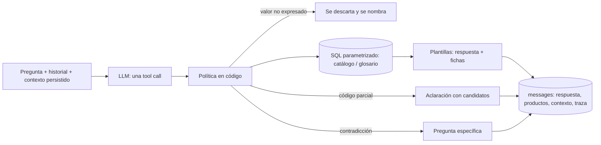
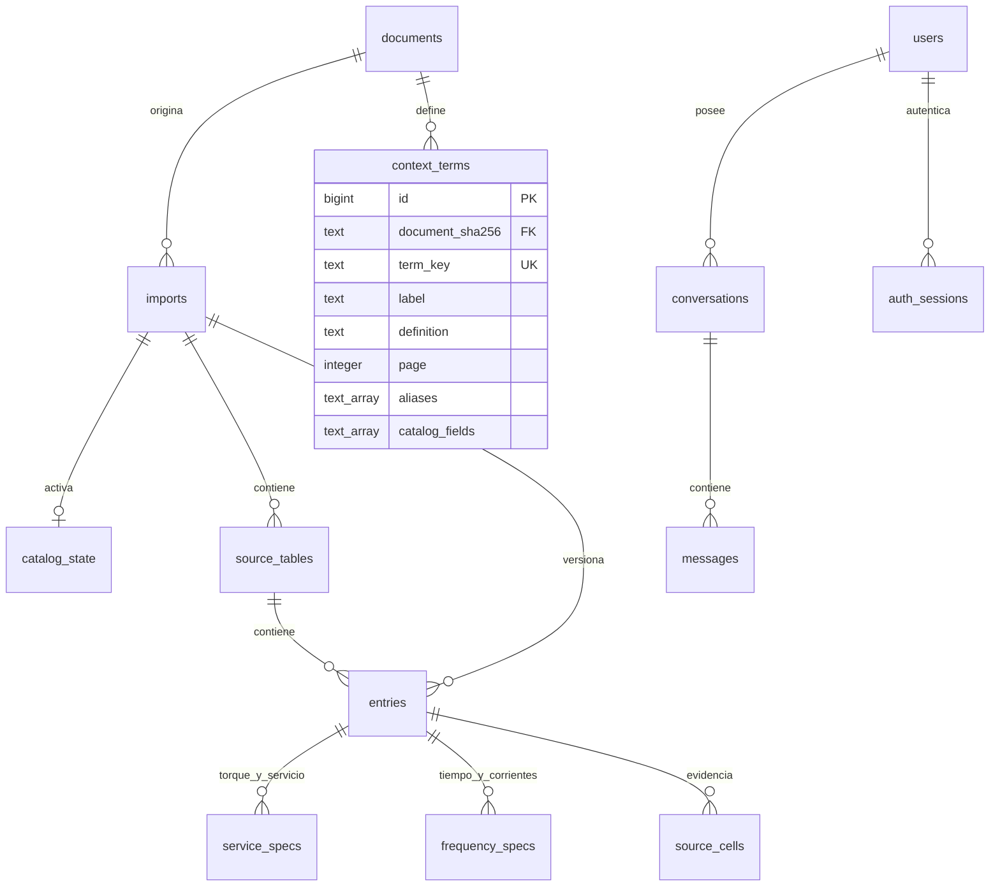

# Arquitectura y modelo entidad–relación

**Arquitectura final: A+.** Un agente LangChain hace una sola llamada LLM por turno, en la que elige una herramienta y sus argumentos. El código valida, consulta PostgreSQL con SQL parametrizado y redacta la respuesta desde las filas o desde citas literales del resumen. El LLM nunca escribe cifras. La decisión y sus alternativas están en [ADR 0001](adr/0001-arquitectura-agente.md).

[Visor HTML](architecture.html) · [ER en SVG](er-series76.svg) · esquema inspeccionado en [`https://github.com/SamuelCharry/serie76-assistant/tree/archive/pre-cleanup/reports/architecture_final/database.json`](https://github.com/SamuelCharry/serie76-assistant/tree/archive/pre-cleanup/reports/architecture_final/database.json) · aceptación con un LLM real en [`https://github.com/SamuelCharry/serie76-assistant/tree/archive/pre-cleanup/reports/agent_acceptance`](evidence/agent_acceptance.md).

## Un turno

| Paso | Archivo | Garantía |
|---|---|---|
| Decisión del LLM | `backend/conversation/agent.py` | Una sola tool call. Sin tool, con una tool desconocida o con esquema inválido, la respuesta es una aclaración segura, nunca texto libre. Una consulta de catálogo más `explain_terms` en paralelo se fusionan en una sola llamada. |
| Códigos | `policy.canonical_code` | Se canonicalizan mayúsculas, espacios y guion. No se completa nunca ni se añade `/A`. Un código que no está en la conversación ni en el contexto se rechaza. |
| Fundamentación | `policy.grounding_errors` | Cada cifra debe aparecer en la conversación. Cada valor categórico debe estar en un léxico o en un supuesto que cite palabras del usuario, y el supuesto se muestra. Lo que no cumple no se aplica y se nombra. |
| Seguimientos | `policy.merge_filters` | El LLM envía un delta (`refine`, `more`, `remove`) y el código conserva el resto. Si cambia el servicio, se elimina la tasa incompatible y se informa. |
| Contradicciones | `policy.conflicts` | DC con Hz o fases, ciclos con modulante, arranques con On/Off y ambas tasas producen una pregunta concreta. Las restricciones compatibles quedan pendientes en el contexto. |
| Consulta | `backend/catalog/repository.py` | SQL parametrizado. Un dato desconocido nunca cumple un umbral. El torque in-lb se compara con la columna publicada en in-lb, sin conversión. |
| Respuesta | `backend/conversation/rendering.py` | Unidades, servicio y frecuencia (50/60 Hz, DC sin frecuencia, no especificada), `source_NA` frente a `not_in_layout` y la página/tabla de origen. |
| Definiciones | `backend/catalog/context.py` | El texto literal del resumen con su página. Si se pregunta por una sigla que el glosario no tiene, se dice explícitamente. |
| Trazas | `messages.tool_calls` | Parámetros crudos y fusionados, validación, contexto antes/después, renderizador, modelo, latencia y tokens. Sin razonamiento. |

Los errores del proveedor devuelven 503 con `error_code` y el turno se revierte completo.

## Modelo entidad–relación

El diagrama completo, con las 99 columnas y las 12 FK reales, está en [er-series76.svg](er-series76.svg). Lo genera `scripts/render_architecture.py` desde `information_schema` y `pg_constraint`.

- Una `entry` es una aparición en una tabla y una versión, no un producto global deduplicado. `service_specs` distingue On/Off, modulante y valores compartidos. `frequency_specs` guarda la frecuencia publicada, no especificada o no aplicable (DC). Las magnitudes van en columnas NUMERIC y la evidencia variable en JSONB.
- `context_terms` **no tiene FK a `entries`**: una definición general no certifica ni cuantifica una referencia. Solo hay un glosario activo y la recarga es transaccional e idempotente por SHA del PDF.
- `messages` guarda una instantánea de productos, contexto y trazas, sin FK a la versión del catálogo. Una conversación conserva lo que se mostró aunque cambie la importación activa.
- `users`, `auth_sessions` y `auth_login_limits` pertenecen al login opcional, implementado en un bloque concurrente.
- **pgvector no está en el esquema operativo.** La tabla experimental de fragmentos solo vivió en la instancia archivada del puerto 5543.

## Coste y escala

Hay una llamada de generación por turno, sin embeddings. En la cohorte de aceptación v2, la media fue de 2.154 tokens de entrada y 36 de salida por llamada, con una latencia p50 de 2,4 s y p95 de 7,6 s (ver `https://github.com/SamuelCharry/serie76-assistant/tree/archive/pre-cleanup/reports/agent_acceptance/v2/summary.json`). Con 100 turnos, A+ hace como máximo 100 llamadas; C/E harían 200 y D, 300. Esos números son límites del flujo, no una prueba de carga. `CAPACITY` (4 turnos simultáneos) y el bloqueo por sesión de PostgreSQL acotan la concurrencia.

## Apéndice: configuraciones A–E (archivadas)

La comparación de cinco diseños quedó inconclusa: 1 escenario común de 24 y 19 fallos del proveedor. Código, protocolo y evidencia están en el tag `arch-eval-cohort-1`, en [ARCHITECTURE_EVALUATION.md](ARCHITECTURE_EVALUATION.md) y en [ANALISIS.md](evidence/architecture_comparison.md).

| ID | Diseño | LLM por turno | Destino |
|---|---|---:|---|
| A | Agente único con SQL | 1 | Evolucionó a A+ (glosario, política y trazas) |
| B | A + pgvector sobre el resumen | 1 | Descartado: con 16 definiciones, recuperar solo puede perder recall |
| C | Contexto → catálogo | 2 | Descartado: el doble de coste y propagación de supuestos |
| D | Supervisor + especialistas | 3 | Descartado: el triple de coste; enrutar no corrige la validación |
| E | Proponente + revisor | 2 | Descartado: un revisor del mismo modelo no sustituye la validación determinista |
