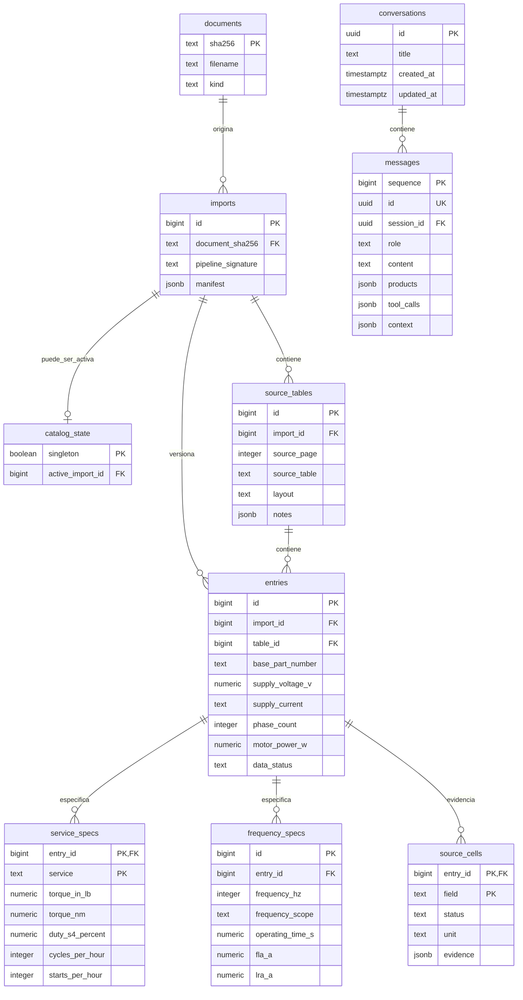
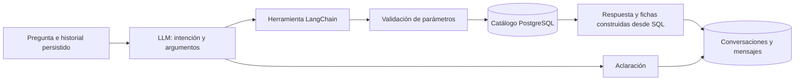
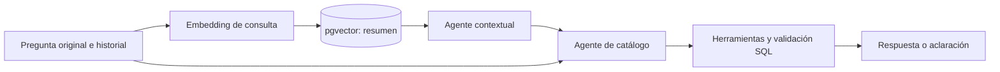
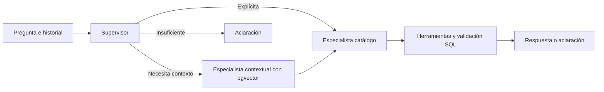
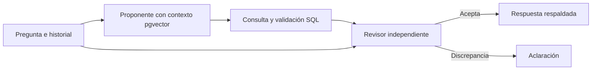

# Arquitectura y modelo entidad–relación

El catálogo relacional conserva cifras y procedencia. La recuperación vectorial experimental aporta definiciones del resumen. Los modelos interpretan lenguaje; SQL recupera las cifras y aplica restricciones. **Tener varios agentes no demuestra una mejora.**

Vista navegable, autocontenida y con el ER completo: [architecture.html](architecture.html). [ER en SVG exportable](er-series76.svg). Columnas y claves verificadas contra PostgreSQL: [database.json](../reports/architecture_eval/database.json). Comparación ejecutada: [análisis final](../reports/architecture_eval/ANALISIS.md); la salida original del runner se conserva por separado.

## Modelo actual

El diagrama resume columnas; HTML y JSON contienen todas las columnas y las definiciones reales de claves. `schema_migrations` registra versiones técnicas y no pertenece al dominio del catálogo. La unicidad de imports es **compuesta** `(document_sha256, pipeline_signature)`; pipeline_signature por sí sola no es única.

- `entry` es una aparición en una tabla/version, no un producto global deduplicado. El código completo tiene índice; la fila se identifica por tabla y posición. La FK compuesta impide cruzar tabla e importación.
- `service_specs` distingue On/Off, modulante y valores compartidos publicados. No duplica un torque compartido como dos mediciones independientes.
- `frequency_specs` conserva frecuencia especificada, no especificada y no aplicable. No supone 50/60 Hz para corriente continua.
- `source_NA` y `not_in_layout` tienen significados diferentes; los nulos no se convierten en cero. `field_status`, notas y evidencia permiten distinguirlos.
- `source_cells` conserva coordenadas y lectura OCR; JSONB almacena evidencia variable. Las magnitudes consultadas están en columnas NUMERIC.
- `catalog_state` es un selector singleton de versión activa; muchas versiones históricas pueden coexistir. Mensajes guardan productos/contexto como instantánea, sin FK a la versión del catálogo: una conversación conserva lo mostrado incluso si cambia la importación activa.

## Flujos comparados

Este es A, el flujo operativo actual. B añade recuperación de contexto antes de la única llamada LLM. No cambia el catálogo ni la API.

**C: dos especialistas secuenciales.** El primero aporta interpretación y evidencias; el segundo recibe también el original. Riesgo: propagación de supuestos. Máximo dos llamadas LLM.

**D: supervisor y especialistas.** Contexto solo cuando el supervisor lo selecciona. El paso final puede consultar catálogo, seleccionar una definición o aclarar. Máximo tres llamadas; sin recursión. Riesgo: decisiones de enrutamiento adicionales.

**E: proponente y revisor.** El revisor contrasta solicitud original, argumentos y evidencia. Puede aceptar o exigir aclaración; no reescribe cifras ni inicia reparaciones. Máximo dos llamadas. Riesgo: errores correlacionados y aclaraciones innecesarias.

## Almacenamiento experimental

Instancia separada: puerto 5543, proyecto Compose `series76-architecture-eval`, volumen propio. `architecture_eval.chunks` tiene PK `(index_signature,id)`, `metadata JSONB` y `embedding vector(768)`. Metadatos: documento/hash, página, sección, texto y tokens. No tiene FK a entries: una definición general no acredita una especificación de un producto.

La firma del índice incluye corpus, fragmentación, modelo y dimensión. Distancia coseno exacta, top-4; sin índice aproximado ni umbral inventado. `embedding_cache` evita volver a pagar por entradas idénticas. No se usa búsqueda administrada de Google ni una segunda base vectorial.

El resumen puede simplificar voltajes o describir certificaciones generales. Ningún agente puede convertir esas frases en certificaciones verificadas de una referencia. Las definiciones se muestran como extractos citados; se omiten oraciones con cifras. No se evalúa aquí una redacción libre en español ni se presenta ese límite como capacidad ya resuelta.

La arquitectura final se elige por resultados, no por número de agentes. Fuentes: [patrones de agentes](https://www.anthropic.com/research/building-effective-agents), [MAST](https://arxiv.org/abs/2503.13657), [pgvector](https://github.com/pgvector/pgvector), [embeddings Gemini](https://aistudio.google.com/docs/embeddings).

## Qué cambia al aumentar la demanda

Para cien turnos, A/B requieren como máximo cien llamadas de generación; C/E, doscientas; D, trescientas, además de embeddings cuando corresponda. Son límites del flujo, no mediciones de carga. Los roles comparten proveedor y cuota: añadir agentes no elimina un 429/503 ni multiplica el presupuesto disponible. La instancia experimental y el controlador secuencial no acreditan cien usuarios concurrentes. Para producción harían falta límites de concurrencia y medición del proveedor con la arquitectura elegida; este ensayo no autoriza ampliar infraestructura.
