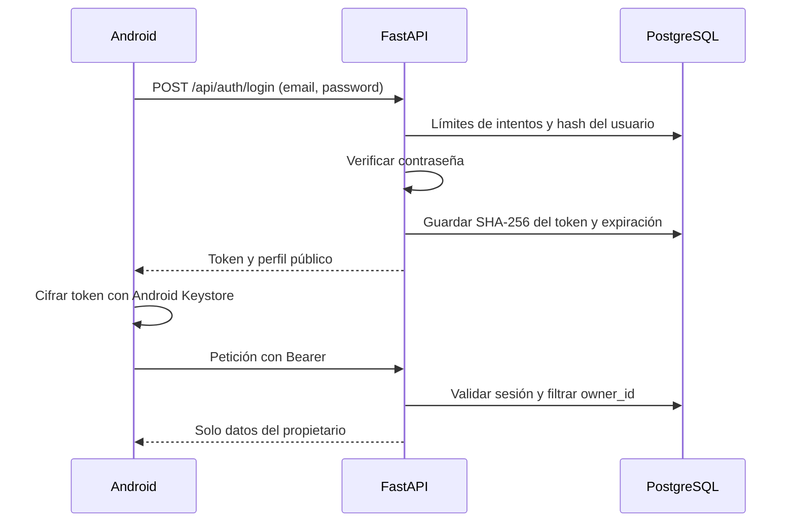

# Login y aislamiento de conversaciones

## Alcance y decisiones

Autenticación email/password con cuentas precargadas y sesiones opacas revocables. FastAPI obtiene la identidad del token; PostgreSQL almacena usuarios, hashes de contraseñas, sesiones y propietarios de conversaciones. Android conserva el diseño aprobado y añade login, identidad real en el perfil y Sign out. Sin Firebase, registro público, OAuth, recuperación de contraseña ni voz.

Se eligió token opaco sobre JWT porque esta aplicación ya depende de PostgreSQL y necesita revocación inmediata al salir; evita otra clave de firma y una lista adicional de revocaciones. Cada petición requiere una consulta indexada de sesión. No se afirma que esta solución haya sido validada para un despliegue masivo.



## Preparación reproducible

Desde la raíz, con `.env` local existente y Docker activo:

```powershell
docker compose up --build -d
```

La migración aditiva `003_auth.sql` conserva los datos existentes. El runner ordena por nombre completo y verifica checksums; no editar migraciones ya aplicadas ni borrar volúmenes. La migración de contexto desarrollada en paralelo tiene otro nombre completo y no forma parte del cambio de autenticación.

El arranque provisiona cuentas p?blicas **SOLO DE PRUEBA** para el evaluador;
[credenciales y DEMO_USERS_JSON en README](../README.md#postgresql-y-api-t?cnica).
El comando `python -m backend.auth.cli ensure-demo-users` tambi?n puede ejecutarse
manualmente. Omite identidades existentes y nunca restablece contrase?as.
`DEMO_USERS_JSON=[]` desactiva nuevas cuentas de prueba; no elimina las existentes.

Para aprovisionamiento privado expl?cito, `python -m backend.auth.cli seed-demo`
conserva la generaci?n aleatoria y el archivo privado ignorado por Git. No copiar
credenciales privadas a reportes, issues o repositorios.

Cuenta propia, desde CLI local interactiva:

```powershell
./.venv-chat/Scripts/python.exe -m backend.auth.cli create-user --email usuario@example.com --name "Nombre"
```

Solicita contraseña y confirmación sin mostrarlas. Requiere12–1024 caracteres. La API de login normaliza correo con trim/lower; las contraseñas no se recortan ni normalizan. No existe registro público.

## Contrato HTTP

| Ruta | Autorización | Resultado |
|---|---|---|
| POST /api/auth/login | Email/password JSON | access_token, token_type=bearer, expires_at, user{id,email,name} |
| GET /api/auth/me | Bearer válido | Perfil público actual |
| POST /api/auth/logout | Bearer válido | 204; revoca esa sesión |
| GET /api/sessions | Bearer válido | Página de conversaciones del usuario |
| GET /api/sessions/{id}/messages | Bearer y propiedad | Historial paginado |
| POST /api/conversation | Bearer y propiedad si session_id existe | Contrato público anterior, propietario tomado del token |
| GET /api/messages/{id}/debug | Bearer, propiedad y DEV_DEBUG=true | Trazas del propietario; sigue excluido de release Android |
| Rutas /api/actuators | Bearer válido | Catálogo compartido de solo lectura |
| GET /health y /ready | Públicas | Salud operativa, sin historial ni credenciales |

Enviar `Authorization: Bearer <access_token>` en las peticiones protegidas. Identificador ajeno, inexistente o histórico sin dueño:404; la continuación se rechaza antes de invocar el modelo. Token ausente, inválido, expirado o usuario inactivo:401 con WWW-Authenticate. Login incorrecto/desconocido/inactivo comparte el mismo error. Saturación o límite de intentos:429 y Retry-After; fallo de base de datos:503 sin detalles privados. Respuestas /api llevan Cache-Control:no-store. Los errores de validación no reflejan el cuerpo de entrada.

## Seguridad y límites

- PBKDF2-HMAC-SHA256 con600000 iteraciones y sal aleatoria de128bits por contraseña; comparación constante. Formato versionado, sin dependencia nueva. Es una alternativa documentada a Argon2id, no una afirmación de superioridad: [OWASP Password Storage](https://cheatsheetseries.owasp.org/cheatsheets/Password_Storage_Cheat_Sheet.html).
- Token aleatorio de256bits, del que PostgreSQL solo guarda SHA-256. Caducidad absoluta12h, sin refresh automático; al expirar se vuelve a pedir login. Salir revoca el token actual, no todos los dispositivos. Usuario inactivo invalida todas sus sesiones en cada consulta.
- Ventana persistida de5min: máximo10 intentos por correo y30 por dirección cliente; hashes en las claves del limitador. Máximo2 verificaciones costosas simultáneas por proceso. No confiar en X-Forwarded-For arbitrario. Antes de exposición pública, configurar límites de conexión/cuerpo y proxy de confianza; detrás de un proxy sin configuración todos comparten su IP.
- SQL parametrizado y predicado de propietario antes de paginar y en cada lectura, contexto, continuación y traza. Los helpers internos con owner_id=None sirven únicamente para mantenimiento explícito del historial antiguo; ninguna ruta HTTP pasa ese valor.
- Android cifra el token con AES-GCM y una clave no exportable de Android Keystore; no guarda la contraseña ni serializa el campo en estado guardado. Backups deshabilitados y FLAG_SECURE protege capturas/recientes. La instrumentación puede retirar ese flag solo en su instancia de prueba para evidencias sin contraseñas. [Android Keystore](https://developer.android.com/privacy-and-security/keystore).
- Release requiere HTTPS. HTTP solo para debug local con loopback/ADB; no usarlo para cuentas reales por redes no confiables. No hay logs de cuerpos, contraseñas ni Authorization. Redirects HTTP no se siguen con el cliente autenticado.

## Historial anterior y estado Android

Las conversaciones anteriores a login mantienen owner_id=NULL. No se borran ni aparecen en ninguna cuenta. Asignación puntual, después de revisar propietario y UUID:

```powershell
./.venv-chat/Scripts/python.exe -m backend.auth.cli assign-legacy --session UUID --email usuario@example.com --confirm
```

Solo acepta una conversación aún sin dueño y una cuenta activa; no reasigna conversaciones de otro usuario. No se ejecutó transferencia automática en esta entrega.

La ficha local anterior permanece como preferencia histórica pero ya no determina la identidad. El perfil autenticado toma nombre/correo de /me y no ofrece edición local de identidad; conserva Light/Dark/System. Para cambiar de cuenta: Sign out y login nuevo.

Cada sesión autenticada posee un ViewModelStore de chat independiente. Salida o401 del token actual cancelan y destruyen sus ViewModels; una respuesta401 tardía de otro token no puede cerrar una cuenta nueva. El cliente verifica /me al arrancar antes de mostrar historial; ante fallo de red ofrece reintento sin revelar datos de una identidad no validada. Si logout falla por red, conserva la cuenta y permite reintentar la revocación, sin fingir que el servidor cerró sesión.

Rotación conserva el estado en memoria mediante AuthViewModel. Después de muerte de proceso se valida el token cifrado y el usuario reabre el historial desde el servidor; no se restaura el borrador ni una conversación abierta desde SavedStateHandle compartido. Una petición ya autorizada puede terminar en el servidor después de cerrar sesión; su resultado sigue perteneciendo al usuario original.

## Verificación y pendientes

Guía de evidencia: `reports/mobile/auth-v7/README.md`. Pruebas de aislamiento usan dos usuarios, acceso directo por UUID, listado, contexto, continuación y trazas. Las pruebas HTTP reales y las nativas de reapertura usan conversaciones marcadas de verificación; no prueban la interpretación del LLM. No se hicieron llamadas pagadas para implementar login.

La aceptación integral con OpenRouter, medición en teléfono físico, despliegue HTTPS real y voz siguen pendientes. No cerrar requisitos de calidad del modelo con estas pruebas.
