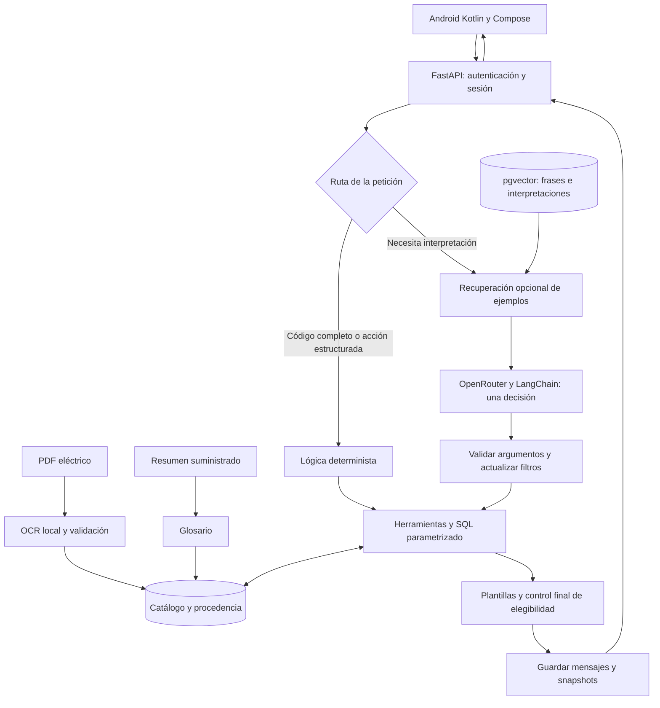

# Arquitectura

La app habla con una API y la API consulta el catálogo en PostgreSQL. Cuando la pregunta necesita interpretación, el backend llama al modelo por OpenRouter. El PDF se procesa antes, durante la ingesta; no se vuelve a leer en cada conversación.

Las cajas muestran pasos del proceso, no servidores separados. El enrutamiento, las herramientas y la construcción de respuestas viven en el mismo backend FastAPI. El catálogo, el glosario, los vectores y el historial comparten PostgreSQL 17.

## Una consulta de principio a fin

Por ejemplo, al preguntar la potencia de `761A00-11300000/A`, Android envía el texto y la sesión. FastAPI comprueba quién está preguntando. Como el código y el campo están claros, el backend consulta SQL directamente y devuelve **15 W** en una respuesta construida por código. Después guarda el turno para poder retomarlo.

Una petición abierta de selección sí puede necesitar el modelo. Este elige una herramienta y propone argumentos; el código los comprueba, conserva los requisitos anteriores y consulta SQL. Antes de devolver los productos se revisa que cumplan los requisitos representados.

**Una decisión completada por turno interpretado** no significa necesariamente una petición de red: puede haber embeddings y reintentos de transporte. Las rutas deterministas no llaman chat ni embeddings. No hay un segundo agente revisor.

## Decisiones y coste

Elegí acotar la tarea del modelo y mantener las cifras en SQL. Esto reduce llamadas, pero deja más reglas y plantillas por mantener. Los motivos y las alternativas descartadas están en [Decisiones](https://github.com/SamuelCharry/serie76-assistant/wiki/Decisiones).

**Escalabilidad pendiente:** hay un límite de cuatro solicitudes de conversación simultáneas por proceso. La transacción permanece abierta durante el turno, incluida la espera al proveedor. No hay evidencia a 100× tráfico; habría que medir contención, conexiones, cuotas distribuidas y coste.

Código: [API y transacción](https://github.com/SamuelCharry/serie76-assistant/blob/main/backend/conversation/api.py) · [Agente](https://github.com/SamuelCharry/serie76-assistant/blob/main/backend/conversation/agent.py) · [Guarda final](https://github.com/SamuelCharry/serie76-assistant/blob/main/backend/conversation/response_integrity.py)
