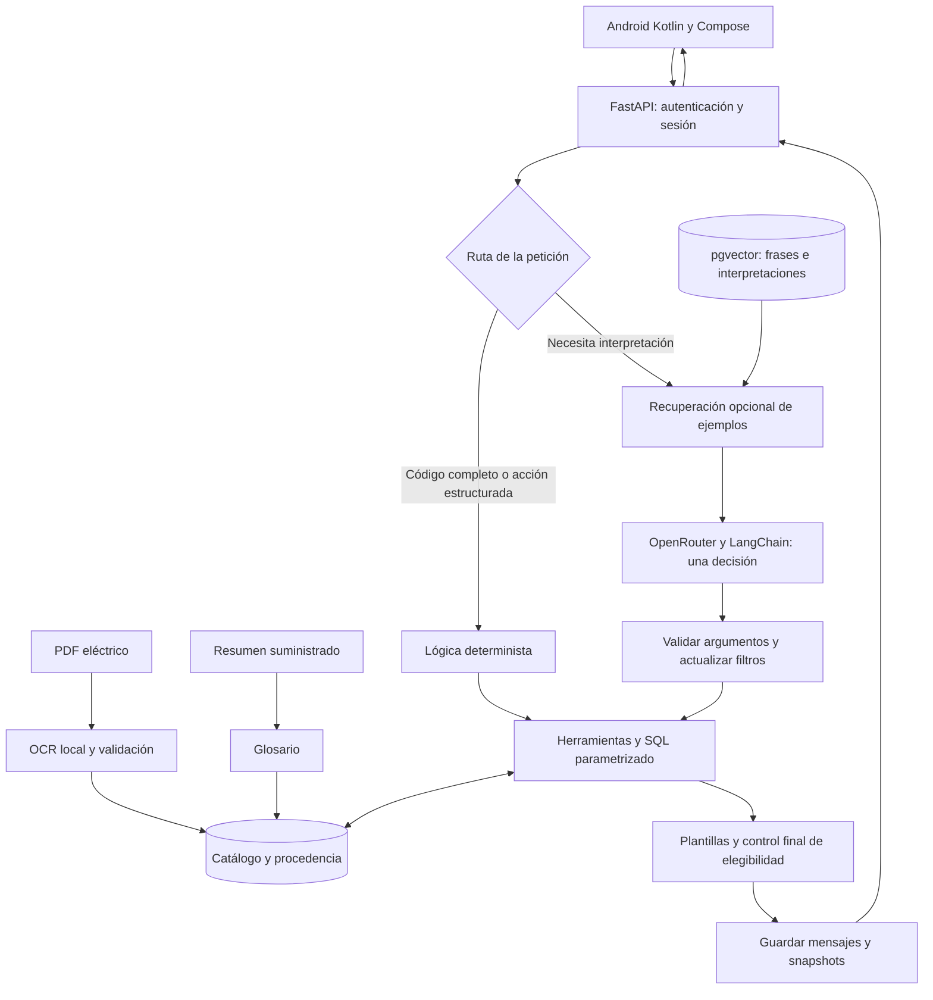

# Arquitectura

Tres piezas en ejecución: **Android**, **FastAPI** y **PostgreSQL 17 con pgvector**. OpenRouter es el proveedor externo de modelos. La ingesta OCR prepara el catálogo antes de atender consultas.

Son responsabilidades, no microservicios: enrutamiento, recuperación, herramientas y renderizado viven en el mismo backend. Catálogo, glosario, vectores e historial comparten PostgreSQL.

| Componente | Responsabilidad |
|---|---|
| Android | Capturar texto, mostrar preguntas/tarjetas, conservar sesión y presentar errores |
| FastAPI | Autenticar, comprobar propietario, limitar capacidad y guardar el turno |
| LLM | Elegir herramienta y proponer argumentos; no genera SQL ni respuesta final |
| Código | Validar, conservar/corregir filtros, resolver referencias y comprobar elegibilidad |
| SQL | Seleccionar filas y devolver cifras publicadas con su ámbito |
| Plantillas | Presentar valores, unidades, N/A, comparaciones y aclaraciones |

**Una decisión completada por turno interpretado** no significa necesariamente una petición de red: puede haber embeddings y reintentos de transporte. Las rutas deterministas no llaman chat ni embeddings. No hay un segundo agente revisor.

## Decisiones y coste

Un agente reduce llamadas y hace visible el flujo, a cambio de mantener reglas y plantillas. El estado se actualiza mediante cambios de filtros; el experimento de estado completo no fue adoptado. pgvector recupera ejemplos de interpretación y solo completa campos no resueltos: no es autoridad numérica.

**Escalabilidad pendiente:** hay un límite de cuatro solicitudes de conversación simultáneas por proceso. La transacción permanece abierta durante el turno, incluida la espera al proveedor. No hay evidencia a 100× tráfico; habría que medir contención, conexiones, cuotas distribuidas y coste.

Código: [API y transacción](https://github.com/SamuelCharry/serie76-assistant/blob/main/backend/conversation/api.py) · [Agente](https://github.com/SamuelCharry/serie76-assistant/blob/main/backend/conversation/agent.py) · [Guarda final](https://github.com/SamuelCharry/serie76-assistant/blob/main/backend/conversation/response_integrity.py)
