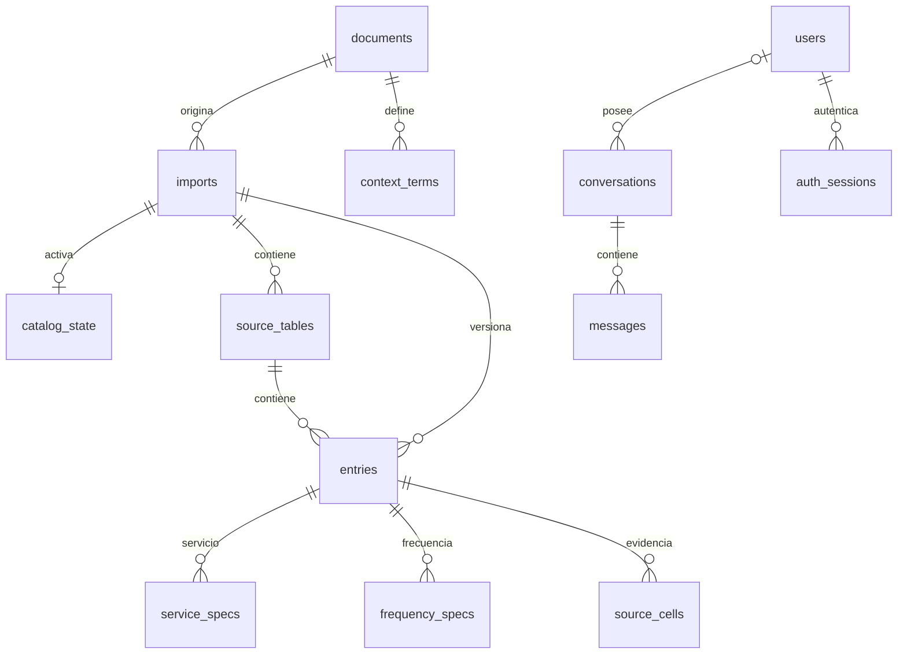

# Modelo entidad-relación

Vista lógica basada en las migraciones entregadas. Se muestran relaciones y grupos principales; no es un inventario de cada columna o índice.

| Grupo | Por qué existe |
|---|---|
| `documents`, `imports`, `catalog_state` | Fuente, versión y catálogo activo |
| `source_tables`, `entries`, `source_cells` | Ubicación y evidencia de cada entrada |
| `service_specs`, `frequency_specs` | Evitar mezclar torque por servicio o corriente/tiempo por frecuencia |
| `context_terms` | Glosario separado de cifras técnicas |
| `users`, `auth_sessions`, `conversations`, `messages` | Autenticación, propiedad e historial |

**Tablas sin relaciones FK en este diagrama:** `auth_login_limits` limita intentos de login; `example_bank`, `concept_anchor` y `example_dataset` guardan vectores, interpretaciones y manifiestos. Sus identificadores de modelo/versión no implican una FK declarada. El registro de migraciones es infraestructura aparte.

`owner_id` admite null por historial anterior al login, que queda en cuarentena. Los mensajes guardan snapshots sin FK al catálogo: una nueva importación no cambia lo que el usuario vio. Una entrada pertenece a una importación/tabla; no es una pieza global deduplicada.

[Migraciones SQL](https://github.com/SamuelCharry/serie76-assistant/tree/main/backend/catalog/migrations) · [Consultas y ejemplos](https://github.com/SamuelCharry/serie76-assistant/blob/main/docs/wiki/es/database.md)
