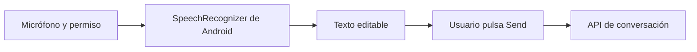

# Mensajes de voz

La voz es una entrada opcional al editor. Android transcribe; el usuario revisa o corrige y pulsa **Send**. La app no envía audio al backend de este proyecto ni manda automáticamente el texto reconocido.

Se prefiere reconocimiento on-device en API 31+ cuando está disponible. El servicio alternativo recibe una preferencia offline, pero puede usar red. Sin servicio disponible, la app informa que no puede reconocer voz.

## Evidencia disponible

- **Implementado:** permiso, resultados parciales/finales, errores y cancelación del reconocedor.
- **Verificado con entradas controladas:** el texto llega al editor, no se envía solo y se ignoran callbacks tardíos tras cancelar.
- **Confirmado manualmente por el autor (2026-11-06):** el micrófono y el reconocimiento real funcionaron en el emulador. Esta confirmación no añade una ejecución automatizada ni una grabación al informe P2-D.
- **Pendiente:** validación en dispositivo físico y cobertura completa de permisos, cancelación y errores del servicio.

La prueba manual acredita ese recorrido concreto. No establece funcionamiento offline, precisión en todos los idiomas ni comportamiento en teléfonos físicos.

[Reconocedor](https://github.com/SamuelCharry/serie76-assistant/blob/main/mobile/android/app/src/main/java/com/serie76/assistant/ui/AndroidVoiceRecognizer.kt) · [Evidencia P2-D](https://github.com/SamuelCharry/serie76-assistant/blob/main/reports/submission/P2-D.md)
