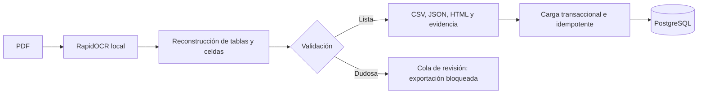

# Pipeline de ingesta

La única autoridad para cifras es `series_76_electric_data.pdf`. El resumen suministrado aporta definiciones y contexto. La extracción de producción no lee las transcripciones de evaluación.

Se preservan códigos completos, unidades, servicio, frecuencia, notas y procedencia. `source_NA` significa N/A explícito; `not_in_layout`, campo no publicado en ese diseño. Ninguno equivale a cero. Las celdas compartidas conservan su ámbito.

El OCR se ejecuta localmente; la primera preparación puede descargar pesos públicos. La carga valida manifiesto y hashes antes de activar una importación. El inicio normal usa el catálogo validado incluido, sin repetir OCR.

**Evidencia:** 941/941 controles primarios: 68 códigos, 869 valores numéricos y 4 N/A; además 5/5 marcas de nota y 272/272 controles de contexto. La prueba de 100 páginas repite cuatro páginas: mide ese volumen, no precisión en diseños nuevos.

[Script](https://github.com/SamuelCharry/serie76-assistant/blob/main/scripts/ingest.py) · [Datos entregados](https://github.com/SamuelCharry/serie76-assistant/tree/main/data/extracted/series76) · [Evidencia OCR](https://github.com/SamuelCharry/serie76-assistant/blob/main/docs/evidence/ocr.md)
