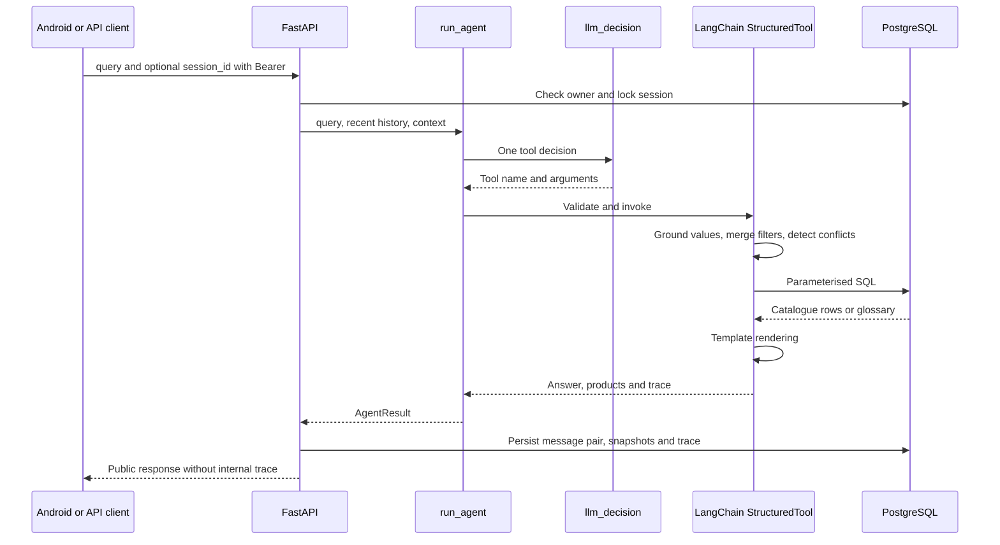

# Agent

[Wiki](index.md) · [English](../en/agent.md) · [Español](../es/agent.md)

How one LangChain decision becomes a validated, reproducible technical answer.

Answers, fixed messages and suggested replies are English-only by product decision; input may be Spanish. The LLM interprets one tool decision per turn and never writes answer text, tables or replies.



## Typed tools

Provider-facing `args_schema` values are compact JSON Schema dictionaries. Code normalises and validates every decision against strict Pydantic models before execution. The LLM supplies intent/arguments, never SQL or final technical prose.

The provider uses `bounds=[{"field":"min_torque_in_lb","op":"gt","value":1000}]` for numeric limits and omits unknown properties instead of sending null. Code expands these into the canonical value/op fields described below; legacy internal arguments and the direct search API remain accepted. Focus uses field strings plus optional scalar service/frequency qualifiers. All four tools are still bound in one request and only one model decision runs per turn. [Wire contract](../../../backend/conversation/tool_wire.py) and [offline schema budget test](../../../tests/test_tool_schema_budget.py) limit cumulative structural complexity; provider probing remains a separate coordinator check. The table below describes the canonical internal arguments after expansion.

| Tool | Input schema |
|---|---|
| `get_actuator` | `part_numbers`: 1..4 strings, max 40 chars each; `focus`: list of `{field,service?,frequency_hz?}`; fields overview/motor_power/torque/operating_time/fla/lra/duty/rates/certification; omitted focus reuses context; `explain_terms`: up to 3 glossary keys, default [] |
| `search_actuators` | Optional technical filters below; `limit`: 1..20 default 5; `refine=false`, `more=false`, `remove`: up to 8 filter names; `assumptions`: up to 4 `{field,user_phrase}` (phrase 2..80 chars); `explain_terms`: up to 3 keys |
| `explain_terms` | `term_keys`: 1..3 keys constrained to the loaded glossary |
| `ask_clarification` | `field`: part_number/service/frequency/supply/requirements/which_product/term_not_in_summary/unsupported/cancel/decline; `cancel_previous=false` |

Filters: `enclosure` weatherproof/explosionproof; `supply_current` accepts `AC`, `DC`, or literal `AC/DC`; `phase_count` 1/3; `service` on_off/modulating; `frequency_hz` 50/60; positive `supply_voltage_v`; nonnegative `min_torque_nm`, `min_torque_in_lb`, `min_duty_s4_percent` (up to 100), `min_cycles_per_hour`, `min_starts_per_hour`, `max_operating_time_s`, `max_fla_a`, `max_lra_a`, `max_motor_power_w`; `csa_required=false`. Decimal magnitudes have an upper bound of 1e12 and integer rates 2147483647; null means no new constraint. Public search pagination differs: see [API](api.md).

## Deterministic policy

For `DC + 60 Hz`, ask which requirement is intended; retain compatible constraints. A follow-up `now 220 V` uses `refine=true` and only the voltage delta; `merge_filters` carries the rest. `remove` drops named constraints; `more` advances pagination. Changing service drops the incompatible old cycles/starts constraint with an explanation.

Codes are canonicalised for case/spaces/missing hyphen, never completed with `/A` or a guessed suffix. Partial codes receive prefix candidates; well-formed absent codes return not found. Codes must be in the conversation or persisted context. Unstated filters are dropped and named; assumptions must quote actual user wording and are shown. Numeric grounding checks occurrence of a number in the text, not complete semantic correctness; a wrong field assignment is still possible.

SQL compares published columns, with AND filters, service/frequency scope and explicit absence states. Unknown values cannot satisfy thresholds. Templates render the resulting rows and literal glossary quotes; no second model writes the answer. One completed model decision per turn; failed 503, timeout and connection attempts may retry once per model, with an optional fallback model and a shared 60-second deadline. No 4xx is retried. A catalogue call plus an `explain_terms` call in the same response may be merged into one execution; other invalid call shapes produce a clarification.

## Runtime controls and tracing

`AGENT_MAX_CALLS_PER_HOUR=120` counts attempted model calls in a rolling hour per process, including failures. Restart resets it; more workers multiply it. It is not a billing cap. `OPENROUTER_REQUIRE_PARAMETERS=true` adds `provider.require_parameters` only for host `openrouter.ai`; this filters routing compatibility, not funds. [Operations](operations.md) lists defaults.

LangSmith is off by default and requires both tracing=true and a key. Enabling it sends prompts, user text, tool inputs/results and catalogue rows to the configured LangSmith service; the parent trace also records query/context and answer metadata. Stored local traces include raw/merged parameters, validation, context before/after, renderer, model/latency/usage. Public history omits traces; the developer endpoint is owner-scoped and opt-in.

## Real trace excerpt

[Persisted SQL projection](database.md):

```json
{
  "role": "assistant",
  "tool": "get_actuator",
  "part_numbers": [
    "761A00-11300000/A"
  ],
  "validation": [
    "ok"
  ],
  "renderer": "get_actuator"
}
```

This trace establishes stored tool execution, not a real-provider acceptance result. [Tests and cohort evidence](testing.md) keep those claims separate.

## Where in the code

- [backend/conversation/agent.py](../../../backend/conversation/agent.py#L135)
- [backend/conversation/agent.py](../../../backend/conversation/agent.py#L521)
- [backend/conversation/policy.py](../../../backend/conversation/policy.py#L85)
- [backend/conversation/rendering.py](../../../backend/conversation/rendering.py#L1)

## T7 conversation policy

### Focus and thresholds

`focus=[{"field":"torque","service":"on_off"},{"field":"operating_time","frequency_hz":60}]` renders only On/Off torque and the 60 Hz operating time, including focused product measurements. Focus is persisted for follow-ups. `overview` requests all fields. Legacy scalar focus is accepted for existing clients.

Magnitude filters accept `{value,op}` with `gt|gte|lt|lte`. “More than”, “over”, “mayor a”, “más de” are strict gt; “below”/“menos de” are lt; “at least”/“al menos” are gte; “up to”/“hasta” are lte. SQL operators come from an allowlist; the original number is not adjusted. Legacy scalar bounds remain inclusive. Summaries print the actual operator.

### Ranking and result size

`sort_by` is ordered: fastest (operating time ascending), lowest_power (motor power ascending), highest_torque or lowest_current (FLA ascending). Requested service/frequency scopes are retained; without frequency, ranking uses the lowest published value and explicitly labels that choice. Unknown values sort last; explicit N/A entries are excluded from recommendations. Motor power is a proxy for the stated preference, not total energy use. Sorted results show the top 3 and ranking fields plus one narrowing question.

Without sorting, more than 4 matches show the SQL count and one question; no products are listed. The split attribute maximises entropy across current SQL supply/enclosure/phase facets. Its options become suggested messages. Two to four matches get a brief list with a distinguishing value and comparison pairs; one match gets a focused answer. Zero matches never ask for service/frequency: diagnostics remove each numeric bound in turn and calculate SQL min/max and all tied models under the remaining constraints. An empty remaining combination is reported explicitly; no invented nearest product is substituted.

### Questions, submissions, cancellation and suggestions

Questions are `interaction={kind:"question",questions:[{id,prompt,options:[{value,label}]}]}`. All required service/frequency fields are collected together in priority order; every option is a published SQL facet under the active candidate constraints. A broad request asks for service, voltage and current type. A search with more than four matches may ask one additional SQL split; without a filterable split it reports the count without inventing options.

`answers` and `remove_filters` are additive request fields, outside the LLM schemas. Submitted strings must exactly match a pending field and option; removals must name active filters, otherwise HTTP 422 `invalid_answers`/`invalid_filter`. Code validates and merges them, re-runs SQL and stores the readable `query` without a model call or budget reservation. Active filters are persisted removable tags. A decline or a repeated unresolved question shows up to three candidates with a note identifying the open requirements. Cancel clears filters, focus and pending state.

Suggestions are optional (0?3), with `suggested_replies` retained as an identical deprecated alias. Questions have no suggestions. A search returning two to four matches offers one comparison pair with the most differing published fields (ties retain SQL order); impossible searches offer SQL-derived relaxations. Single facts, definitions, comparisons, greetings, cancellations and unsupported requests have none. Generic navigation and Cancel are never suggestions.

Two-model comparisons use `layout:"table"`, a code-computed summary, explicit preference assumptions, differing `rows`, identical `hidden_rows`, and integer `better` indices or null. More torque/cycles is preferred; less time/current/motor power is preferred. This is an unweighted field count, not an overall suitability rating. Three or four models use `layout:"cards"`, no winners, and four key fields: torque, operating time, FLA, motor power, retaining explicit service/frequency scopes. A one-sentence `lead` accompanies cards/comparisons; `answer` remains the complete plain-text response for API clients. Migration 005 adds lead, interaction, suggestions and active-filter snapshots; historical rows default to null/empty lists.

Greeting-only input is handled by code with the authenticated user's first name (or `Hello.`), no inference and no suggestions. Ranges support two bounds on one field; decimal comma 1,5 means 1.5. Alternative voltages produce a SQL-backed question. "Same performance" after changing service retains numeric limits and states that assumption. Price/weighted-price selection and ordering explicitly report catalogue/application limits; conflicting label/invoice codes cannot establish the installed identity. Combined catalogue/glossary requests render supported parts and explicitly identify absent terms such as IP67.

### Transport resilience

LangChain `.with_retry(stop_after_attempt=2)` retries only 503, timeout and connection failures; `.with_fallbacks` is enabled only by `OPENROUTER_FALLBACK_MODEL`, on the same endpoint. The SDK's own retries remain disabled. Each actual attempt reserves the process-local cap and is recorded in trace metadata; failed-turn exceptions retain safe attempt metadata without persisting half a conversation.

`AGENT_TURN_DEADLINE_S=60` is shared by primary retries and fallback. Each attempt has `min(AGENT_TIMEOUT_S, remaining)` timeout; when less than `AGENT_RETRY_MIN_REMAINING_S=10` remains, the attempt is recorded as `deadline_skipped` and does not reserve a call. This default stays below Android's 70-second read/75-second call timeout. Uvicorn keep-alive is 75 seconds. These transport behaviors are tested against local fakes, including a delayed local HTTP server; live provider resilience remains unverified.

Impossibility extrema retain their published scope: when service is unknown, On/Off and Modulating bounds are calculated and labelled separately; a known service reports only its own bound. Operating time, FLA and LRA extrema are separated by published frequency (or explicitly unspecified/not applicable); a requested frequency restricts that diagnostic. SQL-verified ties and shared-as-published notes are preserved.

## Known limits

The lexical policy and numeric grounding remain bounded: occurrence of a number does not prove correct semantic assignment. T6 focus, strict thresholds, ranking, cancellation and comparison are verified offline with scripted decisions and SQL; the coordinator’s real-LLM v5 check is pending. Only 12 recent messages (truncated to 2000 chars each) plus persisted context are supplied. OpenRouter and full Android-to-real-LLM acceptance remain pending.

Provider focus is a flat list of field names, with optional focus_service for torque and focus_frequency_hz for operating time/FLA/LRA. Code expands these into the persisted per-field canonical focus. Combined explain_terms uses comma-separated glossary keys; assumptions maps filter names to verbatim user phrases. Bounds remain field/op/value records. Numeric ranges and list/string limits are checked by canonical Pydantic validation, not advertised to the provider. Run the [schema preflight](operations.md#tool-schema-preflight-before-any-cohort) before any paid cohort.
