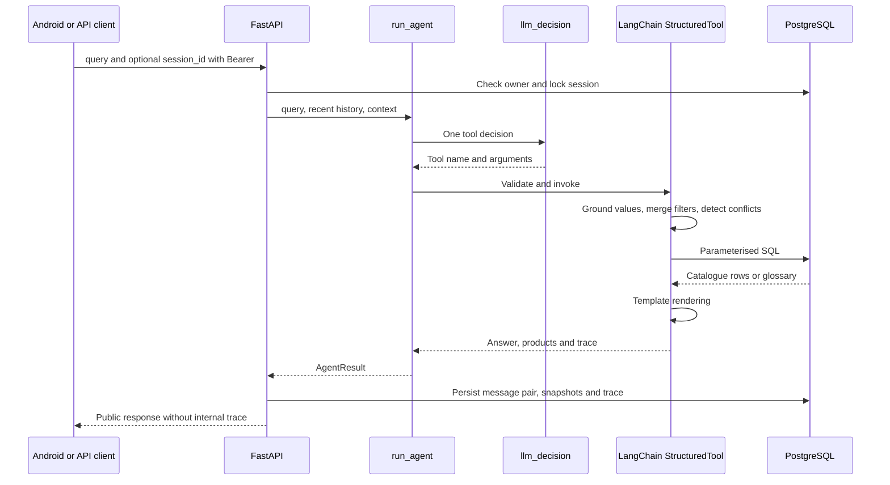

# Agent

[Wiki](index.md) · [English](../en/agent.md) · [Español](../es/agent.md)

How one LangChain decision becomes a validated, reproducible technical answer.

Answers, fixed messages and suggested replies are English-only by product decision; input may be Spanish. The LLM interprets one tool decision per turn and never writes answer text, tables or replies.



## Typed tools

All `args_schema` models forbid extra fields. The LLM supplies intent/arguments, never SQL or final technical prose.

| Tool | Input schema |
|---|---|
| `get_actuator` | `part_numbers`: 1..4 strings, max 40 chars each; `focus`: list of `{field,service?,frequency_hz?}`; fields overview/motor_power/torque/operating_time/fla/lra/duty/rates/certification; omitted focus reuses context; `explain_terms`: up to 3 glossary keys, default [] |
| `search_actuators` | Optional technical filters below; `limit`: 1..20 default 5; `refine=false`, `more=false`, `remove`: up to 8 filter names; `assumptions`: up to 4 `{field,user_phrase}` (phrase 2..80 chars); `explain_terms`: up to 3 keys |
| `explain_terms` | `term_keys`: 1..3 keys constrained to the loaded glossary |
| `ask_clarification` | `field`: part_number/service/frequency/supply/requirements/which_product/term_not_in_summary/unsupported/cancel/decline; `cancel_previous=false` |

Filters: `enclosure` weatherproof/explosionproof; `supply_current` accepts `AC`, `DC`, or literal `AC/DC`; `phase_count` 1/3; `service` on_off/modulating; `frequency_hz` 50/60; positive `supply_voltage_v`; nonnegative `min_torque_nm`, `min_torque_in_lb`, `min_duty_s4_percent` (up to 100), `min_cycles_per_hour`, `min_starts_per_hour`, `max_operating_time_s`, `max_fla_a`, `max_lra_a`, `max_motor_power_w`; `csa_required=false`. Decimal magnitudes have an upper bound of 1e12 and integer rates 2147483647; null means no new constraint. Public search pagination differs: see [API](api.md).

## Deterministic policy

For `DC + 60 Hz`, ask which requirement is intended; retain compatible constraints. A follow-up `now 220 V` uses `refine=true` and only the voltage delta; `merge_filters` carries the rest. `remove` drops named constraints; `more` advances pagination. Changing service drops the incompatible old cycles/starts constraint with an explanation.

Codes are canonicalised for case/spaces/missing hyphen, never completed with `/A` or a guessed suffix. Partial codes receive prefix candidates; well-formed absent codes return not found. Codes must be in the conversation or persisted context. Unstated filters are dropped and named; assumptions must quote actual user wording and are shown. Numeric grounding checks occurrence of a number in the text, not complete semantic correctness; a wrong field assignment is still possible.

SQL compares published columns, with AND filters, service/frequency scope and explicit absence states. Unknown values cannot satisfy thresholds. Templates render the resulting rows and literal glossary quotes; no second model writes the answer. One provider invocation per turn, no retries. A catalogue call plus an `explain_terms` call in the same response may be merged into one execution; other invalid call shapes produce a clarification.

## Runtime controls and tracing

`AGENT_MAX_CALLS_PER_HOUR=120` counts attempted model calls in a rolling hour per process, including failures. Restart resets it; more workers multiply it. It is not a billing cap. `OPENROUTER_REQUIRE_PARAMETERS=true` adds `provider.require_parameters` only for host `openrouter.ai`; this filters routing compatibility, not funds. [Operations](operations.md) lists defaults.

LangSmith is off by default and requires both tracing=true and a key. Enabling it sends prompts, user text, tool inputs/results and catalogue rows to the configured LangSmith service; the parent trace also records query/context and answer metadata. Stored local traces include raw/merged parameters, validation, context before/after, renderer, model/latency/usage. Public history omits traces; the developer endpoint is owner-scoped and opt-in.

## Real trace excerpt

[Persisted SQL projection](database.md):

```json
{
  "role": "assistant",
  "tool": "get_actuator",
  "part_numbers": [
    "761A00-11300000/A"
  ],
  "validation": [
    "ok"
  ],
  "renderer": "get_actuator"
}
```

This trace establishes stored tool execution, not a real-provider acceptance result. [Tests and cohort evidence](testing.md) keep those claims separate.

## Where in the code

- [backend/conversation/agent.py](../../../backend/conversation/agent.py#L135)
- [backend/conversation/agent.py](../../../backend/conversation/agent.py#L521)
- [backend/conversation/policy.py](../../../backend/conversation/policy.py#L85)
- [backend/conversation/rendering.py](../../../backend/conversation/rendering.py#L1)

## T6 conversation policy

### Focus and thresholds

`focus=[{"field":"torque","service":"on_off"},{"field":"operating_time","frequency_hz":60}]` renders only On/Off torque and the 60 Hz operating time, including focused product measurements. Focus is persisted for follow-ups. `overview` requests all fields. Legacy scalar focus is accepted for existing clients.

Magnitude filters accept `{value,op}` with `gt|gte|lt|lte`. “More than”, “over”, “mayor a”, “más de” are strict gt; “below”/“menos de” are lt; “at least”/“al menos” are gte; “up to”/“hasta” are lte. SQL operators come from an allowlist; the original number is not adjusted. Legacy scalar bounds remain inclusive. Summaries print the actual operator.

### Ranking and result size

`sort_by` is ordered: fastest (operating time ascending), lowest_power (motor power ascending), highest_torque or lowest_current (FLA ascending). Requested service/frequency scopes are retained; without frequency, ranking uses the lowest published value and explicitly labels that choice. Unknown values sort last; explicit N/A entries are excluded from recommendations. Motor power is a proxy for the stated preference, not total energy use. Sorted results show the top 3 and ranking fields plus one narrowing question.

Without sorting, more than 4 matches show the SQL count and one question; no products are listed. The split attribute maximises entropy across current SQL supply/enclosure/phase facets. Its options become suggested messages. Two to four matches get a brief list with a distinguishing value and comparison pairs; one match gets a focused answer. Zero matches never ask for service/frequency: diagnostics remove each numeric bound in turn and calculate SQL min/max and all tied models under the remaining constraints. An empty remaining combination is reported explicitly; no invented nearest product is substituted.

### Cancel, comparison and suggested replies

`ask_clarification` accepts cancel/decline. A bare no after a pending question declines it without repetition. Cancel clears pending clarification, filters and focus; it runs no catalogue lookup/search. `cancel_previous=true` also supports cancellation followed by a new search or an out-of-scope request. A deterministic guard recognises bare cancellation/decline even if the model proposes an inappropriate tool; the turn still makes only one model decision.

A comparison uses at most two SQL-verified codes. `comparison={models,rows,identical_fields_hidden}` contains differences only; each row has field, label, a, b and better=a|b|null. Better is assigned only for higher torque or lower time/current/motor power. Identical values are hidden and counted; 3–4 candidates offer pairs instead. `answer` remains plain text without Markdown tables.

Every new successful turn has exactly 3 distinct English `suggested_replies`, assembled in code from SQL options/codes and fixed supported messages. Both new fields are persisted in message snapshots by additive migration 004; older messages remain readable with [] replies and null comparison. Android shows chips on the last assistant message (disabled while loading/reconciling) and a wrapping three-column difference card with the better value bold, without horizontal scrolling.

## Known limits

The lexical policy and numeric grounding remain bounded: occurrence of a number does not prove correct semantic assignment. T6 focus, strict thresholds, ranking, cancellation and comparison are verified offline with scripted decisions and SQL; the coordinator’s real-LLM v5 check is pending. Only 12 recent messages (truncated to 2000 chars each) plus persisted context are supplied. OpenRouter and full Android-to-real-LLM acceptance remain pending.
