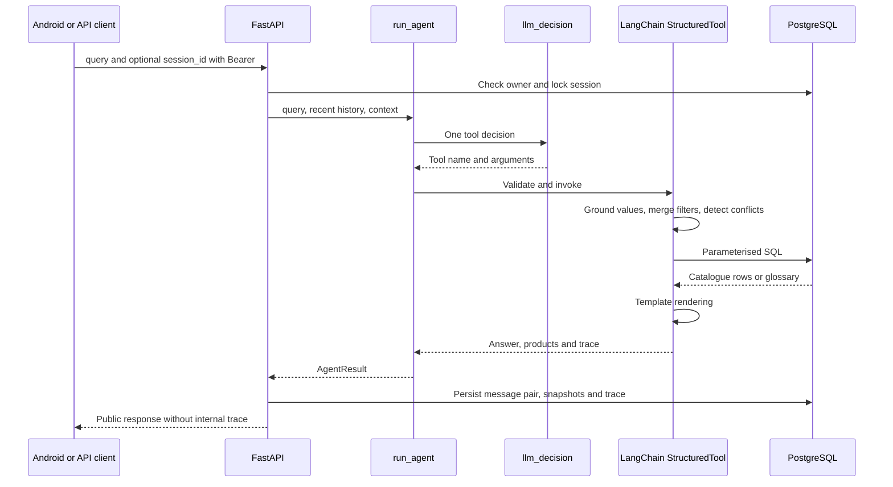

# Agent

[Wiki](index.md) · [English](../en/agent.md) · [Español](../es/agent.md)

How one LangChain decision becomes a validated, reproducible technical answer.



## Typed tools

All `args_schema` models forbid extra fields. The LLM supplies intent/arguments, never SQL or final technical prose.

| Tool | Input schema |
|---|---|
| `get_actuator` | `part_numbers`: 1..4 strings, max 40 chars each; `focus`: overview/motor_power/torque/operating_time/fla/lra/duty/rates/certification, default overview; `explain_terms`: up to 3 glossary keys, default [] |
| `search_actuators` | Optional technical filters below; `limit`: 1..20 default 5; `refine=false`, `more=false`, `remove`: up to 8 filter names; `assumptions`: up to 4 `{field,user_phrase}` (phrase 2..80 chars); `explain_terms`: up to 3 keys |
| `explain_terms` | `term_keys`: 1..3 keys constrained to the loaded glossary |
| `ask_clarification` | `field`: part_number/service/frequency/supply/requirements/which_product/term_not_in_summary/unsupported |

Filters: `enclosure` weatherproof/explosionproof; `supply_current` accepts `AC`, `DC`, or literal `AC/DC`; `phase_count` 1/3; `service` on_off/modulating; `frequency_hz` 50/60; positive `supply_voltage_v`; nonnegative `min_torque_nm`, `min_torque_in_lb`, `min_duty_s4_percent` (up to 100), `min_cycles_per_hour`, `min_starts_per_hour`, `max_operating_time_s`, `max_fla_a`, `max_lra_a`, `max_motor_power_w`; `csa_required=false`. Decimal magnitudes have an upper bound of 1e12 and integer rates 2147483647; null means no new constraint. Public search pagination differs: see [API](api.md).

## Deterministic policy

For `DC + 60 Hz`, ask which requirement is intended; retain compatible constraints. A follow-up `now 220 V` uses `refine=true` and only the voltage delta; `merge_filters` carries the rest. `remove` drops named constraints; `more` advances pagination. Changing service drops the incompatible old cycles/starts constraint with an explanation.

Codes are canonicalised for case/spaces/missing hyphen, never completed with `/A` or a guessed suffix. Partial codes receive prefix candidates; well-formed absent codes return not found. Codes must be in the conversation or persisted context. Unstated filters are dropped and named; assumptions must quote actual user wording and are shown. Numeric grounding checks occurrence of a number in the text, not complete semantic correctness; a wrong field assignment is still possible.

SQL compares published columns, with AND filters, service/frequency scope and explicit absence states. Unknown values cannot satisfy thresholds. Templates render the resulting rows and literal glossary quotes; no second model writes the answer. One provider invocation per turn, no retries. A catalogue call plus an `explain_terms` call in the same response may be merged into one execution; other invalid call shapes produce a clarification.

## Runtime controls and tracing

`AGENT_MAX_CALLS_PER_HOUR=120` counts attempted model calls in a rolling hour per process, including failures. Restart resets it; more workers multiply it. It is not a billing cap. `OPENROUTER_REQUIRE_PARAMETERS=true` adds `provider.require_parameters` only for host `openrouter.ai`; this filters routing compatibility, not funds. [Operations](operations.md) lists defaults.

LangSmith is off by default and requires both tracing=true and a key. Enabling it sends prompts, user text, tool inputs/results and catalogue rows to the configured LangSmith service; the parent trace also records query/context and answer metadata. Stored local traces include raw/merged parameters, validation, context before/after, renderer, model/latency/usage. Public history omits traces; the developer endpoint is owner-scoped and opt-in.

## Real trace excerpt

[Persisted SQL projection](database.md):

```json
{
  "role": "assistant",
  "tool": "get_actuator",
  "part_numbers": [
    "761A00-11300000/A"
  ],
  "validation": [
    "ok"
  ],
  "renderer": "get_actuator"
}
```

This trace establishes stored tool execution, not a real-provider acceptance result. [Tests and cohort evidence](testing.md) keep those claims separate.

## Where in the code

- [backend/conversation/agent.py](../../../backend/conversation/agent.py#L114)
- [backend/conversation/agent.py](../../../backend/conversation/agent.py#L456)
- [backend/conversation/policy.py](../../../backend/conversation/policy.py#L84)
- [backend/conversation/rendering.py](../../../backend/conversation/rendering.py#L1)

## Known limits

The lexical policy is bounded. Limits are inclusive: the current prompt maps “below 5 W” to <=5, so strict inequalities remain a known weakness. The v4 correction has not been rechecked with a real LLM. Only 12 recent messages (each truncated to 2000 chars) plus persisted filters/codes are sent. OpenRouter and full Android acceptance are pending.
