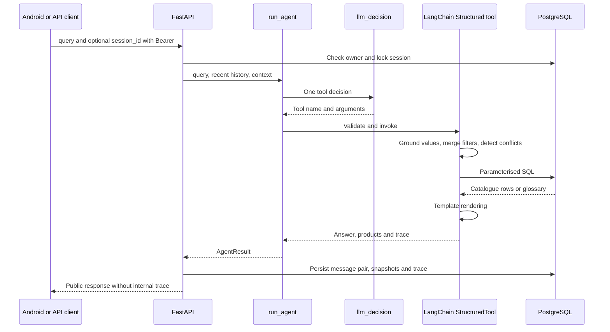

# Agent

[Wiki](index.md) · [English](../en/agent.md) · [Español](../es/agent.md)

After login, `What is the motor power of 761A00-11300000/A?` works keyless and returns the published **15 W**. A single named field for one complete valid code (including `FLA of 761A00-11300000/A at 60 Hz` or `operating time of 761A00-11300000/A`), greetings and explicit code comparisons use SQL/templates with zero model calls. Ambiguous requests, extra conditions and free-language selection need `OPENROUTER_API_KEY` plus `OPENROUTER_CHAT_MODEL`; without them those interpretation requests return 503 `not_configured`. The field route uses the same answer planner as an equivalent LLM lookup decision.

How one LangChain decision becomes a validated, reproducible technical answer.

Answers, fixed messages and suggested replies are English-only by product decision; input may be Spanish. The LLM interprets one tool decision per turn and never writes answer text, tables or replies.



## T8/T9: current flow

The model makes one decision on turns requiring language interpretation; it writes neither figures nor final answers. Greetings, Submit, filter removal, structured actions and closed lookups of complete codes use deterministic routes without chat or embeddings. Transport attempts are not additional completed decisions.

T8 collects discriminating questions in `interaction.questions`, ordered by candidate reduction with SQL counts. Android presents one card with navigation, review, Submit and Cancel. An empty combination returns `422 empty_combination` without saving a turn. `recommendation` declares `ranked_by`, total, shown count and up to three codes with SQL reasons/values; previews and alternatives requiring relaxed filters are labelled. `compare_top`, `show_all` and `rank_by` actions use persisted context without an LLM. Soft deletion is owner-scoped; see [API](api.md).

The [answer planner](../../../backend/conversation/answer_planner.py) chooses a field, specification, verdict, difference or ratio; references resolve against saved `on_screen` order and focus. [requirement_coverage.py](../../../backend/conversation/requirement_coverage.py) checks stated quantities, compatible units and bounds, including after merging filters; occurrence of a number alone is insufficient. [integrity.py](../../../backend/conversation/integrity.py) independently checks returned rows against filters and prevents unsafe recommendations while hazard context is unresolved. An uncovered quantity withholds a pick; ambiguity prompts clarification. These checks reduce omissions, but do not guarantee every semantic interpretation.

### Additive embeddings

[embeddings.py](../../../backend/conversation/embeddings.py) retrieves up to five cosine examples (minimum 0.70) and concept anchors from pgvector before the single LLM decision. The bank contains phrasings and interpretations, never numeric product knowledge. `gemini-embedding-2` uses 768 dimensions; its OpenRouter ID is `google/gemini-embedding-2`. Deterministic normalization always runs, ON and OFF: explicit requirements, negations, grounded arguments and carried filters win; suggestions only fill unresolved fields. Hazard context asks for confirmation with an Explosionproof preview, not site certification.

Missing model, key, results or retrieval failure preserves deterministic behavior. Retrieval has a total 1.5 s budget, zero retries, four bounded workers and SQL inside a savepoint; late results are discarded. An already-sent request may still finish remotely. Startup client initialization makes no inference call. Traces include example IDs/similarities, concepts and timing; [per-answer debug and voice](android.md), [loading and provenance](operations.md#example-bank), [results and limits](testing.md#behavior-evaluation).

## Typed tools

Provider-facing `args_schema` values are compact JSON Schema dictionaries. Code normalises and validates every decision against strict Pydantic models before execution. The LLM supplies intent/arguments, never SQL or final technical prose.

The provider uses `bounds=[{"field":"min_torque_in_lb","op":"gt","value":1000}]` for numeric limits and omits unknown properties instead of sending null. Code expands these into the canonical value/op fields described below; legacy internal arguments and the direct search API remain accepted. Focus uses field strings plus optional scalar service/frequency qualifiers. All four tools are still bound in one request and only one model decision runs per turn. [Wire contract](../../../backend/conversation/tool_wire.py) and [offline schema budget test](../../../tests/test_tool_schema_budget.py) limit cumulative structural complexity; provider probing remains a separate coordinator check. The table below describes the canonical internal arguments after expansion.

| Tool | Input schema |
|---|---|
| `get_actuator` | `part_numbers`: 1..4 strings, max 40 chars each; `focus`: list of `{field,service?,frequency_hz?}`; fields overview/motor_power/torque/operating_time/fla/lra/duty/rates/certification; omitted focus reuses context; `explain_terms`: up to 3 glossary keys, default [] |
| `search_actuators` | Optional technical filters below; `limit`: 1..20 default 5; `refine=false`, `more=false`, `remove`: up to 8 filter names; `assumptions`: up to 4 `{field,user_phrase}` (phrase 2..80 chars); `explain_terms`: up to 3 keys |
| `explain_terms` | `term_keys`: 1..3 keys constrained to the loaded glossary |
| `ask_clarification` | `field`: part_number/service/frequency/supply/requirements/which_product/term_not_in_summary/unsupported/cancel/decline; `cancel_previous=false` |

Filters: `enclosure` weatherproof/explosionproof; `supply_current` accepts `AC`, `DC`, or literal `AC/DC`; `phase_count` 1/3; `service` on_off/modulating; `frequency_hz` 50/60; positive `supply_voltage_v`; nonnegative `min_torque_nm`, `min_torque_in_lb`, `min_duty_s4_percent` (up to 100), `min_cycles_per_hour`, `min_starts_per_hour`, `max_operating_time_s`, `max_fla_a`, `max_lra_a`, `max_motor_power_w`; `csa_required=false`. Decimal magnitudes have an upper bound of 1e12 and integer rates 2147483647; null means no new constraint. Public search pagination differs: see [API](api.md).

## Deterministic policy

For `DC + 60 Hz`, ask which requirement is intended; retain compatible constraints. A follow-up `now 220 V` uses `refine=true` and only the voltage delta; `merge_filters` carries the rest. `remove` drops named constraints; `more` advances pagination. Changing service drops the incompatible old cycles/starts constraint with an explanation.

Codes are canonicalised for case/spaces/missing hyphen, never completed with `/A` or a guessed suffix. Partial codes receive prefix candidates; well-formed absent codes return not found. Codes must be in the conversation or persisted context. Unstated filters are dropped and named; assumptions must quote actual user wording and are shown. T9 also checks quantity/unit coverage in both directions; semantic field assignment can still fail.

SQL compares published columns, with AND filters, service/frequency scope and explicit absence states. Unknown values cannot satisfy thresholds. Templates render the resulting rows and literal glossary quotes; no second model writes the answer. One completed model decision per turn; failed 503, timeout and connection attempts may retry once per model, with an optional fallback model and a shared 60-second deadline. No 4xx is retried. A catalogue call plus an `explain_terms` call in the same response may be merged into one execution; other invalid call shapes produce a clarification.

## Runtime controls and tracing

`AGENT_MAX_CALLS_PER_HOUR=120` counts attempted model calls in a rolling hour per process, including failures. Restart resets it; more workers multiply it. It is not a billing cap. `OPENROUTER_REQUIRE_PARAMETERS=true` adds `provider.require_parameters` only for host `openrouter.ai`; this filters routing compatibility, not funds. [Operations](operations.md) lists defaults.

LangSmith is off by default and requires both tracing=true and a key. Enabling it sends prompts, user text, tool inputs/results and catalogue rows to the configured LangSmith service; the parent trace also records query/context and answer metadata. Stored local traces include raw/merged parameters, validation, context before/after, renderer, model/latency/usage. Public history omits traces; the developer endpoint is owner-scoped and opt-in.

## Real trace excerpt

[Persisted SQL projection](database.md):

```json
{
  "role": "assistant",
  "tool": "get_actuator",
  "part_numbers": [
    "761A00-11300000/A"
  ],
  "validation": [
    "ok"
  ],
  "renderer": "get_actuator"
}
```

This trace establishes stored tool execution, not a real-provider acceptance result. [Tests and cohort evidence](testing.md) keep those claims separate.

## Where in the code

- [backend/conversation/agent.py](../../../backend/conversation/agent.py#L135)
- [backend/conversation/agent.py](../../../backend/conversation/agent.py#L521)
- [backend/conversation/policy.py](../../../backend/conversation/policy.py#L85)
- [backend/conversation/rendering.py](../../../backend/conversation/rendering.py#L1)

## T7 conversation policy

Historical T7 examples: the T8/T9 rules above supersede ranking, actions and guard behavior.

### Focus, filters and ranking

`focus` selects fields and their service/frequency scope; omitted focus reuses context and `overview` requests all fields. Bounds use `gt|gte|lt|lte`, preserve the stated number and unit, and allow a lower and upper bound on the same field. Legacy scalar bounds remain inclusive. SQL owns comparisons; an unknown or N/A value cannot satisfy a numeric threshold.

`sort_by` orders fastest, lowest_power, highest_torque or lowest_current preferences. Ranked results show up to three candidates; without frequency, ranking uses the lowest published value and says so. Motor power is not total energy consumption. Unsorted sets above four report their SQL count and ask an available splitting facet; without a filterable facet, no invented question/options are added. Zero matches produce scoped SQL extrema and relaxation choices, never an inferior model labelled as compliant.

### Questions and code-only submissions

A question means the assistant needs information; a suggestion is an optional next action. `interaction.questions` collects all currently required fields in order, with options from SQL facets under the current filters. Android collects choices locally, shows a review, and sends them only on Submit. This captured interaction asks for both service and frequency:

```json
{
  "kind": "question",
  "questions": [
    {
      "id": "service",
      "prompt": "Which service?",
      "options": [
        {
          "value": "on_off",
          "label": "On/Off"
        },
        {
          "value": "modulating",
          "label": "Modulating"
        }
      ]
    },
    {
      "id": "frequency_hz",
      "prompt": "Which frequency?",
      "options": [
        {
          "value": "50",
          "label": "50 Hz"
        },
        {
          "value": "60",
          "label": "60 Hz"
        }
      ]
    }
  ]
}
```

Source: `two_questions` in [T7 HTTP evidence](../../../reports/submission/T7-interactions.json). Submitted option strings must exactly match pending IDs/values. `answers` and `remove_filters` are request fields outside the LLM schemas: code validates them, merges/removes filters and reruns SQL without a model call or a `reserve_agent_call` reservation. The readable `query` is stored as the user message. Invalid answers/removals return 422; see [API](api.md#t7-conversation-contract).

`active_filters` persists removable search tags. Declining or repeating an unresolved question shows up to three current candidates and names the open requirement. Cancel clears pending information, filters and focus. A normal language turn retains one completed LLM tool decision; structured submissions and greeting-only turns need zero. A failed transport attempt is not a second completed decision.

### Optional suggestions

| Result/state | Suggestions |
|---|---|
| Pending question | 0; the question carries its options |
| Search with 2–4 results and no question | 1 comparison of the pair with the most differing fields; ties keep SQL order |
| More than 4 results, no pending question | 0 |
| Impossible requirements | 0–3 executable SQL-derived relaxations/lookup choices |
| One factual answer, definition, comparison, greeting, unsupported request or cancellation | 0 |

`suggestions` and deprecated `suggested_replies` carry the same list. Never pad with generic navigation, the action just performed or Cancel.

### Comparisons and lead

Two models use `layout:"table"`: `summary` counts wins without weighting; `assumptions` states the preference directions; differing fields are in `rows` and identical fields in `hidden_rows`. `better` is a zero-based model index computed by plain numeric comparison in code, not by the agent. More torque/cycles and less time/current/motor power are preferred; ties, N/A and fields without an agreed direction have null. Conflicting dual-unit directions have no winner. The count is not an overall suitability score.

Real row from `compare_two` in [T7 HTTP evidence](../../../reports/submission/T7-interactions.json):

```json
{
  "field": "on_off_torque",
  "label": "On/Off torque",
  "values": [
    "700 in-lb / 80 Nm",
    "880 in-lb / 100 Nm"
  ],
  "better": 1
}
```

Three or four models use `layout:"cards"`, `better:null`, no arrows and four code-selected `key_fields`: torque, operating time, FLA and motor power, retaining the requested scopes. The captured three-model keys are `on_off_torque`, `operating_time_50hz_s`, `fla_50hz_a`, `motor_power_w`.

Products/comparisons get a one-sentence `lead` for the app; `answer` remains the full plain-text result for API clients. The app falls back to `answer` for old messages without a lead.

### Greeting and edge policies

Greeting-only input (including punctuation-tolerant English/Spanish greetings) is handled by code, with the authenticated first name or `Hello.` and no suggestions. Captured response:

> Hello, Samuel. I can look up Series 76 actuators, find models for your requirements, compare models or explain catalogue terms.

The following approved behaviors are exercised in [T7 EC evidence](../../../reports/submission/T7-scenarios.json), using the [40-case specification](../../evaluation/edge-case-suite.es.md):

| Case | Policy |
|---|---|
| EC05 | Label/invoice disagreement cannot identify the installed actuator; check the nameplate and compare the catalogue models. |
| EC10 | A 70–100 Nm inclusive range retains both `gte 70` and `lte 100` on the torque field. |
| EC15 | Decimal comma `1,5` means `1.5`, never `15`. |
| EC20 | “Same performance” after changing service keeps numeric thresholds and states that assumption. |
| EC25 | `110 V or 220 V` asks with both published options; it does not AND them or silently choose one. |
| EC30 | No catalogue prices or agreed price-weighted overall score; offer published technical comparisons. |
| EC35 | No ordering or delivery confirmation; offer catalogue specifications. |
| EC40 | Render the supported facts/comparison and FLA/LRA/S4 definitions in one decision; explicitly state that the supplied summary does not define IP67. |

### Retry, fallback and deadline

LangChain `.with_retry(stop_after_attempt=2)` retries only 503, timeout and connection errors; never 4xx. An optional `OPENROUTER_FALLBACK_MODEL` uses `.with_fallbacks` on the same endpoint. SDK retries stay disabled. Every actual attempt reserves the local call cap and is recorded; failed turns preserve safe attempt metadata without persisting half a conversation.

The shared `AGENT_TURN_DEADLINE_S=60` covers primary retries and fallback. Each attempt uses `min(AGENT_TIMEOUT_S=45, remaining)`; less than `AGENT_RETRY_MIN_REMAINING_S=10` remaining records `deadline_skipped` without reserving a call. Defaults stay below Android's 70 s read/75 s call timeout. Keep-alive is separate: client pool 30 s, Uvicorn 75 s. [Operations](operations.md) documents configuration and the first-tap failure.

## Known limits

T7 is verified with scripted decisions, real SQL and local HTTP/transport tests; [testing](testing.md) separates real-model acceptance. Numeric occurrence does not prove semantic assignment. Only 12 recent messages (up to 2000 characters each) and persisted context reach the model. Offline checks do not establish provider availability, arbitrary-language correctness, device layout or production load behavior.
