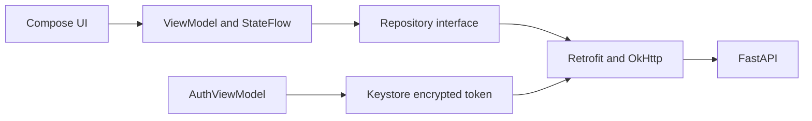

# Android

[Wiki](index.md) · [English](../en/android.md) · [Español](../es/android.md)

Build, navigate and diagnose the native Kotlin/Compose client.



## Screens and state

Login validates the saved token through `/me` before showing private history. Chat displays a personalized Hello on an empty session, product cards/comparison rows, a composer and loading/error feedback. The drawer lists the current user’s conversations with pagination, New chat, account/Sign out and Light/Dark/System appearance. Hidden per-answer debug is available in both APK variants.

ViewModels own requests and StateFlow; constructor injection isolates Retrofit DTOs from presentation. Product decimal JSON values are kept as decimal text for display rather than converted through Double. The authenticated profile comes from the server; the old editable local profile is historical. Appearance preferences persist locally. Voice input uses Android SpeechRecognizer; no Firebase.

Loading prevents duplicate sends and session changes mid-turn. A failed send preserves the draft and requires history reload before retry; if no session_id was received, inspect the list. Rotation retains ViewModels. After process death, the encrypted token is revalidated and history reopened from the server; draft/open-session restoration is not guaranteed. Logout failure keeps the session available for revocation retry. A late 401 from an old token cannot sign out a new account.

## T7 questions, suggestions and comparisons

The pinned QUESTION card above the composer shows the prompt, full-width radio choices and step count. Choices advance locally through all questions; review lists every answer and lets the user edit it. Submit sends exact option values in `answers` plus a readable summary; no request is made while selecting. Cancel clears the card and sends `Cancel` without partial answers. The composer is dimmed while a question is open but remains typable after touch/focus; sending free text drops local selections.

Optional suggestions are quiet dashed chips under the latest assistant message, labelled `✦ Suggestions · optional`. They disappear while typing/sending or while an interaction is present; there may be zero. Removable active-filter tags sit below the app bar and send `remove_filters` with a readable query. The backend, not the app, validates options and filters.

Two-model comparisons show a summary, muted assumptions, a three-column table, and expandable identical rows. A bold value and orange arrow display the server's numeric `better` index. Three/four-model comparisons instead show one card per model with four server-selected fields in a 2×2 grid and no arrows. `lead` replaces full `answer` only when products/comparison are rendered; legacy messages fall back to answer. The app preserves decimal strings and source notes.

The empty chat greets the authenticated account's first name: `Hello, Samuel` for the recorded Samuel example, or `Hello` when absent. Greeting-only messages also receive the backend's personalized sentence; see [captured HTTP examples](../../../reports/submission/T7-interactions.json). The existing visual identity and greeting animation remain.

## T8 interaction

One card contains all questions, option counts and optional descriptions: Back/Next, editable review, Submit and Cancel. Selection sends nothing; `422 empty_combination` restores review with the inline error. Recommendation displays `Ranked by …`, up to three server codes/reasons and `Showing 3 of N` using actual counts. Comparison cards use `key_fields` and `key_fields_reason`; the device computes no catalogue figures.

Object suggestions send their label and `action`; legacy strings remain supported. Long-press a conversation and confirm to hide it with `Conversation deleted · Undo`: DELETE waits five seconds. Undo cancels only the latest pending deletion; another confirmed deletion or ViewModel disposal commits the earlier one. Failure restores the row. Pending sends display `Searching the catalog…`, then `Still working…` after eight seconds.

## First-tap connection failure

T7 addresses the first tap after idle failing when OkHttp reused a pooled connection that Uvicorn had closed after its former 5 s keep-alive. The client now expires pooled connections after 30 s, below the server's 75 s (`--timeout-keep-alive 75`). Rebuild both sides when updating; changing only the app leaves the old server mismatch.

Automatic POST/connection retries remain off (`retryOnConnectionFailure(false)`), to avoid replaying a conversation write. Read timeout is 70 s and total call timeout 75 s; the provider decision deadline defaults to 60 s. After an uncertain network failure, reload history before resending.

[Android T7 evidence](../../../reports/submission/T7-android.md): 40 JVM tests passed and the debug APK built. The pool regression uses production Retrofit/OkHttp with MockWebServer, confirms initial pooling and 30 s expiry, then a successful fresh POST without retries. This covers a local closed-socket scenario; it does not replay the deployed 5 s timeout or prove pixel fit/emulator acceptance. Backend contract examples are real SQL; Android comparison fixtures are synthetic, not catalogue evidence.

## Authentication

Android stores only an AES-GCM encrypted bearer in private preferences with a non-exportable Android Keystore key; no password is saved. OkHttp attaches Authorization, disables redirects and automatic connection retry, and handles current-token 401. Backend stores salted PBKDF2-HMAC-SHA256 passwords (600000 iterations) and SHA-256 token hashes; opaque tokens expire after 12h. Backups are disabled and FLAG_SECURE protects the normal app window. HTTP is debug-only; release requires HTTPS.

## Build and run

Before building, run `java -version` and confirm **JDK 17**. Set `JAVA_HOME` to that JDK installation and put its `bin` first on PATH; set `ANDROID_HOME` to the SDK folder containing `platforms/android-36`. Android Studio's SDK Manager installs SDK Platform 36. Add the SDK's `platform-tools` to PATH before using `adb`. JDK 17 is the documented validation baseline; success on another JDK does not establish that baseline.

```sh
# macOS/Linux: replace these paths with your installed locations
export JAVA_HOME=/path/to/jdk-17
export ANDROID_HOME=/path/to/Android/sdk
export PATH="$JAVA_HOME/bin:$ANDROID_HOME/platform-tools:$PATH"
java -version
test -d "$ANDROID_HOME/platforms/android-36"
adb version
```

```powershell
# Windows PowerShell: replace these paths with your installed locations
$env:JAVA_HOME='C:\path\to\jdk-17'
$env:ANDROID_HOME="$env:LOCALAPPDATA\Android\Sdk"
$env:Path="$env:JAVA_HOME\bin;$env:ANDROID_HOME\platform-tools;$env:Path"
java -version
Test-Path "$env:ANDROID_HOME\platforms\android-36"
adb version
```

For an independent second checkout, add `COMPOSE_PROJECT_NAME=serie76-clean`, `POSTGRES_PORT=55432` and `API_PORT=18000` to its `.env` before running Compose. Use `http://localhost:18000` in HTTP examples and `-PbackendUrl=http://10.0.2.2:18000/` for its emulator build. These names and ports isolate this checkout; keep its database password consistent with its own volume.

Install Android Studio, JDK 17, SDK Platform 36 and an API 26+ emulator/device. Open `mobile/android`, let Studio generate ignored `local.properties`, select app/debug and Run. Start the backend with the [README](../../../README.md). No model key is packaged in the APK.

```sh
# macOS/Linux, repository root
sh mobile/android/gradlew -p mobile/android :app:assembleDebug :app:testDebugUnitTest
# Windows PowerShell
./mobile/android/gradlew.bat -p mobile/android :app:assembleDebug :app:testDebugUnitTest
# Either platform, adb on PATH
adb install -r mobile/android/app/build/outputs/apk/debug/app-debug.apk
```

Open Series 76 in the emulator launcher and sign in with a [TEST ONLY account](../../../README.md#demo-users-test-only). Default URL: `http://10.0.2.2:8000/`; emulator localhost is Android itself. Change at build time with `-PbackendUrl=https://your-host/`, then reinstall. For USB, `adb reverse tcp:8000 tcp:8000` and build debug with `-PbackendUrl=http://127.0.0.1:8000/`. PostgreSQL never connects to the phone.

`assembleRelease` produces `app/build/outputs/apk/release/app-release-unsigned.apk`; installation requires local signing. Use debug for review; no signing key is committed.

## T9 voice

The grey 48 dp microphone sits left of Send. First use explains and requests `RECORD_AUDIO`; denial shows `Microphone permission is needed for voice input` with a settings shortcut. Tap to dictate and again to stop. Partial text replaces only the dictated suffix, preserving the previous draft. Review/edit the result and press Send: recognition never sends automatically.

API 31+ prefers `createOnDeviceSpeechRecognizer` when available; otherwise `createSpeechRecognizer` uses the installed service and requests offline mode. That service may ignore the preference and use its network: offline operation is not guaranteed on every device. No audio goes to the backend or OpenRouter. Missing service shows `Voice input isn't available on this device`; no recognition shows `Didn't catch that — try again`.

Listening is bounded to 60 s, with up to 15 s for final text after stopping. Typing, sending, changing conversations, opening drawer/debug, leaving/pausing or signing out cancels and releases recognition; stale callbacks are rejected. No background capture occurs.

## Developer debug

Set `DEV_DEBUG=true` in `.env` and run `docker compose up -d backend`. In the drawer tap the **profile name/email seven times within three seconds**; `Developer mode on` confirms the toggle. Repeat to disable. The flag persists locally and defaults off; the avatar opens the account menu separately. There is no Developer debug menu entry.

Each assistant answer has **ⓘ** (`Debug details`) while developer mode is on, including reopened conversations. Its sheet lazily requests `GET /api/messages/{id}/debug`, verifies the ID and supports expandable sections, selection/copy and JSON scrolling. It shows tools, raw/validated/merged parameters, rows, latency, attempts, `llm_called`, and retrieval examples/similarities/concepts. Missing values remain `null`.

The HTTP contract is `{message_id,session_id,tool_calls,debug}`. A 404 displays `Backend debug is disabled (DEV_DEBUG=false)`, although it can also mean a missing answer; other failures offer Try again. Both variants share this flow: hiding it is presentation; token, ownership and `DEV_DEBUG` enforce access.

## T8/T9 verification

[T8](../../../reports/submission/T8-android.md): 51 JVM tests; [reviewed T9](../../../reports/submission/T9-android.md): **74 JVM tests**, debug and unsigned release APKs. Fake recognizers verify permission, partial/final text, cancellation and late callbacks; HTTP fixtures verify persisted traces. Compiling instrumentation does not mean executing it. Pending: actual recognition services/languages, accessibility/rendering, merged backend and real-model flow.

## Where in the code

- [mobile/android/app/build.gradle.kts](../../../mobile/android/app/build.gradle.kts#L1)
- [mobile/android/app/src/main/java/com/serie76/assistant/ui/AppViewModel.kt](../../../mobile/android/app/src/main/java/com/serie76/assistant/ui/AppViewModel.kt#L1)
- [mobile/android/app/src/main/java/com/serie76/assistant/data/ConversationRepository.kt](../../../mobile/android/app/src/main/java/com/serie76/assistant/data/ConversationRepository.kt#L1)
- [mobile/android/app/src/main/java/com/serie76/assistant/data/Authentication.kt](../../../mobile/android/app/src/main/java/com/serie76/assistant/data/Authentication.kt#L34)
- [mobile/android/app/src/main/java/com/serie76/assistant/ui/DebugDetails.kt](../../../mobile/android/app/src/main/java/com/serie76/assistant/ui/DebugDetails.kt#L1)

- [VoiceInput.kt](../../../mobile/android/app/src/main/java/com/serie76/assistant/ui/VoiceInput.kt), [AndroidVoiceRecognizer.kt](../../../mobile/android/app/src/main/java/com/serie76/assistant/ui/AndroidVoiceRecognizer.kt), [VoiceController.kt](../../../mobile/android/app/src/main/java/com/serie76/assistant/ui/VoiceController.kt)

## Known limits

No offline DB/sync or guaranteed draft recovery after process death. Emulator/UI and controlled HTTP checks do not prove Android-to-real-LLM acceptance. OpenRouter acceptance completed on 2026-11-05; see [Models](../../../README.md#models-design-and-limitations). Post-fix held-out v12 remains pending. Physical-device measurement and public HTTPS deployment remain pending; [mobile evidence](../../evidence/mobile.md) describes verified scope.
