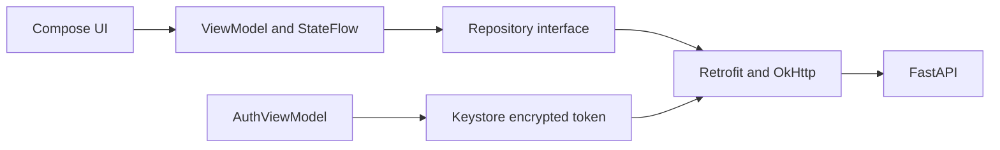

# Android

[Wiki](index.md) · [English](../en/android.md) · [Español](../es/android.md)

Build, navigate and diagnose the native Kotlin/Compose client.



## Screens and state

Login validates the saved token through `/me` before showing private history. Chat displays a personalized Hello on an empty session, product cards/comparison rows, a composer and loading/error feedback. The drawer lists the current user’s conversations with pagination, New chat, account/Sign out and Light/Dark/System appearance. Developer debug is a separate debug-only surface; release substitutes an inert implementation.

ViewModels own requests and StateFlow; constructor injection isolates Retrofit DTOs from presentation. Product decimal JSON values are kept as decimal text for display rather than converted through Double. The authenticated profile comes from the server; the old editable local profile is historical. Appearance preferences persist locally. No Firebase or voice.

Loading prevents duplicate sends and session changes mid-turn. A failed send preserves the draft and requires history reload before retry; if no session_id was received, inspect the list. Rotation retains ViewModels. After process death, the encrypted token is revalidated and history reopened from the server; draft/open-session restoration is not guaranteed. Logout failure keeps the session available for revocation retry. A late 401 from an old token cannot sign out a new account.

## T7 questions, suggestions and comparisons

The pinned QUESTION card above the composer shows the prompt, full-width radio choices and step count. Choices advance locally through all questions; review lists every answer and lets the user edit it. Submit sends exact option values in `answers` plus a readable summary; no request is made while selecting. Cancel clears the card and sends `Cancel` without partial answers. The composer is dimmed while a question is open but remains typable after touch/focus; sending free text drops local selections.

Optional suggestions are quiet dashed chips under the latest assistant message, labelled `✦ Suggestions · optional`. They disappear while typing/sending or while an interaction is present; there may be zero. Removable active-filter tags sit below the app bar and send `remove_filters` with a readable query. The backend, not the app, validates options and filters.

Two-model comparisons show a summary, muted assumptions, a three-column table, and expandable identical rows. A bold value and orange arrow display the server's numeric `better` index. Three/four-model comparisons instead show one card per model with four server-selected fields in a 2×2 grid and no arrows. `lead` replaces full `answer` only when products/comparison are rendered; legacy messages fall back to answer. The app preserves decimal strings and source notes.

The empty chat greets the authenticated account's first name: `Hello, Samuel` for the recorded Samuel example, or `Hello` when absent. Greeting-only messages also receive the backend's personalized sentence; see [captured HTTP examples](../../../reports/submission/T7-interactions.json). The existing visual identity and greeting animation remain.

## First-tap connection failure

T7 addresses the first tap after idle failing when OkHttp reused a pooled connection that Uvicorn had closed after its former 5 s keep-alive. The client now expires pooled connections after 30 s, below the server's 75 s (`--timeout-keep-alive 75`). Rebuild both sides when updating; changing only the app leaves the old server mismatch.

Automatic POST/connection retries remain off (`retryOnConnectionFailure(false)`), to avoid replaying a conversation write. Read timeout is 70 s and total call timeout 75 s; the provider decision deadline defaults to 60 s. After an uncertain network failure, reload history before resending.

[Android T7 evidence](../../../reports/submission/T7-android.md): 40 JVM tests passed and the debug APK built. The pool regression uses production Retrofit/OkHttp with MockWebServer, confirms initial pooling and 30 s expiry, then a successful fresh POST without retries. This covers a local closed-socket scenario; it does not replay the deployed 5 s timeout or prove pixel fit/emulator acceptance. Backend contract examples are real SQL; Android comparison fixtures are synthetic, not catalogue evidence.

## Authentication

Android stores only an AES-GCM encrypted bearer in private preferences with a non-exportable Android Keystore key; no password is saved. OkHttp attaches Authorization, disables redirects and automatic connection retry, and handles current-token 401. Backend stores salted PBKDF2-HMAC-SHA256 passwords (600000 iterations) and SHA-256 token hashes; opaque tokens expire after 12h. Backups are disabled and FLAG_SECURE protects the normal app window. HTTP is debug-only; release requires HTTPS.

## Build and run

Install Android Studio, JDK 17, SDK Platform 36 and an API 26+ emulator/device. Open `mobile/android`, let Studio generate ignored `local.properties`, select app/debug and Run. Start the backend with the [README](../../../README.md). No model key is packaged in the APK.

```sh
# macOS/Linux, repository root
sh mobile/android/gradlew -p mobile/android :app:assembleDebug :app:testDebugUnitTest
# Windows PowerShell
./mobile/android/gradlew.bat -p mobile/android :app:assembleDebug :app:testDebugUnitTest
# Either platform, adb on PATH
adb install -r mobile/android/app/build/outputs/apk/debug/app-debug.apk
```

Open Series 76 in the emulator launcher and sign in with a [TEST ONLY account](../../../README.md#demo-users-test-only). Default URL: `http://10.0.2.2:8000/`; emulator localhost is Android itself. Change at build time with `-PbackendUrl=https://your-host/`, then reinstall. For USB, `adb reverse tcp:8000 tcp:8000` and build debug with `-PbackendUrl=http://127.0.0.1:8000/`. PostgreSQL never connects to the phone.

`assembleRelease` produces `app/build/outputs/apk/release/app-release-unsigned.apk`; installation requires local signing. Use debug for review; no signing key is committed.

## Developer debug

Set `DEV_DEBUG=true` in local backend configuration and run `docker compose up -d backend`. Install Android debug, open the left drawer, select Developer debug and choose an assistant response. It shows tool names, validated parameters and returned data for that user only; no reasoning text. With DEV_DEBUG=false, API debug is 404; Android release excludes the screen/client and menu action.

## Where in the code

- [mobile/android/app/build.gradle.kts](../../../mobile/android/app/build.gradle.kts#L1)
- [mobile/android/app/src/main/java/com/serie76/assistant/ui/AppViewModel.kt](../../../mobile/android/app/src/main/java/com/serie76/assistant/ui/AppViewModel.kt#L1)
- [mobile/android/app/src/main/java/com/serie76/assistant/data/ConversationRepository.kt](../../../mobile/android/app/src/main/java/com/serie76/assistant/data/ConversationRepository.kt#L1)
- [mobile/android/app/src/main/java/com/serie76/assistant/data/Authentication.kt](../../../mobile/android/app/src/main/java/com/serie76/assistant/data/Authentication.kt#L34)
- [mobile/android/app/src/debug/java/com/serie76/assistant/ui/DeveloperScreen.kt](../../../mobile/android/app/src/debug/java/com/serie76/assistant/ui/DeveloperScreen.kt#L1)

## Known limits

No offline DB/sync or guaranteed draft recovery after process death. Emulator/UI and controlled HTTP checks do not prove Android-to-real-LLM acceptance. OpenRouter, physical-device measurement and public HTTPS deployment remain pending; [mobile evidence](../../evidence/mobile.md) describes verified scope.
