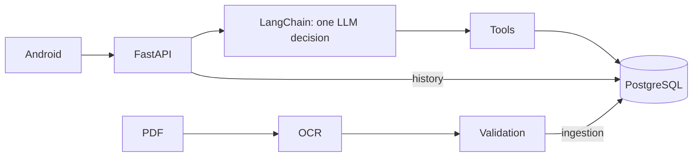

# Series 76 wiki

[Wiki](index.md) · [English](../en/index.md) · [Español](../es/index.md)

A reading map for someone opening the repository for the first time.

Arrows show data access and requests; the agent runs inside the backend process. Catalogue numbers come only from the electrical PDF; definitions come from the supplied summary. PostgreSQL holds the active catalogue, auth and message snapshots.

- [Ingestion](ingestion.md)
- [Database](database.md)
- [Agent](agent.md)
- [API](api.md)
- [Android](android.md)
- [Patterns](patterns.md)
- [Testing](testing.md)
- [Operations](operations.md)

Start with the [README](../../../README.md), then follow one turn: `POST /api/conversation` → model tool decision → validation → SQL → template → saved turn. Try `What is the motor power of 761A00-11300000/A?`; without model configuration the response is 503 `not_configured`.

Evidence: [OCR](../../evidence/ocr.md), [PostgreSQL](../../evidence/postgres.md), [agent](../../evidence/agent_acceptance.md), [Android](../../evidence/mobile.md), [comparison](../../evidence/architecture_comparison.md). The [brief](../../assessment-en.pdf) defines the requirements; [ADR 0001](../../adr/0001-arquitectura-agente.md) records the decision.

## Where in the code

- [backend/app/main.py](../../../backend/app/main.py#L1)
- [backend/conversation/agent.py](../../../backend/conversation/agent.py#L508)

## Known limits

OpenRouter acceptance and Android-to-real-LLM acceptance are pending. Voice is not implemented. Earlier progress checklists are historical, not current proof.
