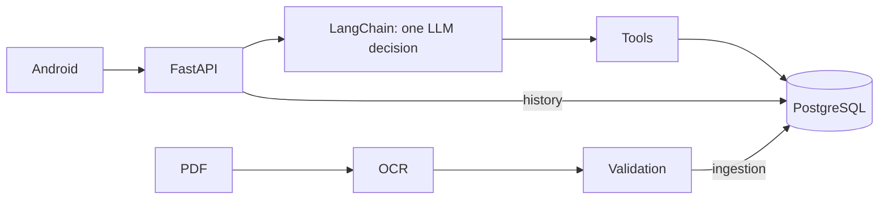

# Series 76 wiki

[Wiki](index.md) · [English](../en/index.md) · [Español](../es/index.md)

A reading map for someone opening the repository for the first time.

Arrows show data access and requests; the agent runs inside the backend process. Catalogue numbers come only from the electrical PDF; definitions come from the supplied summary. PostgreSQL holds the active catalogue, auth and message snapshots.

- [Ingestion](ingestion.md)
- [Database](database.md)
- [Agent](agent.md)
- [API](api.md)
- [Android](android.md)
- [Patterns](patterns.md)
- [Testing](testing.md)
- [Operations](operations.md)

Start with the [README](../../../README.md), then follow one turn: `POST /api/conversation` → model tool decision → validation → SQL → template → saved turn. Try `What is the motor power of 761A00-11300000/A?`; T8 resolves this complete-code lookup without a model. Free-language interpretation without configuration returns 503 `not_configured`.

Evidence: [OCR](../../evidence/ocr.md), [PostgreSQL](../../evidence/postgres.md), [agent](../../evidence/agent_acceptance.md), [Android](../../evidence/mobile.md), [comparison](../../evidence/architecture_comparison.md). The [brief](../../assessment-en.pdf) defines the requirements; [ADR 0001](../../adr/0001-arquitectura-agente.md) records the decision.

## Where in the code

- [backend/app/main.py](../../../backend/app/main.py#L1)
- [backend/conversation/agent.py](../../../backend/conversation/agent.py#L508)

## Current evidence and limits

The single chat model is `google/gemini-3.6-flash`, with no fallback; embeddings use `google/gemini-embedding-2`. The adopted improvement averaged **79.4% versus 61.1%** in three paired v17 runs; pass^3 was **71.7% versus 55%**. About **20% of novel multi-turn conversations still fail**. [Measurements, authorized exception and offline repairs](../../../reports/submission/P2-A.md).

[Public-text audit](../../../reports/submission/P2-B.md), [Linux Quick start CI](../../../reports/submission/P2-C.md), [Windows clean clone](../../../reports/submission/T17-final-clean-clone.md) and [8/8 emulator tests](../../../reports/submission/P2-D.md) establish their stated scopes. Actual voice recognition still needs a manual check. Android-to-real-LLM acceptance and physical-device readability are not established by controlled emulator inputs. Recorded OpenRouter spend is about **USD 6.17 of 10**.

Report labels such as P2-A or T17 identify evidence records, not product features. Historical records retain their original versions and must not be treated as current universal guarantees.
