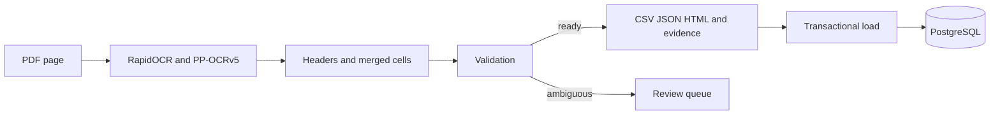

# Ingestion

[Wiki](index.md) · [English](../en/ingestion.md) · [Español](../es/ingestion.md)

How the electrical PDF becomes a validated catalogue without an LLM.



The production extractor reads the PDF, never `data/manual`, `data/reference` or `data/reviewed`. It reconstructs identity, enclosure, supply, torque in both published units, service, duty, cycles/starts, motor power, time, FLA/LRA and frequency. Notes, CSA exceptions and full `/A` codes survive extraction.

`source_NA` means explicit N/A; `not_in_layout` means the table does not publish that field. Neither means zero. Shared cells expand only within visible geometry; shared service values remain shared. DC has no mains frequency; AC/DC tables without a frequency remain unspecified. Motor power is not total electrical consumption.

## Rerun

Use Python 3.12, 64-bit. First execution downloads public OCR weights; subsequent recognition is local. Use a new output root to preserve evidence. Passing a directory processes a batch; `--no-images --threads 2` reduces retained images and controls runtime threads.

Run only your shell block; `deactivate` leaves an active environment before switching.

```sh
# macOS/Linux: deactivate the backend environment first, if active
python -m venv .venv-ingest
. .venv-ingest/bin/activate
pip install -r requirements-ingest.lock.txt
python scripts/ingest.py data/raw/series_76_electric_data.pdf --out data/processed/new-import
```

```powershell
# Windows PowerShell: deactivate the backend environment first, if active
python -m venv .venv-ingest
.\.venv-ingest\Scripts\Activate.ps1
pip install -r requirements-ingest.lock.txt
python scripts/ingest.py data/raw/series_76_electric_data.pdf --out data/processed/new-import
```

Each document gets its own hash/signature folder. `manifest.json` records `ready`, `needs_review` or `failed`; `cells.jsonl` retains raw text, alternate reads, bounding boxes, units, page/table/row and source hash. `review_queue.jsonl` blocks validated exports when unresolved. CSV/JSON/HTML appear only on success. The batch exits 2 if a document fails or needs review; other documents continue. Identical completed output is reused only after hash checks.

The retained output is [data/extracted/series76](../../../data/extracted/series76). Load that validated folder with the commands below; for a new output, pass its per-document folder to `load`. Loading checks `ready`, hashes, OCR origin and evidence consistency, then activates the version atomically. `--no-activate` stages a version; `activate <import_id>` selects a previous complete version.

```sh
docker compose exec -T backend python -m backend.catalog.cli load data/extracted/series76
docker compose exec -T backend python -m backend.catalog.cli load-context
docker compose exec -T backend python -m backend.catalog.cli status
```

## Validation and historical review

[941/941 primary checks](../../evidence/ocr.md): 68 codes + 869 numbers + 4 N/A; 5/5 footnote markers are an additional check. Context: 272/272. Three variants and failure/resume checks passed. The 100-page test repeats four pages 25 times; it does not prove accuracy on new layouts. The manual reference is evaluation-only and fallible.

The historical Tesseract/EasyOCR/RapidOCR comparison and reviewed exports are in [archive/pre-cleanup](https://github.com/SamuelCharry/serie76-assistant/tree/archive/pre-cleanup/reports/ocr). Three reference transcription mistakes were corrected against page 4: `764X30-11300000/A` power 180→90 W; `764X30-11320000/A` modulating torque 620→640 Nm; `764Y30-11320000/A` cycles 160→140/h. These corrections belong to evaluation fixtures, never production lookup rules. See [correction fixtures](../../../data/manual) and [review test](../../../tests/test_reviewed_catalog.py).

## Where in the code

- [scripts/ingest.py](../../../scripts/ingest.py#L1)
- [catalog_ingest/pipeline.py](../../../catalog_ingest/pipeline.py#L1)
- [backend/catalog/loader.py](../../../backend/catalog/loader.py#L133)
- [scripts/verify_ingestion.py](../../../scripts/verify_ingestion.py#L1)

## Known limits

Supported table layouts are bounded; ambiguous geometry or unknown units require review. OCR confidence is not accuracy. SQLite is cache/spool only, not the business DB; cache disk grows with unique content. No distributed queue or heterogeneous-document throughput guarantee exists.
