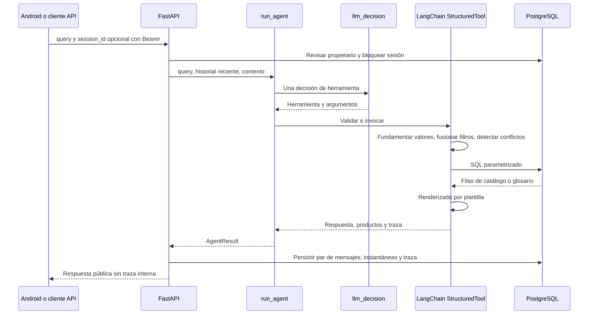

# Agente

[Wiki](index.md) · [English](../en/agent.md) · [Español](../es/agent.md)

Cómo una decisión LangChain se convierte en respuesta técnica validada y reproducible.

Las respuestas, mensajes fijos y sugerencias son solo en inglés por decisión de producto; la entrada puede ser española. El LLM interpreta una herramienta por turno y nunca redacta texto, tablas ni sugerencias.



## Herramientas tipadas

Los `args_schema` que recibe el proveedor son diccionarios JSON Schema compactos. El código normaliza y valida cada decisión contra modelos Pydantic estrictos antes de ejecutarla. El LLM aporta intención/argumentos, nunca SQL ni prosa técnica final.

El proveedor usa `bounds=[{"field":"min_torque_in_lb","op":"gt","value":1000}]` y omite propiedades desconocidas en lugar de enviar null. El código convierte esa lista a los campos canónicos value/op descritos abajo; siguen admitidos los argumentos internos antiguos y la API de búsqueda directa. Focus contiene nombres de campos y calificadores escalares opcionales de servicio/frecuencia. Las cuatro herramientas siguen juntas en una solicitud y hay una decisión de modelo por turno. [Contrato compacto](../../../backend/conversation/tool_wire.py) y [prueba offline de presupuesto](../../../tests/test_tool_schema_budget.py) limitan la complejidad estructural acumulada; el coordinador comprobará el proveedor aparte. La tabla siguiente describe los argumentos canónicos internos después de la expansión.

| Herramienta | Esquema de entrada |
|---|---|
| `get_actuator` | `part_numbers`: 1..4 textos de máximo 40 caracteres; `focus`: lista `{field,service?,frequency_hz?}` con campos overview/motor_power/torque/operating_time/fla/lra/duty/rates/certification; sin focus reutiliza contexto; `explain_terms`: hasta 3 claves, predeterminado [] |
| `search_actuators` | Filtros técnicos opcionales siguientes; `limit`: 1..20, predeterminado 5; `refine=false`, `more=false`, `remove`: hasta 8 nombres de filtro; `assumptions`: hasta 4 `{field,user_phrase}` (frase de 2..80 caracteres); `explain_terms`: hasta 3 claves |
| `explain_terms` | `term_keys`: 1..3 claves restringidas al glosario cargado |
| `ask_clarification` | `field`: part_number/service/frequency/supply/requirements/which_product/term_not_in_summary/unsupported/cancel/decline; `cancel_previous=false` |

Filtros: `enclosure` weatherproof/explosionproof; `supply_current` admite `AC`, `DC` y `AC/DC`; `phase_count` 1/3; `service` on_off/modulating; `frequency_hz` 50/60; `supply_voltage_v` positivo; valores no negativos `min_torque_nm`, `min_torque_in_lb`, `min_duty_s4_percent` (hasta 100), `min_cycles_per_hour`, `min_starts_per_hour`, `max_operating_time_s`, `max_fla_a`, `max_lra_a`, `max_motor_power_w`; `csa_required=false`. Las magnitudes decimales tienen máximo 1e12 y las tasas enteras 2147483647; null significa no agregar restricción. La paginación de búsqueda pública difiere: ver [API](api.md).

## Política determinista

Ante `DC + 60 Hz`, pregunta qué requisito conservar y mantiene las restricciones compatibles. `Ahora 220 V` usa `refine=true` y solo el delta de tensión; `merge_filters` conserva el resto. `remove` retira filtros y `more` avanza la página. Cambiar servicio elimina la tasa incompatible anterior y lo explica.

Los códigos normalizan mayúsculas/espacios/guion omitido, nunca completan `/A` ni sufijos supuestos. Los parciales reciben candidatos por prefijo; los completos inexistentes se informan como no encontrados. Deben figurar en conversación o contexto. Los filtros no expresados se descartan y nombran; los supuestos citan palabras reales y se muestran. La fundamentación numérica comprueba presencia del número, no semántica completa; todavía puede asignarse al campo equivocado.

SQL compara columnas publicadas con filtros AND, alcance por servicio/frecuencia y estados de ausencia. Lo desconocido no cumple umbrales. Las plantillas redactan filas y citas literales; ningún segundo modelo escribe la respuesta. Una invocación al proveedor por turno, sin reintentos. Una llamada de catálogo más `explain_terms` en la misma respuesta se puede fusionar en una ejecución; otras formas inválidas producen aclaración.

## Controles y trazas

`AGENT_MAX_CALLS_PER_HOUR=120` cuenta intentos en una hora móvil por proceso, incluidos fallos. Reiniciar lo restablece y más procesos lo multiplican. No es un límite monetario. `OPENROUTER_REQUIRE_PARAMETERS=true` añade `provider.require_parameters` solo al host `openrouter.ai`; filtra compatibilidad, no saldo. [Operación](operations.md) enumera los valores predeterminados.

LangSmith está apagado por defecto y requiere tracing=true y clave. Activarlo envía prompts, texto del usuario, entradas/resultados de herramientas y filas del catálogo al servicio configurado; la traza padre registra también consulta/contexto y metadatos de respuesta. Las trazas locales guardan parámetros crudos/fusionados, validación, contexto antes/después, renderizador y modelo/latencia/uso. El historial público omite trazas; el endpoint de desarrollo exige propietario y activación explícita.

## Extracto de traza real

[Proyección SQL persistida](database.md):

```json
{
  "role": "assistant",
  "tool": "get_actuator",
  "part_numbers": [
    "761A00-11300000/A"
  ],
  "validation": [
    "ok"
  ],
  "renderer": "get_actuator"
}
```

Acredita ejecución almacenada, no aceptación con proveedor real. [Pruebas y cohortes](testing.md) separan ambas afirmaciones.

## Dónde está en el código

- [backend/conversation/agent.py](../../../backend/conversation/agent.py#L135)
- [backend/conversation/agent.py](../../../backend/conversation/agent.py#L521)
- [backend/conversation/policy.py](../../../backend/conversation/policy.py#L85)
- [backend/conversation/rendering.py](../../../backend/conversation/rendering.py#L1)

## Política conversacional T6

### Focus y umbrales

`focus=[{"field":"torque","service":"on_off"},{"field":"operating_time","frequency_hz":60}]` muestra solo torque On/Off y tiempo a 60 Hz, también en los productos estructurados. Focus persiste para seguimientos; `overview` pide todos los campos. Se acepta el focus escalar antiguo por compatibilidad.

Los filtros de magnitud aceptan `{value,op}` con `gt|gte|lt|lte`. “More than”, “over”, “mayor a”, “más de” son gt estricto; “below”/“menos de”, lt; “at least”/“al menos”, gte; “up to”/“hasta”, lte. Los operadores SQL vienen de una lista permitida; no se altera la cifra. Los filtros escalares antiguos siguen siendo inclusivos. El resumen imprime el operador aplicado.

### Ranking y tamaño del resultado

`sort_by` tiene orden: fastest (tiempo ascendente), lowest_power (potencia ascendente), highest_torque o lowest_current (FLA ascendente). Conserva servicio/frecuencia pedidos; sin frecuencia usa el menor valor publicado y lo aclara. Datos desconocidos quedan al final; N/A explícito se excluye de recomendaciones. Potencia de motor aproxima la preferencia expresada, no consumo total. Con orden muestra los 3 primeros y sus campos de ranking, más una pregunta para acotar.

Sin orden, más de 4 coincidencias muestran conteo SQL y una pregunta, sin productos. El atributo maximiza entropía de las facetas SQL actuales de alimentación/carcasa/fases; sus opciones generan sugerencias. Entre 2 y 4 hay lista breve con un valor distintivo y pares para comparar; con 1, respuesta enfocada. Con 0 no pregunta servicio/frecuencia: retira cada umbral por turno y calcula min/max SQL y todos los modelos empatados bajo los demás requisitos. Si tampoco existe la combinación restante, lo indica; no inventa un sustituto cercano.

### Cancelación, comparación y sugerencias

`ask_clarification` acepta cancel/decline. Un no aislado tras pregunta pendiente la rechaza sin repetirla. Cancel limpia pregunta, filtros y focus, sin consulta/búsqueda de catálogo. `cancel_previous=true` permite cancelar y después buscar o pedir algo fuera de alcance. Una guarda reconoce cancelación/rechazo aislados aunque el modelo proponga otra herramienta; se conserva una decisión LLM por turno.

Se comparan máximo dos códigos verificados en SQL. `comparison={models,rows,identical_fields_hidden}` solo incluye diferencias; cada fila tiene field, label, a, b y better=a|b|null. Solo se marca mejor con más torque o menos tiempo/corriente/potencia. Se cuentan campos idénticos ocultos; con 3–4 candidatos ofrece pares. `answer` sigue siendo texto plano sin tablas Markdown.

Cada turno nuevo exitoso tiene exactamente 3 `suggested_replies` distintas en inglés, construidas por código desde opciones/códigos SQL y mensajes fijos admitidos. Show more exige otra página real mostrable; Cancel requiere información pendiente y se omite inmediatamente tras cancelar. Explain On/Off service solo se ofrece ante una pregunta pendiente de servicio. Tras imposibilidad propone el modelo cercano SQL y búsquedas relajadas con ámbito explícito; al rechazar una pregunta usa una frase natural que solo nombra el campo realmente pendiente. Ambos campos persisten en snapshots con migración aditiva 004; los mensajes antiguos conservan lectura con [] y comparación null. Android muestra chips bajo el último mensaje asistente (desactivados durante carga/reconciliación) y tarjeta de diferencias de tres columnas, valor mejor en negrita, sin scroll horizontal.

Las cotas de imposibilidad conservan su ámbito publicado: sin servicio, On/Off y Modulating se calculan y etiquetan por separado; con servicio conocido solo se muestra su cota. Tiempo, FLA y LRA se separan por frecuencia publicada (o explícitamente no especificada/no aplicable); una frecuencia pedida restringe el diagnóstico. Se conservan empates SQL y notas de datos compartidos publicados.

## Límites conocidos

El léxico y la fundamentación siguen acotados: que una cifra aparezca no demuestra asignación semántica correcta. Focus, umbrales estrictos, ranking, cancelación y comparación T6 se verificaron offline con decisiones programadas y SQL; el coordinador aún debe ejecutar v5 con LLM real. Se envían 12 mensajes recientes (2000 caracteres por mensaje) más contexto persistido. OpenRouter y aceptación integral Android con LLM real siguen pendientes.

El foco del proveedor es una lista plana de campos, con focus_service opcional para torque y focus_frequency_hz para tiempo/FLA/LRA. El código lo expande al foco canónico persistido por campo. explain_terms combinado usa claves del glosario separadas por comas; assumptions mapea filtros a frases literales del usuario. Los límites siguen como registros field/op/value. Pydantic valida rangos numéricos y límites de listas/texto después de la llamada; no se anuncian al proveedor. Ejecutar el [preflight de esquemas](operations.md#preflight-del-esquema-antes-de-cualquier-cohorte) antes de cualquier cohorte de pago.
