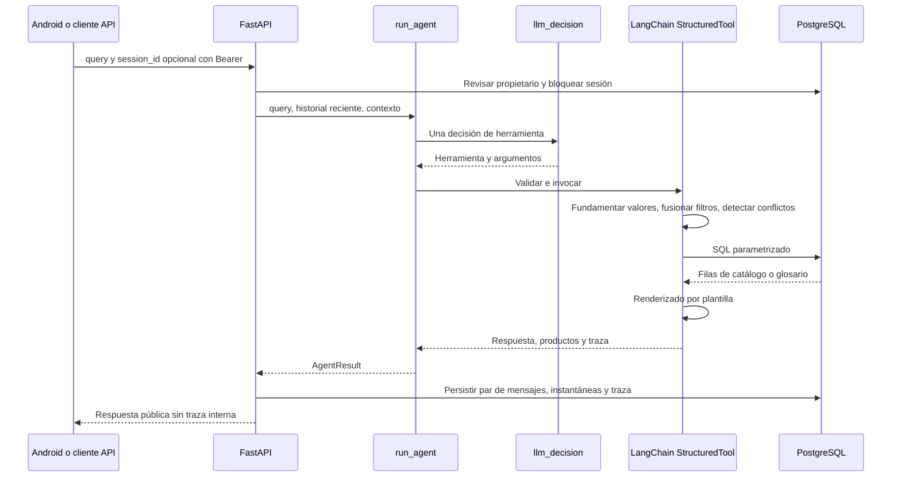

# Agente

[Wiki](index.md) · [English](../en/agent.md) · [Español](../es/agent.md)

Cómo una decisión LangChain se convierte en respuesta técnica validada y reproducible.



## Herramientas tipadas

Todos los modelos `args_schema` prohíben campos extra. El LLM aporta intención/argumentos, nunca SQL ni prosa técnica final.

| Herramienta | Esquema de entrada |
|---|---|
| `get_actuator` | `part_numbers`: 1..4 textos de máximo 40 caracteres; `focus`: overview/motor_power/torque/operating_time/fla/lra/duty/rates/certification, predeterminado overview; `explain_terms`: hasta 3 claves, predeterminado [] |
| `search_actuators` | Filtros técnicos opcionales siguientes; `limit`: 1..20, predeterminado 5; `refine=false`, `more=false`, `remove`: hasta 8 nombres de filtro; `assumptions`: hasta 4 `{field,user_phrase}` (frase de 2..80 caracteres); `explain_terms`: hasta 3 claves |
| `explain_terms` | `term_keys`: 1..3 claves restringidas al glosario cargado |
| `ask_clarification` | `field`: part_number/service/frequency/supply/requirements/which_product/term_not_in_summary/unsupported |

Filtros: `enclosure` weatherproof/explosionproof; `supply_current` admite `AC`, `DC` y `AC/DC`; `phase_count` 1/3; `service` on_off/modulating; `frequency_hz` 50/60; `supply_voltage_v` positivo; valores no negativos `min_torque_nm`, `min_torque_in_lb`, `min_duty_s4_percent` (hasta 100), `min_cycles_per_hour`, `min_starts_per_hour`, `max_operating_time_s`, `max_fla_a`, `max_lra_a`, `max_motor_power_w`; `csa_required=false`. Las magnitudes decimales tienen máximo 1e12 y las tasas enteras 2147483647; null significa no agregar restricción. La paginación de búsqueda pública difiere: ver [API](api.md).

## Política determinista

Ante `DC + 60 Hz`, pregunta qué requisito conservar y mantiene las restricciones compatibles. `Ahora 220 V` usa `refine=true` y solo el delta de tensión; `merge_filters` conserva el resto. `remove` retira filtros y `more` avanza la página. Cambiar servicio elimina la tasa incompatible anterior y lo explica.

Los códigos normalizan mayúsculas/espacios/guion omitido, nunca completan `/A` ni sufijos supuestos. Los parciales reciben candidatos por prefijo; los completos inexistentes se informan como no encontrados. Deben figurar en conversación o contexto. Los filtros no expresados se descartan y nombran; los supuestos citan palabras reales y se muestran. La fundamentación numérica comprueba presencia del número, no semántica completa; todavía puede asignarse al campo equivocado.

SQL compara columnas publicadas con filtros AND, alcance por servicio/frecuencia y estados de ausencia. Lo desconocido no cumple umbrales. Las plantillas redactan filas y citas literales; ningún segundo modelo escribe la respuesta. Una invocación al proveedor por turno, sin reintentos. Una llamada de catálogo más `explain_terms` en la misma respuesta se puede fusionar en una ejecución; otras formas inválidas producen aclaración.

## Controles y trazas

`AGENT_MAX_CALLS_PER_HOUR=120` cuenta intentos en una hora móvil por proceso, incluidos fallos. Reiniciar lo restablece y más procesos lo multiplican. No es un límite monetario. `OPENROUTER_REQUIRE_PARAMETERS=true` añade `provider.require_parameters` solo al host `openrouter.ai`; filtra compatibilidad, no saldo. [Operación](operations.md) enumera los valores predeterminados.

LangSmith está apagado por defecto y requiere tracing=true y clave. Activarlo envía prompts, texto del usuario, entradas/resultados de herramientas y filas del catálogo al servicio configurado; la traza padre registra también consulta/contexto y metadatos de respuesta. Las trazas locales guardan parámetros crudos/fusionados, validación, contexto antes/después, renderizador y modelo/latencia/uso. El historial público omite trazas; el endpoint de desarrollo exige propietario y activación explícita.

## Extracto de traza real

[Proyección SQL persistida](database.md):

```json
{
  "role": "assistant",
  "tool": "get_actuator",
  "part_numbers": [
    "761A00-11300000/A"
  ],
  "validation": [
    "ok"
  ],
  "renderer": "get_actuator"
}
```

Acredita ejecución almacenada, no aceptación con proveedor real. [Pruebas y cohortes](testing.md) separan ambas afirmaciones.

## Dónde está en el código

- [backend/conversation/agent.py](../../../backend/conversation/agent.py#L114)
- [backend/conversation/agent.py](../../../backend/conversation/agent.py#L456)
- [backend/conversation/policy.py](../../../backend/conversation/policy.py#L84)
- [backend/conversation/rendering.py](../../../backend/conversation/rendering.py#L1)

## Límites conocidos

El léxico es acotado. Los umbrales son inclusivos: el prompt actual transforma “below 5 W” en <=5; las desigualdades estrictas siguen siendo una debilidad conocida. La corrección v4 no se revalidó con LLM real. Se envían 12 mensajes recientes (cada uno truncado a 2000 caracteres) más filtros/códigos persistidos. OpenRouter y aceptación integral Android pendientes.
