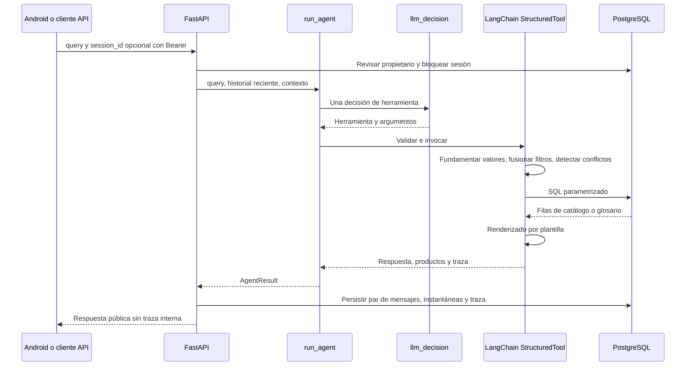

# Agente

[Wiki](index.md) · [English](../en/agent.md) · [Español](../es/agent.md)

Cómo una decisión LangChain se convierte en respuesta técnica validada y reproducible.

Las respuestas, mensajes fijos y sugerencias son solo en inglés por decisión de producto; la entrada puede ser española. El LLM interpreta una herramienta por turno y nunca redacta texto, tablas ni sugerencias.



## T8/T9: flujo actual

El modelo interpreta una decisión por turno que requiere lenguaje; no redacta cifras ni respuestas. Saludos, Submit, retirada de filtros, acciones estructuradas y consultas cerradas de códigos completos usan rutas deterministas sin chat ni embeddings. Los intentos de transporte no equivalen a decisiones adicionales completadas.

T8 reúne las preguntas distinguibles en `interaction.questions`, ordenadas por reducción de candidatos con conteos SQL. Android las presenta en una sola tarjeta con navegación, revisión, Submit y Cancel. Una combinación vacía devuelve `422 empty_combination` sin guardar turno. `recommendation` declara `ranked_by`, total, cantidad mostrada y hasta tres códigos con razones/valores SQL; una vista previa o una alternativa que relaja filtros se identifica como tal. Las acciones `compare_top`, `show_all` y `rank_by` operan sobre contexto persistido sin LLM. El borrado lógico se limita al propietario; ver [API](api.md).

El [planificador](../../../backend/conversation/answer_planner.py) elige campo, ficha, veredicto, diferencia o razón; las referencias se resuelven contra `on_screen` y el foco guardado. [requirement_coverage.py](../../../backend/conversation/requirement_coverage.py) comprueba cantidades expresadas, unidades compatibles y límites, incluso tras fusionar filtros; no basta con que una cifra aparezca en el texto. [integrity.py](../../../backend/conversation/integrity.py) comprueba de nuevo que las filas cumplen filtros y evita recomendaciones inseguras ante peligro pendiente. Una cantidad sin representar bloquea la elección; una ambigua pide aclaración. Esto reduce omisiones, pero no garantiza toda interpretación semántica.

### Embeddings aditivos

[embeddings.py](../../../backend/conversation/embeddings.py) consulta hasta cinco ejemplos por coseno (mínimo 0.70) y anclas de conceptos en pgvector, antes de la única decisión LLM. El banco contiene frases e interpretaciones, nunca conocimiento numérico de productos. `gemini-embedding-2` usa 768 dimensiones; OpenRouter lo identifica como `google/gemini-embedding-2`. La normalización determinista siempre corre, ON y OFF: requisitos explícitos, negaciones, argumentos fundamentados y filtros previos prevalecen; las sugerencias solo llenan campos sin resolver. Peligro solicita confirmación y vista previa Explosionproof, no certifica la instalación.

Sin modelo, clave, resultados o ante fallo, se conservan las rutas deterministas. El presupuesto total de retrieval es 1.5 s, cero retries, cuatro trabajos acotados y SQL con savepoint; los resultados tardíos se descartan. Una petición ya enviada puede terminar remotamente. Inicializar el cliente al arrancar no hace inferencia. La traza incluye ejemplos/similitudes, conceptos y tiempo; [debug por respuesta y voz](android.md), [carga y procedencia](operations.md#example-bank), [resultados y límites](testing.md#behavior-evaluation).

## Herramientas tipadas

Los `args_schema` que recibe el proveedor son diccionarios JSON Schema compactos. El código normaliza y valida cada decisión contra modelos Pydantic estrictos antes de ejecutarla. El LLM aporta intención/argumentos, nunca SQL ni prosa técnica final.

El proveedor usa `bounds=[{"field":"min_torque_in_lb","op":"gt","value":1000}]` y omite propiedades desconocidas en lugar de enviar null. El código convierte esa lista a los campos canónicos value/op descritos abajo; siguen admitidos los argumentos internos antiguos y la API de búsqueda directa. Focus contiene nombres de campos y calificadores escalares opcionales de servicio/frecuencia. Las cuatro herramientas siguen juntas en una solicitud y hay una decisión de modelo por turno. [Contrato compacto](../../../backend/conversation/tool_wire.py) y [prueba offline de presupuesto](../../../tests/test_tool_schema_budget.py) limitan la complejidad estructural acumulada; el coordinador comprobará el proveedor aparte. La tabla siguiente describe los argumentos canónicos internos después de la expansión.

| Herramienta | Esquema de entrada |
|---|---|
| `get_actuator` | `part_numbers`: 1..4 textos de máximo 40 caracteres; `focus`: lista `{field,service?,frequency_hz?}` con campos overview/motor_power/torque/operating_time/fla/lra/duty/rates/certification; sin focus reutiliza contexto; `explain_terms`: hasta 3 claves, predeterminado [] |
| `search_actuators` | Filtros técnicos opcionales siguientes; `limit`: 1..20, predeterminado 5; `refine=false`, `more=false`, `remove`: hasta 8 nombres de filtro; `assumptions`: hasta 4 `{field,user_phrase}` (frase de 2..80 caracteres); `explain_terms`: hasta 3 claves |
| `explain_terms` | `term_keys`: 1..3 claves restringidas al glosario cargado |
| `ask_clarification` | `field`: part_number/service/frequency/supply/requirements/which_product/term_not_in_summary/unsupported/cancel/decline; `cancel_previous=false` |

Filtros: `enclosure` weatherproof/explosionproof; `supply_current` admite `AC`, `DC` y `AC/DC`; `phase_count` 1/3; `service` on_off/modulating; `frequency_hz` 50/60; `supply_voltage_v` positivo; valores no negativos `min_torque_nm`, `min_torque_in_lb`, `min_duty_s4_percent` (hasta 100), `min_cycles_per_hour`, `min_starts_per_hour`, `max_operating_time_s`, `max_fla_a`, `max_lra_a`, `max_motor_power_w`; `csa_required=false`. Las magnitudes decimales tienen máximo 1e12 y las tasas enteras 2147483647; null significa no agregar restricción. La paginación de búsqueda pública difiere: ver [API](api.md).

## Política determinista

Ante `DC + 60 Hz`, pregunta qué requisito conservar y mantiene las restricciones compatibles. `Ahora 220 V` usa `refine=true` y solo el delta de tensión; `merge_filters` conserva el resto. `remove` retira filtros y `more` avanza la página. Cambiar servicio elimina la tasa incompatible anterior y lo explica.

Los códigos normalizan mayúsculas/espacios/guion omitido, nunca completan `/A` ni sufijos supuestos. Los parciales reciben candidatos por prefijo; los completos inexistentes se informan como no encontrados. Deben figurar en conversación o contexto. Los filtros no expresados se descartan y nombran; los supuestos citan palabras reales y se muestran. T9 comprueba también cobertura de cantidades y unidades en ambas direcciones; todavía puede fallar la asignación semántica a un campo.

SQL compara columnas publicadas con filtros AND, alcance por servicio/frecuencia y estados de ausencia. Lo desconocido no cumple umbrales. Las plantillas redactan filas y citas literales; ningún segundo modelo escribe la respuesta. Una decisión de modelo completada por turno; los fallos transitorios pueden reintentarse dentro del plazo compartido descrito abajo. Una llamada de catálogo más `explain_terms` en la misma respuesta se puede fusionar en una ejecución; otras formas inválidas producen aclaración.

## Controles y trazas

`AGENT_MAX_CALLS_PER_HOUR=120` cuenta intentos en una hora móvil por proceso, incluidos fallos. Reiniciar lo restablece y más procesos lo multiplican. No es un límite monetario. `OPENROUTER_REQUIRE_PARAMETERS=true` añade `provider.require_parameters` solo al host `openrouter.ai`; filtra compatibilidad, no saldo. [Operación](operations.md) enumera los valores predeterminados.

LangSmith está apagado por defecto y requiere tracing=true y clave. Activarlo envía prompts, texto del usuario, entradas/resultados de herramientas y filas del catálogo al servicio configurado; la traza padre registra también consulta/contexto y metadatos de respuesta. Las trazas locales guardan parámetros crudos/fusionados, validación, contexto antes/después, renderizador y modelo/latencia/uso. El historial público omite trazas; el endpoint de desarrollo exige propietario y activación explícita.

## Extracto de traza real

[Proyección SQL persistida](database.md):

```json
{
  "role": "assistant",
  "tool": "get_actuator",
  "part_numbers": [
    "761A00-11300000/A"
  ],
  "validation": [
    "ok"
  ],
  "renderer": "get_actuator"
}
```

Acredita ejecución almacenada, no aceptación con proveedor real. [Pruebas y cohortes](testing.md) separan ambas afirmaciones.

## Dónde está en el código

- [backend/conversation/agent.py](../../../backend/conversation/agent.py#L135)
- [backend/conversation/agent.py](../../../backend/conversation/agent.py#L521)
- [backend/conversation/policy.py](../../../backend/conversation/policy.py#L85)
- [backend/conversation/rendering.py](../../../backend/conversation/rendering.py#L1)

## Política conversacional T7

Ejemplos históricos T7: las reglas T8/T9 anteriores prevalecen para ranking, acciones y guardas.

### Focus, filtros y ranking

`focus` selecciona campos y ámbito de servicio/frecuencia; al omitirlo reutiliza contexto y `overview` pide todos los campos. Los límites usan `gt|gte|lt|lte`, conservan cifra y unidad, y admiten cota inferior y superior en el mismo campo. Los escalares antiguos siguen inclusivos. SQL controla las comparaciones; un dato desconocido o N/A no satisface un umbral numérico.

`sort_by` ordena preferencias fastest, lowest_power, highest_torque o lowest_current. Muestra hasta tres candidatos ordenados; sin frecuencia usa el menor valor publicado y lo explica. Potencia de motor no equivale a consumo energético total. Más de cuatro resultados sin orden muestran conteo SQL y preguntan por una faceta que los separe; sin faceta filtrable no inventan pregunta/opciones. Cero coincidencias produce extremos SQL por ámbito y opciones de relajación, nunca un modelo inferior presentado como válido.

### Preguntas y envíos resueltos por código

Una pregunta pide información necesaria; una sugerencia propone una acción opcional. `interaction.questions` reúne todos los campos actualmente requeridos, ordenados y con opciones de facetas SQL bajo los filtros actuales. Android recoge respuestas localmente, muestra revisión y solo envía al pulsar Submit. Esta interacción capturada pide servicio y frecuencia juntos:

```json
{
  "kind": "question",
  "questions": [
    {
      "id": "service",
      "prompt": "Which service?",
      "options": [
        {
          "value": "on_off",
          "label": "On/Off"
        },
        {
          "value": "modulating",
          "label": "Modulating"
        }
      ]
    },
    {
      "id": "frequency_hz",
      "prompt": "Which frequency?",
      "options": [
        {
          "value": "50",
          "label": "50 Hz"
        },
        {
          "value": "60",
          "label": "60 Hz"
        }
      ]
    }
  ]
}
```

Fuente: `two_questions` en [evidencia HTTP T7](../../../reports/submission/T7-interactions.json). Los textos enviados deben coincidir exactamente con IDs/valores pendientes. `answers` y `remove_filters` son campos de la solicitud, fuera de los esquemas LLM: el código valida, fusiona/elimina filtros y repite SQL sin llamar al modelo ni reservar `reserve_agent_call`. Guarda el `query` legible como mensaje del usuario. Respuestas/eliminaciones inválidas devuelven 422; ver [API](api.md#contrato-conversacional-t7).

`active_filters` conserva etiquetas removibles de búsqueda. Rechazar o repetir una pregunta sin resolver muestra hasta tres candidatos y nombra el requisito abierto. Cancel limpia información pendiente, filtros y focus. Un turno normal de lenguaje conserva una decisión LLM completada; envíos estructurados y saludos puros necesitan cero. Un intento de transporte fallido no es otra decisión completada.

### Sugerencias opcionales

| Resultado/estado | Sugerencias |
|---|---|
| Pregunta pendiente | 0; las opciones pertenecen a la pregunta |
| Búsqueda con 2–4 resultados y sin pregunta | 1 comparación del par con más campos distintos; empates conservan orden SQL |
| Más de 4 resultados sin pregunta pendiente | 0 |
| Requisitos imposibles | 0–3 relajaciones/consultas ejecutables derivadas de SQL |
| Dato único, definición, comparación, saludo, fuera de alcance o cancelación | 0 |

`suggestions` y el alias obsoleto `suggested_replies` llevan la misma lista. No se rellena con navegación genérica, la acción recién realizada ni Cancel.

### Comparación y lead

Dos modelos usan `layout:"table"`: `summary` cuenta campos ganados sin ponderación; `assumptions` declara preferencias; las diferencias están en `rows` y los campos idénticos en `hidden_rows`. `better` es el índice del modelo desde cero, calculado por comparación numérica simple en código, no por el agente. Se prefiere más torque/ciclos y menos tiempo/corriente/potencia; empates, N/A y campos sin dirección acordada quedan null. Si las unidades publicadas discrepan en dirección, no hay ganador. El conteo no mide idoneidad global.

Fila real de `compare_two` en [evidencia HTTP T7](../../../reports/submission/T7-interactions.json):

```json
{
  "field": "on_off_torque",
  "label": "On/Off torque",
  "values": [
    "700 in-lb / 80 Nm",
    "880 in-lb / 100 Nm"
  ],
  "better": 1
}
```

Tres o cuatro modelos usan `layout:"cards"`, `better:null`, sin flechas y cuatro `key_fields` elegidos por código: torque, tiempo, FLA y potencia, conservando los ámbitos pedidos. Las claves capturadas para tres modelos son `on_off_torque`, `operating_time_50hz_s`, `fla_50hz_a`, `motor_power_w`.

Productos/comparaciones reciben un `lead` de una frase para la app; `answer` conserva la respuesta completa en texto plano para clientes API. La app usa `answer` cuando un mensaje antiguo no tiene lead.

### Saludo y políticas de casos límite

El código resuelve saludos puros en inglés/español, tolerando puntuación, con el primer nombre autenticado o `Hello.` y sin sugerencias. Respuesta capturada:

> Hello, Samuel. I can look up Series 76 actuators, find models for your requirements, compare models or explain catalogue terms.

Estas políticas aprobadas se ejercitan en [evidencia EC T7](../../../reports/submission/T7-scenarios.json), siguiendo la [especificación de 40 casos](../../evaluation/edge-case-suite.es.md):

| Caso | Política |
|---|---|
| EC05 | Etiqueta y factura contradictorias no identifican el actuador instalado; revisar placa y comparar modelos del catálogo. |
| EC10 | El intervalo inclusivo 70–100 Nm conserva `gte 70` y `lte 100` en torque. |
| EC15 | La coma decimal `1,5` significa `1.5`, nunca `15`. |
| EC20 | “Same performance” al cambiar servicio conserva umbrales numéricos y declara el supuesto. |
| EC25 | `110 V or 220 V` pregunta con ambas opciones publicadas; no aplica AND ni elige una en silencio. |
| EC30 | No hay precios ni puntuación global ponderada por precio acordada; ofrece comparación técnica publicada. |
| EC35 | No compra ni confirma entrega; ofrece especificaciones del catálogo. |
| EC40 | Resuelve datos/comparación admitidos y definiciones FLA/LRA/S4 en una decisión; declara que el resumen no define IP67. |

### Retry, fallback y plazo total

LangChain `.with_retry(stop_after_attempt=2)` reintenta solo 503, timeout y errores de conexión; nunca 4xx. `OPENROUTER_FALLBACK_MODEL` habilita opcionalmente `.with_fallbacks` en el mismo endpoint. Los retries propios del SDK permanecen apagados. Cada intento real reserva cuota local y queda registrado; los fallos conservan metadatos seguros sin persistir medio turno.

`AGENT_TURN_DEADLINE_S=60` es compartido por reintentos y fallback. Cada intento usa `min(AGENT_TIMEOUT_S=45, tiempo restante)`; con menos de `AGENT_RETRY_MIN_REMAINING_S=10` registra `deadline_skipped` sin reservar llamada. Los valores predeterminados quedan bajo los 70 s de lectura/75 s totales de Android. Keep-alive es independiente: pool cliente 30 s, Uvicorn 75 s. [Operación](operations.md) explica configuración y fallo del primer toque.

## Límites conocidos

T7 se verificó con decisiones controladas, SQL real y HTTP/transporte locales; [pruebas](testing.md) separa la aceptación con modelo real. Presencia numérica no prueba asignación semántica. Solo llegan al modelo 12 mensajes recientes (hasta 2000 caracteres cada uno) y contexto persistido. Los controles offline no acreditan disponibilidad del proveedor, lenguaje arbitrario, diseño en dispositivo ni carga productiva.
