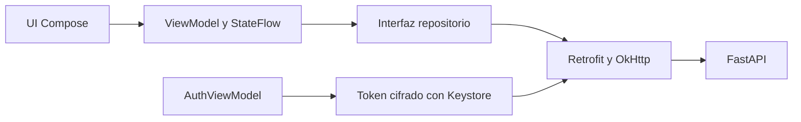

# Android

[Wiki](index.md) · [English](../en/android.md) · [Español](../es/android.md)

Compilar, recorrer y diagnosticar el cliente nativo Kotlin/Compose.



## Pantallas y estado

Login valida el token guardado mediante `/me` antes de mostrar historial privado. Chat presenta Hello personalizado al iniciar, fichas/filas comparables, compositor y estados de carga/error. El drawer lista conversaciones propias con paginación, New chat, cuenta/Sign out y apariencia Light/Dark/System. Debug oculto por respuesta está disponible en ambas variantes APK.

Los ViewModels controlan peticiones y StateFlow; la inyección por constructor separa DTO Retrofit de presentación. Los decimales JSON se conservan como texto decimal para mostrarlos, sin pasar por Double. El perfil autenticado viene del servidor; el perfil local editable anterior es histórico. La apariencia se conserva localmente. Voz con SpeechRecognizer de Android; sin Firebase.

La carga impide envíos duplicados y cambios de sesión durante un turno. Un envío fallido conserva el borrador y exige recargar historial; sin session_id recibido, revisar la lista. La rotación conserva ViewModels. Tras muerte de proceso se revalida el token cifrado y se reabre historial del servidor; no se garantiza restaurar borrador/sesión abierta. Si falla logout se conserva la cuenta para reintentar revocación. Un 401 tardío de un token antiguo no cierra una cuenta nueva.

## Preguntas, sugerencias y comparaciones T7

La tarjeta QUESTION fija sobre el compositor presenta pregunta, opciones de radio de ancho completo y contador de pasos. Las selecciones avanzan localmente por todas las preguntas; la revisión muestra cada respuesta y permite editarla. Submit envía valores exactos en `answers` y un resumen legible; seleccionar no hace peticiones. Cancel retira la tarjeta y envía `Cancel` sin respuestas parciales. El compositor se atenúa mientras hay pregunta, pero permite escribir tras tocarlo/enfocarlo; enviar texto libre descarta las selecciones locales.

Las sugerencias opcionales son chips discretos con borde discontinuo bajo el último mensaje, rotulados `✦ Suggestions · optional`. Se ocultan al escribir/enviar o si hay interacción; pueden ser cero. Las etiquetas de filtros activos debajo de la barra superior permiten quitar filtros y envían `remove_filters` con query legible. El backend valida opciones/filtros; la app no los decide.

Dos modelos muestran resumen, supuestos atenuados, tabla de tres columnas y filas idénticas expandibles. La negrita y flecha naranja muestran el índice `better` calculado en servidor. Con tres/cuatro modelos hay una tarjeta por modelo, cuatro campos elegidos por servidor en cuadrícula 2×2 y ninguna flecha. `lead` sustituye `answer` completo solo al renderizar productos/comparación; mensajes antiguos usan answer. Se conservan textos decimales y notas de fuente.

El chat vacío saluda con el primer nombre autenticado: `Hello, Samuel` para el ejemplo Samuel registrado, o `Hello` si falta. Un mensaje de saludo puro también recibe la frase personalizada del backend; ver [capturas HTTP](../../../reports/submission/T7-interactions.json). Se conservan identidad visual y animación existentes.

## Interacción T8

Una sola tarjeta contiene todas las preguntas, conteos de opciones y descripciones opcionales: Back/Next, revisión editable, Submit y Cancel. Seleccionar no envía nada; `422 empty_combination` restaura la revisión con el error inline. La recomendación muestra `Ranked by …`, hasta tres códigos/razones del servidor y `Showing 3 of N` con el conteo real. Las tarjetas comparativas usan `key_fields` y `key_fields_reason`; el dispositivo no calcula cifras de catálogo.

Las sugerencias objeto envían etiqueta y `action`; las cadenas heredadas siguen funcionando. Mantén pulsada una conversación y confirma para ocultarla con `Conversation deleted · Undo`: el DELETE espera cinco segundos. Undo cancela solo el último pendiente; otro borrado confirmado o destruir el ViewModel confirma el anterior. Si falla, se restaura la fila. Durante el envío se muestra `Searching the catalog…`, luego `Still working…` a los ocho segundos.

## Fallo del primer toque por conexión

T7 corrige el primer toque después de inactividad cuando OkHttp reutilizaba una conexión del pool que Uvicorn había cerrado tras su antiguo keep-alive de 5 s. Ahora el cliente expira conexiones a los 30 s, antes de los 75 s del servidor (`--timeout-keep-alive 75`). Actualiza/reconstruye ambos lados; cambiar solo la app conserva el desajuste del servidor antiguo.

Los reintentos automáticos de POST/conexión siguen apagados (`retryOnConnectionFailure(false)`) para evitar repetir una escritura conversacional. El timeout de lectura es 70 s y el total 75 s; el plazo de decisión del proveedor es 60 s por defecto. Ante fallo de red incierto, recarga historial antes de reenviar.

[Evidencia Android T7](../../../reports/submission/T7-android.md): 40 pruebas JVM aprobadas y APK debug compilado. La regresión usa Retrofit/OkHttp productivos y MockWebServer, confirma conexión en pool y expiración a 30 s, y después un POST nuevo exitoso sin retries. Cubre un socket cerrado local; no reproduce el timeout de 5 s del despliegue ni acredita ajuste visual/emulador. Los ejemplos backend usan SQL real; las comparaciones de prueba Android son sintéticas, no evidencia de catálogo.

## Autenticación

Android guarda solo el bearer cifrado AES-GCM en preferencias privadas con clave no exportable de Android Keystore; no guarda contraseña. OkHttp adjunta Authorization, desactiva redirecciones y reintento de conexión y maneja 401 del token vigente. El backend guarda contraseñas PBKDF2-HMAC-SHA256 con sal (600000 iteraciones) y SHA-256 del token; los tokens opacos caducan en 12h. Backups desactivados y FLAG_SECURE protege la ventana normal. HTTP solo en debug; release requiere HTTPS.

## Compilar y ejecutar

Antes de compilar, ejecuta `java -version` y confirma **JDK 17**. Configura `JAVA_HOME` con esa instalación y pon su `bin` primero en PATH; configura `ANDROID_HOME` con la carpeta SDK que contiene `platforms/android-36`. SDK Manager de Android Studio instala SDK Platform 36. Añade `platform-tools` del SDK a PATH antes de usar `adb`. JDK 17 es la base de validación documentada; compilar con otro JDK no acredita esa base.

```sh
# macOS/Linux: sustituye estas rutas por las de tus instalaciones
export JAVA_HOME=/path/to/jdk-17
export ANDROID_HOME=/path/to/Android/sdk
export PATH="$JAVA_HOME/bin:$ANDROID_HOME/platform-tools:$PATH"
java -version
test -d "$ANDROID_HOME/platforms/android-36"
adb version
```

```powershell
# Windows PowerShell: sustituye estas rutas por las de tus instalaciones
$env:JAVA_HOME='C:\path\to\jdk-17'
$env:ANDROID_HOME="$env:LOCALAPPDATA\Android\Sdk"
$env:Path="$env:JAVA_HOME\bin;$env:ANDROID_HOME\platform-tools;$env:Path"
java -version
Test-Path "$env:ANDROID_HOME\platforms\android-36"
adb version
```

Para un segundo checkout independiente, añade `COMPOSE_PROJECT_NAME=serie76-clean`, `POSTGRES_PORT=55432` y `API_PORT=18000` a su `.env` antes de ejecutar Compose. Usa `http://localhost:18000` en los ejemplos HTTP y `-PbackendUrl=http://10.0.2.2:18000/` al compilar para su emulador. Estos nombres y puertos aíslan el checkout; conserva la contraseña de su propio volumen.

Instala Android Studio, JDK 17, SDK Platform 36 y emulador/dispositivo API 26+. Abre `mobile/android`, deja que Studio cree `local.properties` ignorado, selecciona app/debug y Run. Inicia backend desde el [README](../../../README.es.md). El APK no lleva claves de modelo.

```sh
# macOS/Linux, repository root
sh mobile/android/gradlew -p mobile/android :app:assembleDebug :app:testDebugUnitTest
# Windows PowerShell
./mobile/android/gradlew.bat -p mobile/android :app:assembleDebug :app:testDebugUnitTest
# Either platform, adb on PATH
adb install -r mobile/android/app/build/outputs/apk/debug/app-debug.apk
```

Abre Series 76 en el lanzador e inicia sesión con una [cuenta TEST ONLY](../../../README.es.md#usuarios-demo-test-only). URL predeterminada: `http://10.0.2.2:8000/`; localhost en emulador es Android. Cambia al compilar con `-PbackendUrl=https://tu-host/` y reinstala. Para USB, `adb reverse tcp:8000 tcp:8000` y debug con `-PbackendUrl=http://127.0.0.1:8000/`. PostgreSQL nunca se conecta al teléfono.

`assembleRelease` genera `app/build/outputs/apk/release/app-release-unsigned.apk`; instalarlo requiere firma local. Usa debug para revisar; no se incluye clave de firma.

## Voz T9

El micrófono gris de 48 dp queda a la izquierda de Send. El primer uso explica y solicita `RECORD_AUDIO`; si se deniega muestra `Microphone permission is needed for voice input` y acceso a ajustes. Pulsa para dictar y otra vez para detener. El texto parcial sustituye solo el sufijo dictado, conservando el borrador previo. Revisa/edita el resultado y pulsa Send: nunca se envía automáticamente.

En API 31+ se prefiere `createOnDeviceSpeechRecognizer` cuando está disponible; de lo contrario `createSpeechRecognizer` usa el servicio instalado y solicita offline. Ese servicio puede ignorar la preferencia y usar su red: no se garantiza offline en todos los equipos. No se envía audio al backend ni a OpenRouter. Sin servicio aparece `Voice input isn't available on this device`; sin reconocimiento, `Didn't catch that — try again`.

La escucha dura como máximo 60 s y espera final hasta 15 s después de parar. Escribir, enviar, cambiar conversación, abrir drawer/debug, salir/pausar o cerrar sesión cancela y libera el reconocedor; los callbacks tardíos se rechazan. No hay captura en segundo plano.

## Developer debug

Configura `DEV_DEBUG=true` en `.env` y ejecuta `docker compose up -d backend`. En el drawer toca el **nombre/email del perfil siete veces en tres segundos**; el toast `Developer mode on` confirma el modo. Repite para apagarlo. Se guarda localmente y empieza apagado; tocar el avatar abre el menú de cuenta, no el gesto. No existe entrada Developer debug en el menú.

Cada respuesta del asistente muestra **ⓘ** (`Debug details`) cuando el modo está activo, también en conversaciones reabiertas. El sheet consulta perezosamente `GET /api/messages/{id}/debug`; comprueba el ID y permite expandir, seleccionar/copiar JSON y desplazar secciones. Muestra herramientas, parámetros crudos/validados/fusionados, filas, latencia, intentos, `llm_called`, ejemplos/similitudes/conceptos de retrieval. Los campos ausentes quedan `null`.

La respuesta HTTP es `{message_id,session_id,tool_calls,debug}`. Un 404 muestra `Backend debug is disabled (DEV_DEBUG=false)`, aunque también puede significar respuesta inexistente; otros fallos permiten Try again. Ambas variantes comparten el flujo: ocultarlo es presentación; token, propiedad y `DEV_DEBUG` son los controles de acceso.

## Verificación T8/T9

[T8](../../../reports/submission/T8-android.md): 51 pruebas JVM; [T9 revisado](../../../reports/submission/T9-android.md): **74 pruebas JVM**, APK debug y release (sin firmar). Los dobles de reconocimiento verifican permiso, parcial/final, cancelación y callbacks tardíos; fixtures HTTP verifican trazas guardadas. La compilación de instrumentación no equivale a ejecutarla. Pendientes: voz real y sus servicios/idiomas, accesibilidad/rendering, backend fusionado y flujo con LLM real.

## Dónde está en el código

- [mobile/android/app/build.gradle.kts](../../../mobile/android/app/build.gradle.kts#L1)
- [mobile/android/app/src/main/java/com/serie76/assistant/ui/AppViewModel.kt](../../../mobile/android/app/src/main/java/com/serie76/assistant/ui/AppViewModel.kt#L1)
- [mobile/android/app/src/main/java/com/serie76/assistant/data/ConversationRepository.kt](../../../mobile/android/app/src/main/java/com/serie76/assistant/data/ConversationRepository.kt#L1)
- [mobile/android/app/src/main/java/com/serie76/assistant/data/Authentication.kt](../../../mobile/android/app/src/main/java/com/serie76/assistant/data/Authentication.kt#L34)
- [mobile/android/app/src/main/java/com/serie76/assistant/ui/DebugDetails.kt](../../../mobile/android/app/src/main/java/com/serie76/assistant/ui/DebugDetails.kt#L1)

- [VoiceInput.kt](../../../mobile/android/app/src/main/java/com/serie76/assistant/ui/VoiceInput.kt), [AndroidVoiceRecognizer.kt](../../../mobile/android/app/src/main/java/com/serie76/assistant/ui/AndroidVoiceRecognizer.kt), [VoiceController.kt](../../../mobile/android/app/src/main/java/com/serie76/assistant/ui/VoiceController.kt)

## Límites conocidos

Sin base/sincronización offline ni recuperación garantizada de borrador tras muerte de proceso. Emulador/UI y HTTP controlado no prueban aceptación Android con LLM real. La aceptación OpenRouter se completó el 2026-11-05; ver [Models](../../../README.md#models-design-and-limitations). v14 obtuvo 32/45 y v15 v1 obtuvo 42/60 antes de P1-F; sigue pendiente una cohorte nueva con proveedor tras P1-F. La medición en teléfono físico y el despliegue HTTPS público siguen pendientes; [evidencia móvil](../../evidence/mobile.md) delimita lo verificado.
