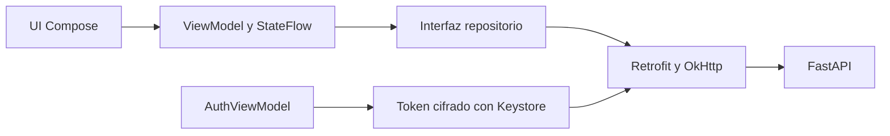

# Android

[Wiki](index.md) · [English](../en/android.md) · [Español](../es/android.md)

Compilar, recorrer y diagnosticar el cliente nativo Kotlin/Compose.



## Pantallas y estado

Login valida el token guardado mediante `/me` antes de mostrar historial privado. Chat presenta Hello al iniciar, fichas/filas comparables, compositor y estados de carga/error. El drawer lista conversaciones propias con paginación, New chat, cuenta/Sign out y apariencia Light/Dark/System. Developer debug es exclusivo de debug; release lo sustituye por implementación inerte.

Los ViewModels controlan peticiones y StateFlow; la inyección por constructor separa DTO Retrofit de presentación. Los decimales JSON se conservan como texto decimal para mostrarlos, sin pasar por Double. El perfil autenticado viene del servidor; el perfil local editable anterior es histórico. La apariencia se conserva localmente. Sin Firebase ni voz.

La carga impide envíos duplicados y cambios de sesión durante un turno. Un envío fallido conserva el borrador y exige recargar historial; sin session_id recibido, revisar la lista. La rotación conserva ViewModels. Tras muerte de proceso se revalida el token cifrado y se reabre historial del servidor; no se garantiza restaurar borrador/sesión abierta. Si falla logout se conserva la cuenta para reintentar revocación. Un 401 tardío de un token antiguo no cierra una cuenta nueva.

## Autenticación

Android guarda solo el bearer cifrado AES-GCM en preferencias privadas con clave no exportable de Android Keystore; no guarda contraseña. OkHttp adjunta Authorization, desactiva redirecciones y reintento de conexión y maneja 401 del token vigente. El backend guarda contraseñas PBKDF2-HMAC-SHA256 con sal (600000 iteraciones) y SHA-256 del token; los tokens opacos caducan en 12h. Backups desactivados y FLAG_SECURE protege la ventana normal. HTTP solo en debug; release requiere HTTPS.

## Compilar y ejecutar

Instala Android Studio, JDK 17, SDK Platform 36 y emulador/dispositivo API 26+. Abre `mobile/android`, deja que Studio cree `local.properties` ignorado, selecciona app/debug y Run. Inicia backend desde el [README](../../../README.es.md). El APK no lleva claves de modelo.

```sh
# macOS/Linux, repository root
sh mobile/android/gradlew -p mobile/android :app:assembleDebug :app:testDebugUnitTest
# Windows PowerShell
./mobile/android/gradlew.bat -p mobile/android :app:assembleDebug :app:testDebugUnitTest
# Either platform, adb on PATH
adb install -r mobile/android/app/build/outputs/apk/debug/app-debug.apk
```

Abre Series 76 en el lanzador e inicia sesión con una [cuenta TEST ONLY](../../../README.es.md#usuarios-demo-test-only). URL predeterminada: `http://10.0.2.2:8000/`; localhost en emulador es Android. Cambia al compilar con `-PbackendUrl=https://tu-host/` y reinstala. Para USB, `adb reverse tcp:8000 tcp:8000` y debug con `-PbackendUrl=http://127.0.0.1:8000/`. PostgreSQL nunca se conecta al teléfono.

`assembleRelease` genera `app/build/outputs/apk/release/app-release-unsigned.apk`; instalarlo requiere firma local. Usa debug para revisar; no se incluye clave de firma.

## Developer debug

Configura `DEV_DEBUG=true` en backend local y ejecuta `docker compose up -d backend`. Instala Android debug, abre drawer izquierdo, pulsa Developer debug y elige una respuesta. Muestra herramientas, parámetros validados y datos devueltos solo del propietario; sin razonamiento. Con DEV_DEBUG=false la API devuelve 404; release excluye pantalla/cliente y acción de menú.

## Dónde está en el código

- [mobile/android/app/build.gradle.kts](../../../mobile/android/app/build.gradle.kts#L1)
- [mobile/android/app/src/main/java/com/serie76/assistant/ui/AppViewModel.kt](../../../mobile/android/app/src/main/java/com/serie76/assistant/ui/AppViewModel.kt#L1)
- [mobile/android/app/src/main/java/com/serie76/assistant/data/ConversationRepository.kt](../../../mobile/android/app/src/main/java/com/serie76/assistant/data/ConversationRepository.kt#L1)
- [mobile/android/app/src/main/java/com/serie76/assistant/data/Authentication.kt](../../../mobile/android/app/src/main/java/com/serie76/assistant/data/Authentication.kt#L34)
- [mobile/android/app/src/debug/java/com/serie76/assistant/ui/DeveloperScreen.kt](../../../mobile/android/app/src/debug/java/com/serie76/assistant/ui/DeveloperScreen.kt#L1)

## Límites conocidos

Sin base/sincronización offline ni recuperación garantizada de borrador tras muerte de proceso. Emulador/UI y HTTP controlado no prueban aceptación Android con LLM real. OpenRouter, medición en teléfono físico y despliegue HTTPS público siguen pendientes; [evidencia móvil](../../evidence/mobile.md) delimita lo verificado.
