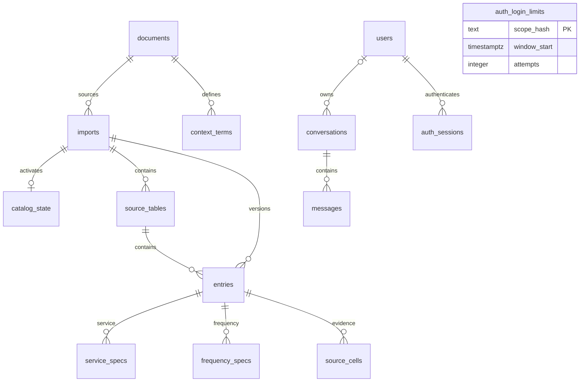

# Base de datos

[Wiki](index.md) · [English](../en/database.md) · [Español](../es/database.md)

Esquema relacional, autoridad numérica y filas concretas detrás de las herramientas.



Las relaciones siguen las [migraciones SQL](../../../backend/catalog/migrations); la [inspección de FK reales](../../../reports/submission/T3-database.json) las confirma. `conversations.owner_id` admite null: el historial anterior al login queda en cuarentena. `auth_login_limits` no tiene FK. El registro del runner de migraciones es aparte; el [SVG completo](../../er-series76.svg) es una instantánea histórica.

Una entrada es una aparición en una importación/tabla, no una pieza global deduplicada. `service_specs` separa On/Off, modulante y compartido; `frequency_specs` separa 50/60 Hz, no especificado y no aplicable. Las mediciones usan NUMERIC y la evidencia variable JSONB. El singleton `catalog_state` apunta a una importación activa. Los mensajes guardan instantáneas de producto/contexto/traza sin FK al catálogo para conservar respuestas anteriores.

## Ejemplos reales de solo lectura

Consultados localmente mediante `backend.catalog.cli.local_environment()` y `connect()`, con `connection.read_only=True`; `SHOW transaction_read_only` devolvió `on`. Solo se ejecutaron SELECT y SHOW. No se consultaron usuarios, hashes de contraseña, sesiones de autenticación ni tokens. [T3-database.json](../../../reports/submission/T3-database.json) conserva SQL y proyecciones completas. Los decimales se serializan como texto en este informe, sin cambiar tipos del catálogo.

### Entrada y especificaciones por servicio

```sql
SELECT e.base_part_number,e.supply_voltage_v,e.supply_current,e.phase_count,e.motor_power_w,s.service,s.torque_nm,s.torque_in_lb,s.duty_s4_percent,s.cycles_per_hour,s.starts_per_hour
FROM series76.entries e
JOIN series76.catalog_state c ON c.active_import_id=e.import_id
JOIN series76.service_specs s ON s.entry_id=e.id
WHERE e.base_part_number='761A00-11300000/A'
ORDER BY s.service;
```

```json
[
  {
    "base_part_number": "761A00-11300000/A",
    "supply_voltage_v": "110",
    "supply_current": "AC",
    "phase_count": 1,
    "motor_power_w": "15",
    "service": "modulating",
    "torque_nm": "65",
    "torque_in_lb": "580",
    "duty_s4_percent": "40",
    "cycles_per_hour": null,
    "starts_per_hour": 960
  },
  {
    "base_part_number": "761A00-11300000/A",
    "supply_voltage_v": "110",
    "supply_current": "AC",
    "phase_count": 1,
    "motor_power_w": "15",
    "service": "on_off",
    "torque_nm": "80",
    "torque_in_lb": "700",
    "duty_s4_percent": "40",
    "cycles_per_hour": 36,
    "starts_per_hour": null
  }
]
```

### N/A explícito

```sql
SELECT e.base_part_number,e.data_status,e.motor_power_w,e.field_status->>'motor_power_w' AS power_status
FROM series76.entries e
JOIN series76.catalog_state c ON c.active_import_id=e.import_id
WHERE e.data_status='source_NA'
ORDER BY e.base_part_number LIMIT 1;
```

```json
[
  {
    "base_part_number": "761A00-11330C00/A",
    "data_status": "source_NA",
    "motor_power_w": null,
    "power_status": "source_NA"
  }
]
```

### Evidencia de celda y procedencia

```sql
SELECT e.base_part_number,t.source_page,t.source_table,e.source_row,sc.field,sc.status,sc.unit,sc.evidence
FROM series76.entries e
JOIN series76.catalog_state c ON c.active_import_id=e.import_id
JOIN series76.source_tables t ON t.id=e.table_id
JOIN series76.source_cells sc ON sc.entry_id=e.id
WHERE e.base_part_number='761A00-11300000/A' AND sc.field='motor_power_w';
```

```json
[
  {
    "base_part_number": "761A00-11300000/A",
    "source_page": 1,
    "source_table": "p1_t1",
    "source_row": 1,
    "field": "motor_power_w",
    "status": "reported",
    "unit": "W",
    "evidence": {
      "raw_text": "15",
      "value": 15,
      "method": "image_consensus",
      "source_sha256": "4c28023929183df8e2a763e759cc84572b44604b30837a21e22c1166f88267e0",
      "source_span_rows": [
        1,
        2
      ],
      "bbox": [
        2051.25,
        826.5,
        2140.75,
        923.0
      ]
    }
  }
]
```

Extracto de la proyección; el JSON enlazado conserva evidencia completa y lecturas alternativas.

### Término literal del glosario

```sql
SELECT term_key,label,definition,page
FROM series76.context_terms
WHERE term_key='fla'
ORDER BY id LIMIT 1;
```

```json
[
  {
    "term_key": "fla",
    "label": "Full Load Current (FLA)",
    "definition": "The electric current (in Amps) drawn by the motor under its maximum rated load.",
    "page": 2
  }
]
```

### Mensaje del asistente y traza almacenados

```sql
SELECT role,content,tool_calls->0->>'name' AS tool,tool_calls->0->'parameters'->'part_numbers' AS part_numbers,tool_calls->0->'validation' AS validation,tool_calls->0->>'renderer' AS renderer
FROM series76.messages
WHERE role='assistant' AND tool_calls->0->>'name'='get_actuator' AND tool_calls->0->'parameters'->'part_numbers'='["761A00-11300000/A"]'::jsonb AND content LIKE '761A00-11300000/A%'
ORDER BY sequence LIMIT 1;
```

```json
[
  {
    "role": "assistant",
    "content": "761A00-11300000/A — weatherproof, 110 V AC 1-phase\n  • On/Off torque: 700 in-lb / 80 Nm\n  • Modulating torque: 580 in-lb / 65 Nm\n  • Duty S4 On/Off: 40%\n  • Duty S4 Modulating: 40%\n  • On/Off cycles per hour: 36\n  • Modulating starts per hour: 960\n  • Operating time at 50 Hz: 20 s\n  • Operating time at 60 Hz: 17 s\n  • FLA at 50 Hz: 1.1 A\n  • FLA at 60 Hz: 1.2 A\n  • LRA at 50 Hz: 1.3 A\n  • LRA at 60 Hz: 1.4 A\n  • Motor power: 15 W\n  Source: series_76_electric_data.pdf, page 1, table p1_t1.",
    "tool": "get_actuator",
    "part_numbers": [
      "761A00-11300000/A"
    ],
    "validation": [
      "ok"
    ],
    "renderer": "get_actuator"
  }
]
```

Es una respuesta determinista realmente persistida. Esta proyección de la traza no acredita qué proveedor tomó la decisión; no constituye aceptación OpenRouter.

## Dónde está en el código

- [backend/catalog/db.py](../../../backend/catalog/db.py#L32)
- [backend/catalog/repository.py](../../../backend/catalog/repository.py#L126)
- [backend/catalog/loader.py](../../../backend/catalog/loader.py#L133)
- [backend/conversation/store.py](../../../backend/conversation/store.py#L70)

## Límites conocidos

El cargador es específico del catálogo y limita el tamaño JSON; no hay borrado automático de versiones ni UI de rollback. Un valor compartido no son mediciones independientes. Una definición no certifica una referencia. La igualdad SQL histórica está en [evidencia PostgreSQL](../../evidence/postgres.md).
