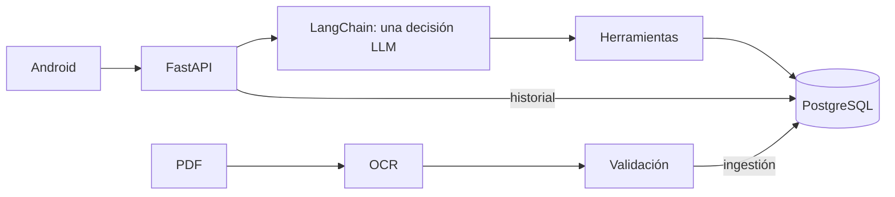

# Wiki de Serie 76

[Wiki](index.md) · [English](../en/index.md) · [Español](../es/index.md)

Si vas a ejecutar la app, empieza por el README. Estas páginas explican con más detalle cómo funciona cada parte. La wiki publicada ofrece una lectura más corta, organizada según el assessment.

Las flechas muestran consultas y solicitudes; el agente se ejecuta dentro del backend. Las cifras proceden solo del PDF eléctrico; las definiciones, del resumen suministrado. PostgreSQL conserva catálogo activo, autenticación e instantáneas de mensajes.

- [Ingestión](ingestion.md)
- [Base de datos](database.md)
- [Agente](agent.md)
- [API](api.md)
- [Android](android.md)
- [Patrones](patterns.md)
- [Pruebas](testing.md)
- [Operación](operations.md)

Empieza por el [README](../../../README.es.md) y sigue un turno: `POST /api/conversation` → herramienta elegida por el modelo → validación → SQL → plantilla → turno guardado. Prueba `What is the motor power of 761A00-11300000/A?`; esta consulta de código completo usa una ruta determinista sin modelo. La interpretación libre sin configuración devuelve 503 `not_configured`.

Evidencia: [OCR](../../evidence/ocr.md), [PostgreSQL](../../evidence/postgres.md), [agente](../../evidence/agent_acceptance.md), [Android](../../evidence/mobile.md), [comparación](../../evidence/architecture_comparison.md). El [enunciado](../../assessment-en.pdf) define requisitos; el [ADR 0001](../../adr/0001-arquitectura-agente.md) registra la decisión.

## Dónde está en el código

- [backend/app/main.py](../../../backend/app/main.py#L1)
- [backend/conversation/agent.py](../../../backend/conversation/agent.py#L508)

## Evidencia vigente y límites

El único modelo de chat es `google/gemini-3.6-flash`, sin fallback; embeddings: `google/gemini-embedding-2`. La mejora adoptada obtuvo **79,4 % frente a 61,1 %** en tres ejecuciones pareadas v17; pass^3 fue **71,7 % frente a 55 %**. Todavía falla cerca del **20 % de las conversaciones inéditas de varios turnos**. [Mediciones, excepción autorizada y correcciones offline](../../../reports/submission/P2-A.md).

La [auditoría de texto público](../../../reports/submission/P2-B.md), [CI Linux](../../../reports/submission/P2-C.md), [clon Windows](../../../reports/submission/T18-tag-clean-clone.md) y [8/8 pruebas de emulador](../../../reports/submission/P2-D.md) acreditan sus alcances concretos. Se confirmó manualmente el reconocimiento de voz real en el emulador el 2026-11-06, sin artefacto automatizado adicional; la validación física sigue pendiente. Las entradas controladas del emulador no acreditan el recorrido Android-modelo real ni legibilidad física. Gasto OpenRouter registrado: aproximadamente **USD 6,17 de 10**.

Las etiquetas P2-A o T18 identifican informes de evidencia, no funciones del producto. Los informes históricos conservan sus versiones originales y no son garantías universales vigentes.

[GitHub Wiki: requisitos del assessment](https://github.com/SamuelCharry/serie76-assistant/wiki)
