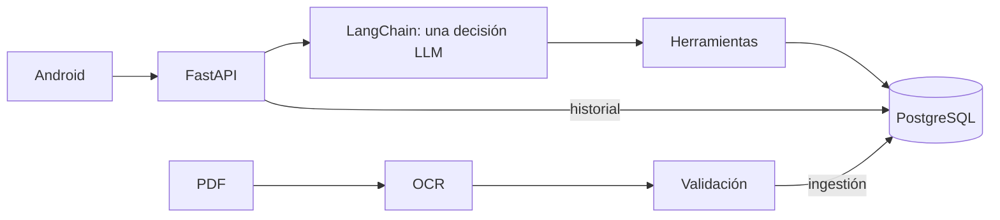

# Wiki de Serie 76

[Wiki](index.md) · [English](../en/index.md) · [Español](../es/index.md)

Mapa de lectura para quien abre el repositorio por primera vez.

Las flechas muestran consultas y solicitudes; el agente se ejecuta dentro del backend. Las cifras proceden solo del PDF eléctrico; las definiciones, del resumen suministrado. PostgreSQL conserva catálogo activo, autenticación e instantáneas de mensajes.

- [Ingestión](ingestion.md)
- [Base de datos](database.md)
- [Agente](agent.md)
- [API](api.md)
- [Android](android.md)
- [Patrones](patterns.md)
- [Pruebas](testing.md)
- [Operación](operations.md)
- [Defensa de entrevista](defensa-entrevista.md)

Empieza por el [README](../../../README.es.md) y sigue un turno: `POST /api/conversation` → herramienta elegida por el modelo → validación → SQL → plantilla → turno guardado. Prueba `What is the motor power of 761A00-11300000/A?`; T8 resuelve esta consulta de código completo sin modelo. La interpretación libre sin configuración devuelve 503 `not_configured`.

Evidencia: [OCR](../../evidence/ocr.md), [PostgreSQL](../../evidence/postgres.md), [agente](../../evidence/agent_acceptance.md), [Android](../../evidence/mobile.md), [comparación](../../evidence/architecture_comparison.md). El [enunciado](../../assessment-en.pdf) define requisitos; el [ADR 0001](../../adr/0001-arquitectura-agente.md) registra la decisión.

## Dónde está en el código

- [backend/app/main.py](../../../backend/app/main.py#L1)
- [backend/conversation/agent.py](../../../backend/conversation/agent.py#L508)

## Límites conocidos

La aceptación OpenRouter se completó el 2026-11-05; ver [Models](../../../README.md#models-design-and-limitations). v14 obtuvo 32/45 y v15 v1 obtuvo 42/60 antes de P1-F; sigue pendiente una cohorte nueva con proveedor tras P1-F. Android con LLM real sigue pendiente. T8 interacción y T9 embeddings/voz/debug oculto están implementados y probados localmente; falta voz real en dispositivo. Los checklists antiguos son históricos, no prueba vigente.
