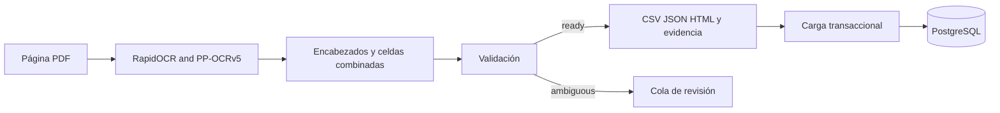

# Ingestión

[Wiki](index.md) · [English](../en/ingestion.md) · [Español](../es/ingestion.md)

Cómo el PDF eléctrico se convierte en catálogo validado sin un LLM.



El extractor de producción lee el PDF, nunca `data/manual`, `data/reference` ni `data/reviewed`. Reconstruye identidad, carcasa, alimentación, torque en ambas unidades publicadas, servicio, duty, ciclos/arranques, potencia, tiempo, FLA/LRA y frecuencia. Conserva notas, excepciones CSA y códigos completos con `/A`.

`source_NA` significa N/A explícito; `not_in_layout`, campo no publicado en ese diseño. Ninguno significa cero. Las celdas combinadas se expanden solo dentro de su geometría visible; los datos compartidos conservan ese alcance. DC no tiene frecuencia de red; AC/DC sin frecuencia publicada queda sin especificar. Potencia de motor no equivale a consumo eléctrico total.

## Reejecutar

La primera ejecución OCR descarga pesos públicos de RapidOCR en `.cache/ocr` del checkout; después el reconocimiento es local. Prepara esos pesos antes de una ejecución sin red. La exportación lista, incluido `manifest.json`, queda en una subcarpeta por documento de `data/processed/new-import`, no directamente en esa raíz.

Usa Python 3.12 de 64 bits. La primera ejecución descarga pesos públicos; después el reconocimiento es local. Usa una raíz de salida nueva para preservar evidencia. Un directorio procesa un lote; `--no-images --threads 2` reduce imágenes retenidas y controla hilos.

Ejecuta solo el bloque de tu shell; `deactivate` sale de un entorno activo antes de cambiar.

```sh
# macOS/Linux: ejecuta deactivate primero si el entorno backend está activo
python -m venv .venv-ingest
. .venv-ingest/bin/activate
pip install -r requirements-ingest.lock.txt
python scripts/ingest.py data/raw/series_76_electric_data.pdf --out data/processed/new-import
```

```powershell
# Windows PowerShell: ejecuta deactivate primero si el entorno backend está activo
python -m venv .venv-ingest
.\.venv-ingest\Scripts\Activate.ps1
pip install -r requirements-ingest.lock.txt
python scripts/ingest.py data/raw/series_76_electric_data.pdf --out data/processed/new-import
```

Cada documento recibe una carpeta por hash/firma. `manifest.json` registra `ready`, `needs_review` o `failed`; `cells.jsonl` guarda texto original, lecturas alternativas, cajas, unidades, página/tabla/fila y hash. `review_queue.jsonl` bloquea exportaciones validadas con dudas abiertas. CSV/JSON/HTML aparecen solo al completar. El lote sale con 2 si un documento falla o requiere revisión; los demás continúan. Solo reutiliza salidas completas tras comprobar hashes.

La salida conservada está en [data/extracted/series76](../../../data/extracted/series76). Carga esa carpeta validada con los comandos siguientes; para otra salida pasa su carpeta por documento a `load`. La carga revisa `ready`, hashes, origen OCR y coherencia de evidencia y activa la versión atómicamente. `--no-activate` prepara una versión; `activate <import_id>` selecciona una versión completa anterior.

```sh
docker compose exec -T backend python -m backend.catalog.cli load data/extracted/series76
docker compose exec -T backend python -m backend.catalog.cli load-context
docker compose exec -T backend python -m backend.catalog.cli status
```

## Validación y revisión histórica

[941/941 controles primarios](../../evidence/ocr.md): 68 códigos + 869 cifras + 4 N/A; las 5/5 marcas de nota son un control adicional. Contexto: 272/272. Pasaron tres variantes y controles de fallo/reanudación. La prueba de 100 páginas repite cuatro páginas 25 veces; no prueba precisión en diseños nuevos. La referencia manual solo evalúa y puede fallar.

La comparación histórica Tesseract/EasyOCR/RapidOCR y las exportaciones revisadas están en [archive/pre-cleanup](https://github.com/SamuelCharry/serie76-assistant/tree/archive/pre-cleanup/reports/ocr). Se corrigieron contra la página 4 tres errores de transcripción: potencia de `764X30-11300000/A`, 180→90 W; torque modulante de `764X30-11320000/A`, 620→640 Nm; ciclos de `764Y30-11320000/A`, 160→140/h. Son fixtures de evaluación, nunca reglas de producción. Ver [fixtures](../../../data/manual) y [prueba de revisión](../../../tests/test_reviewed_catalog.py).

## Dónde está en el código

- [scripts/ingest.py](../../../scripts/ingest.py#L1)
- [catalog_ingest/pipeline.py](../../../catalog_ingest/pipeline.py#L1)
- [backend/catalog/loader.py](../../../backend/catalog/loader.py#L133)
- [scripts/verify_ingestion.py](../../../scripts/verify_ingestion.py#L1)

## Límites conocidos

Los diseños admitidos son acotados; geometría ambigua o unidades desconocidas requieren revisión. Confianza OCR no es precisión. SQLite solo sirve de caché/spool, no de base de negocio; el disco crece con contenido único. No hay cola distribuida ni rendimiento garantizado para documentos heterogéneos.
